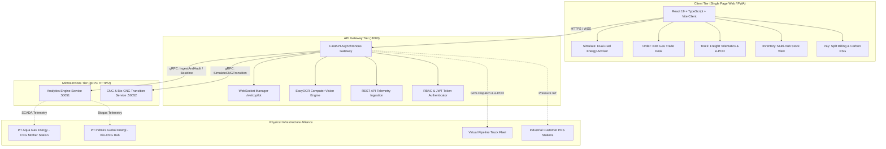

# CNGneers v2.0: Platform Digital Ekosistem & B2B Marketplace CNG + Bio-CNG untuk Akselerasi Transisi Energi Bersih Nasional

> **Definitive Master Product Requirement Document (PRD) & Strategic Technical Blueprint — Version 2.0 (Ultimate Deep Dive Specification)**  
> **Ajang Kompetisi:** ANGEL Innovation Hackathon 2026  
> **Aliansi Kemitraan Strategis (Sisi Suplai & Infrastruktur Gas):**  
> - **PT Aqua Gas Energy** (Anchor Partner: Produsen & Operator Infrastruktur CNG Fosil, Mother Station Gas Pipa, Virtual Pipeline, & PRS)  
> - **PT Indmira Global Energi** (Anchor Partner: Inovator Agro-Bioteknologi, Pengolah Limbah Biomassa Sirkular, & Produsen Bio-CNG / Biometana Terbarukan)  
> **Status Dokumen:** Version 2.0 — Enterprise-Grade Dual-Fuel Multi-Sided Marketplace Specification  
> **Tanggal Pembaruan:** Oktober 2026  

---

## DAFTAR ISI LENGKAP

1. [Executive Summary & Visi Strategis Dual-Fuel](#1-executive-summary--visi-strategis-dual-fuel)
2. [Macro Context & Kesenjangan Energi Nasional](#2-macro-context--kesenjangan-energi-nasional)
3. [Spesifikasi Teknis & Kualitas Gas (CNG Fosil vs Bio-CNG Terbarukan)](#3-spesifikasi-teknis--kualitas-gas-cng-fosil-vs-bio-cng-terbarukan)
   - [3.1 Parameter Fisiko-Kimia Gas (Standar ESDM, ISO 13686, & SNI)](#31-parameter-fisiko-kimia-gas-standar-esdm-iso-13686--sni)
   - [3.2 Alur Pemurnian Biogas Menjadi Bio-CNG (Teknologi Indmira Global Energi)](#32-alur-pemurnian-biogas-menjadi-bio-cng-teknologi-indmira-global-energi)
   - [3.3 Neraca Massa, Biokinetika & Model Sirkular Zero-Waste Indmira](#33-neraca-massa-biokinetika--model-sirkular-zero-waste-indmira)
4. [Arsitektur B2B Multi-Sided Marketplace & Energy Clearinghouse](#4-arsitektur-b2b-multi-sided-marketplace--energy-clearinghouse)
   - [4.1 Sisi Suplai: Aliansi Produsen Energi Bersih (Aqua Gas Energy + Indmira Global Energi)](#41-sisi-suplai-aliansi-produsen-energi-bersih-aqua-gas-energy--indmira-global-energi)
   - [4.2 Sisi Demand: Konsumen Industri B2B Terverifikasi (Segmentasi Pabrik)](#42-sisi-demand-konsumen-industri-b2b-terverifikasi-segmentasi-pabrik)
   - [4.3 Sisi Logistik: Jaringan Virtual Pipeline Uber-like Freight (Tube Trailer Fleet)](#43-sisi-logistik-jaringan-virtual-pipeline-uber-like-freight-tube-trailer-fleet)
   - [4.4 Sisi Enabler: Kontraktor EPC Retrofit & Fintek Pay-As-You-Save](#44-sisi-enabler-kontraktor-epc-retrofit--fintek-pay-as-you-save)
5. [Arsitektur Korporat Dua Lapisan (PlatformCo vs InfraCo/SPV Ring-Fencing)](#5-arsitektur-korporat-dua-lapisan-platformco-vs-infracospv-ring-fencing)
6. [Spesifikasi Rinci 5 Pilar Produk MVP (Unified Marketplace Portal)](#6-spesifikasi-rinci-5-pilar-produk-mvp-unified-marketplace-portal)
   - [6.1 PILAR 1: SIMULATE (Dual-Fuel Energy Advisor & Feasibility Engine)](#61-pilar-1-simulate-dual-fuel-energy-advisor--feasibility-engine)
   - [6.2 PILAR 2: ORDER (B2B Gas Trading Desk & Smart Matching Engine)](#62-pilar-2-order-b2b-gas-trading-desk--smart-matching-engine)
   - [6.3 PILAR 3: TRACK (Logistics Control Tower, Cycle-Time & e-POD)](#63-pilar-3-track-logistics-control-tower-cycle-time--e-pod)
   - [6.4 PILAR 4: INVENTORY (Multi-Hub Virtual Pipeline ERP View)](#64-pilar-4-inventory-multi-hub-virtual-pipeline-erp-view)
   - [6.5 PILAR 5: PAY (Automated Split Invoicing, Escrow Settlement & ESG Carbon Credits)](#65-pilar-5-pay-automated-split-invoicing-escrow-settlement--esg-carbon-credits)
7. [Standar Operasional Prosedur (SOP) & Protokol Keselamatan HSSE Gas Tekanan Tinggi](#7-standar-operasional-prosedur-sop--protokol-keselamatan-hsse-gas-tekanan-tinggi)
   - [7.1 Protokol Decanting Tekanan Tinggi (250 bar ke 2-4 bar)](#71-protokol-decanting-tekanan-tinggi-250-bar-ke-2-4-bar)
   - [7.2 Sistem Odorisasi Gas (THT / Ethyl Mercaptan Dosing)](#72-sistem-odorisasi-gas-tht--ethyl-mercaptan-dosing)
   - [7.3 Protokol Anti-Static Grounding & Bonding Interlock](#73-protokol-anti-static-grounding--bonding-interlock)
   - [7.4 Deteksi Kebocoran Gas & Emergency Shutdown (ESD) Logic](#74-deteksi-kebocoran-gas--emergency-shutdown-esd-logic)
8. [Panduan Rekayasa Retrofit Boiler Industri & Kompatibilitas Burner](#8-panduan-rekayasa-retrofit-boiler-industri--kompatibilitas-burner)
   - [8.1 Sizing Gas Train, Multibloc Valve & Double Block-and-Bleed](#81-sizing-gas-train-multibloc-valve--double-block-and-bleed)
   - [8.2 Kalibrasi Rasio Udara-Bahan Bakar (λ) & Emisi Cerobong](#82-kalibrasi-rasio-udara-bahan-bakar-λ--emisi-cerobong)
   - [8.3 Kompatibilitas Merk Burner Terkemuka (Weishaupt, Riello, Oilon, Saacke)](#83-kompatibilitas-merk-burner-terkemuka-weishaupt-riello-oilon-saacke)
9. [Multi-Channel Data Ingestion Suite (Zero-CAPEX to Industry 4.0)](#9-multi-channel-data-ingestion-suite-zero-capex-to-industry-40)
   - [9.1 Smart Logbook OCR Scanner (AI Vision Pipeline)](#91-smart-logbook-ocr-scanner-ai-vision-pipeline)
   - [9.2 Live SCADA / IoT Telemetry Stream (Edge Modbus/MQTT & WebSockets)](#92-live-scada--iot-telemetry-stream-edge-modbusmqtt--websockets)
   - [9.3 Batch CSV / Excel Historical Data Cleaner](#93-batch-csv--excel-historical-data-cleaner)
   - [9.4 Plant DCS / MES Webhook & REST API Open Specification](#94-plant-dcs--mes-webhook--rest-api-open-specification)
   - [9.5 Mitigasi "Biaya Sensor Mahal": Strategi Retrofit Brownfield Non-Invasif](#95-mitigasi-biaya-sensor-mahal-strategi-retrofit-brownfield-non-invasif)
10. [Landasan Matematis, Termodinamika & Standar Rekayasa](#10-landasan-matematis-termodinamika--standar-rekayasa)
    - [10.1 Normalisasi Energi Lower Heating Value (LHV)](#101-normalisasi-energi-lower-heating-value-lhv)
    - [10.2 Intensitas Konsumsi Energi (IKE / SEC)](#102-intensitas-konsumsi-energi-ike--sec)
    - [10.3 Regresi Multivariat US DOE & ASHRAE Guideline 14](#103-regresi-multivariat-us-doe--ashrae-guideline-14)
    - [10.4 Deteksi Anomali Operasional (+1.5σ Residual)](#104-deteksi-anomali-operasional-15σ-residual)
    - [10.5 Efisiensi Pembakaran Formulasi Siegert & ASME PTC 4](#105-efisiensi-pembakaran-formulasi-siegert--asme-ptc-4)
    - [10.6 Tekno-Ekonomi Transisi & Payback Period Retrofit](#106-tekno-ekonomi-transisi--payback-period-retrofit)
    - [10.7 Dekarbonisasi Ganda (IPCC 2006 Fosil vs Net-Zero Biogenik)](#107-dekarbonisasi-ganda-ipcc-2006-fosil-vs-net-zero-biogenik)
    - [10.8 Operator Triage: Taksonomi Anomali & Rekomendasi Lapangan](#108-operator-triage-taksonomi-anomali--rekomendasi-lapangan)
11. [Model Finansial, Monetisasi Marketplace & Proyeksi 5 Tahun](#11-model-finansial-monetisasi-marketplace--proyeksi-5-tahun)
    - [11.1 Breakdown Struktur Biaya Unit Economics per Sm³](#111-breakdown-struktur-biaya-unit-economics-per-sm)
    - [11.2 Sensitivitas Transaction Take-Rate (0.5% s/d 2.0%)](#112-sensitivitas-transaction-take-rate-05-sd-20)
    - [11.3 Proyeksi Keuangan 5 Tahun PlatformCo (P&L & EBITDA Margin)](#113-proyeksi-keuangan-5-tahun-platformco-pl--ebitda-margin)
    - [11.4 Green Premium Bio-CNG & Mekanisme Perdagangan Sertifikat Karbon](#114-green-premium-bio-cng--mekanisme-perdagangan-sertifikat-karbon)
    - [11.5 Analisis Kelayakan Investasi Pabrik (NPV, IRR & Payback)](#115-analisis-kelayakan-investasi-pabrik-npv-irr--payback)
12. [Arsitektur Teknis Sistem & Kontrak Antarmuka (API / gRPC)](#12-arsitektur-teknis-sistem--kontrak-antarmuka-api--grpc)
    - [12.1 System Architecture Topology (Mermaid)](#121-system-architecture-topology-mermaid)
    - [12.2 Kontrak Protocol Buffer v3 (energy_copilot.proto)](#122-kontrak-protocol-buffer-v3-energy_copilotproto)
    - [12.3 Katalog Endpoint REST API (OpenAPI 3.1)](#123-katalog-endpoint-rest-api-openapi-31)
    - [12.4 Protokol Komunikasi WebSocket Real-Time](#124-protokol-komunikasi-websocket-real-time)
    - [12.5 Skema Database Relasional PostgreSQL & TimescaleDB](#125-skema-database-relasional-postgresql--timescaledb)
    - [12.6 Standar Keamanan Data, RBAC & 100% Traceability](#126-standar-keamanan-data-rbac--100-traceability)
13. [Kerangka Regulasi, Kebijakan Energi & Standar Kepatuhan Hukum](#13-kerangka-regulasi-kebijakan-energi--standar-kepatuhan-hukum)
    - [13.1 Regulasi Sektor Migas (UU 22/2001, Kepmen ESDM 134.K/2021)](#131-regulasi-sektor-migas-uu-222001-kepmen-esdm-134k2021)
    - [13.2 Regulasi Nilai Ekonomi Karbon (NEK - Perpres 98/2021 & Permen LHK 21/2022)](#132-regulasi-nilai-ekonomi-karbon-nek---perpres-982021--permen-lhk-212022)
    - [13.3 Standar Bejana Tekan Transportasi (ASME Sec VIII & ISO 11119 Type 1-4)](#133-standar-bejana-tekan-transportasi-asme-sec-viii--iso-11119-type-1-4)
14. [Go-To-Market (GTM) Funnel & Roadmap 4 Fase Eksekusi](#14-go-to-market-gtm-funnel--roadmap-4-fase-eksekusi)
15. [Manajemen Risiko Komprehensif & Mitigasi Struktural](#15-manajemen-risiko-komprehensif--mitigasi-struktural)
16. [Analisis Kompetitif Head-to-Head & Panduan Panggung Hackathon](#16-analisis-kompetitif-head-to-head--panduan-panggung-hackathon)
    - [16.1 Matriks Komparasi Mendalam: CNGneers vs Solusi Lain](#161-matriks-komparasi-mendalam-cngneers-vs-solusi-lain)
    - [16.2 Narasi Pitch Deck 10 Menit untuk Panggung Hackathon](#162-narasi-pitch-deck-10-menit-untuk-panggung-hackathon)
    - [16.3 Panduan Jawaban Tangkas (Investor & Corporate Jury Q&A Defense)](#163-panduan-jawaban-tangkas-investor--corporate-jury-qa-defense)

---

## 1. Executive Summary & Visi Strategis Dual-Fuel

**CNGneers v2.0** adalah platform digital orkestrasi dan bursa pasar (*B2B Clean Energy Marketplace*) terpadu pertama di Indonesia yang menghubungkan rantai pasok **Compressed Natural Gas (CNG)** berbasis gas alam pipa dan **Bio-CNG (Biometana Terkompresi / Renewable Natural Gas)** berbasis limbah biomassa sirkular ke dalam satu arsitektur *asset-light digital control tower*.

Platform ini mengkristalisasikan kolaborasi strategis antara dua pilar energi nasional:
1. **PT Aqua Gas Energy:** Anchor partner penyedia infrastruktur gas alam, stasiun kompresi (*Mother Station*), armada transportasi tabung gas bergerak (*Virtual Pipeline Tube Trailer*), dan stasiun penurun tekanan (*Pressure Regulating Station / PRS*).
2. **PT Indmira Global Energi:** Anchor partner inovasi bioteknologi dan pengolahan limbah agro-industri yang memproduksi **Bio-CNG terbarukan** dari biomassa pertanian, perkebunan, dan peternakan secara sirkular.

```
+----------------------------------------------------------------------------------------------------+
|                       CNGneers: THE DUAL-FUEL B2B CLEAN GAS MARKETPLACE                            |
+----------------------------------------------------------------------------------------------------+
|                                                                                                    |
|  [ SISI SUPLAI (ALIANSI PRODUSEN GAS BERSIH) ]  [ SISI DEMAND (KONSUMEN INDUSTRI B2B) ]            |
|  - PT Aqua Gas Energy (CNG Gas Pipa Fosil)      - Industri Tekstil & Garmen                        |
|  - PT Indmira Global Energi (Bio-CNG Terbarukan)- Industri Makanan & Minuman (F&B)                 |
|  - PGN & Produsen Gas Mitra Regional            - Industri Keramik, Kaca & Kimia                   |
|                                                 - Industri Pakan Ternak & Pengolahan Kayu          |
|                                                 - Sektor Komersial Horeka (Hotel, Resto, Laundry)  |
|                 \                                       /                                          |
|                  \                                     /                                           |
|                   +-----------------> [ SMART ] <-----+                                            |
|                                       [ MATCHING]                                                  |
|                                       [ ENGINE ]                                                   |
|                   +-----------------> [ (RADIUS] <----+                                            |
|                  /                    [ 100 KM) ]      \                                           |
|                 /                                       \                                          |
|  [ SISI LOGISTIK (VIRTUAL PIPELINE) ]            [ SISI VALUE-ADDED ENABLERS (EPC & BANK) ]        |
|  - Konsorsium Truk Tube Trailer Mitra            - Kontraktor Retrofit Burner (Weishaupt, Riello)  |
|  - Uber-like Freight Dispatch & e-POD            - Bank & Fintek Pembiayaan CAPEX Pay-As-You-Save  |
|                                                                                                    |
+----------------------------------------------------------------------------------------------------+
                                                  |
                                                  v
                      [ REVENUE: 0.5% - 2.0% Take-Rate on Every Traded Sm³ ]
```

---

## 2. Macro Context & Kesenjangan Energi Nasional

1. **Krisis Ketergantungan Impor LPG (81% Impor):**
   - Total konsumsi LPG nasional mencapai **8,6 Juta Ton / Tahun**.
   - Produksi domestik kilang minyak dan gas bumi Indonesia hanya mampu memasok **1,6 – 1,7 Juta Ton / Tahun (~19%)**.
   - Defisit sebesar **7,0 Juta Ton / Tahun (~81%)** wajib diimpor setiap tahun, menguras cadangan devisa negara ratusan triliun rupiah dan membebani APBN melalui subsidi energi.
2. **Kekayaan Gas Alam Domestik & Hambatan Pipa Transmisi:**
   - Indonesia memiliki cadangan gas alam terbukti melimpah (lebih dari 41 TCF).
   - Namun, pembangunan jaringan pipa gas transmisi membutuhkan investasi modal raksasa ($1 - 2 Juta USD per kilometer) dan waktu konstruksi 3 - 5 tahun. Akibatnya, ratusan kawasan industri strategis di Pulau Jawa, Sumatera, dan pulau lainnya berada di wilayah *non-piped area*.
   - **Solusi Virtual Pipeline (CNG):** Mengompresi gas ke tekanan 200 - 250 bar ke dalam tabung baja (*tube trailer*) dan mendistribusikannya via jalan raya adalah satu-satunya metode tercepat dan paling fleksibel.
3. **Limbah Biomassa Agro-Industri sebagai Ladang Emas Bio-CNG:**
   - Indonesia menghasilkan puluhan juta ton limbah organik basah per tahun (limbah cair pabrik sawit / POME, limbah tapioka, limbah peternakan sapi, dan limbah biomassa pertanian Indmira).
   - Penguraian limbah secara terbuka melepaskan jutaan meter kubik gas metana ($CH_4$) ke atmosfer. Metana memiliki *Global Warming Potential* (GWP) **28 kali lebih tinggi** dibanding karbon dioksida.
   - Mengolah biogas ini menjadi Bio-CNG menciptakan nilai tambah ekonomi berlipat ganda: mengatasi pencemaran limbah lokal sekaligus menghasilkan energi pengganti LPG fosil.

---

## 3. Spesifikasi Teknis & Kualitas Gas (CNG Fosil vs Bio-CNG Terbarukan)

### 3.1 Parameter Fisiko-Kimia Gas (Standar ESDM, ISO 13686, & SNI)
Agar Bio-CNG dari PT Indmira Global Energi dapat disalurkan secara *seamless* bersama CNG fosil PT Aqua Gas Energy tanpa merusak burner boiler pabrik, Bio-CNG wajib memenuhi spesifikasi gas pipa terkompresi yang setara secara termodinamika:

| Parameter Fisik / Kimia | Satuan | Standar CNG Pipa (Aqua Gas Energy) | Standar Bio-CNG Upgraded (Indmira Global Energi) | Metode Pengujian | Standar Toleransi Mesin Burner |
| :--- | :---: | :---: | :---: | :---: | :---: |
| **Kadar Metana ($CH_4$)** | % vol | $88.0 - 95.0\%$ | $\mathbf{\ge 95.0\%}$ | Gas Chromatography | Min 85.0% untuk stabilitas api |
| **Karbon Dioksida ($CO_2$)** | % vol | $\le 3.0\%$ | $\mathbf{\le 2.5\%}$ | NDIR Analyzer | Maks 4.0% pencegah pendinginan api |
| **Nitrogen ($N_2$) & Inerts** | % vol | $\le 3.0\%$ | $\le 2.0\%$ | ASTM D1945 | Maks 5.0% gas tak mudah terbakar |
| **Oksigen Bebas ($O_2$)** | % vol | $\le 0.1\%$ | $\le 0.2\%$ | Paramagnetic Sensor | Maks 0.5% proteksi ledakan kompresor |
| **Hidrogen Sulfida ($H_2S$)** | ppm / $\text{mg/Nm}^3$ | $\le 5.0\text{ ppm}$ | $\mathbf{\le 5.0\text{ ppm}}$ | Tutwiler / Lead Acetate | Wajib $< 5\text{ ppm}$ anti korosi asam |
| **Total Sulfur** | $\text{mg/Nm}^3$ | $\le 20.0$ | $\le 15.0$ | UV Fluorescence | Mencegah emisi $SO_x$ cerobong |
| **Nilai Kalor Bawah (LHV)** | $\text{MJ/Sm}^3$ | $36.0 - 38.0$ | $\mathbf{36.0 - 37.5}$ | ISO 6976 | Fluktuasi maksimum $\pm 5\%$ |
| **Indeks Wobbe (Wobbe Index)**| $\text{MJ/Sm}^3$ | $48.0 - 52.0$ | $\mathbf{48.5 - 51.5}$ | Kalkulasi Standar | **Wajib dalam rentang interchangeability** |
| **Kandungan Air (Moisture)** | $\text{mg/Nm}^3$ | $\le 32.0$ (Dew Point $\le -15^\circ\text{C}$) | $\le 32.0$ (Dew Point $\le -20^\circ\text{C}$) | Chilled Mirror / Hygrometer | Mencegah pembentukan hidrat es |
| **Tekanan Pengisian Trailer** | bar (g) | $200 - 250\text{ bar}$ | $200 - 250\text{ bar}$ | Manometer Kelas 0.5 | ASME Sec VIII Div 1 |
| **Kadar Partikulat Padat** | $\mu\text{m}$ | Bebas minyak & debu | Filter $0.1\ \mu\text{m}$ coalescing | Gravimetric Millipore | Mencegah penyumbatan nozzle pilot |

> **Kesimpulan Engineering Mutlak:** Karena nilai Indeks Wobbe ($W = \frac{LHV}{\sqrt{SG}}$) dan Nilai Kalor Bio-CNG berada persis di dalam rentang CNG gas alam ($\pm 2\%$), keduanya adalah **100% Interchangeable Drop-In Replacement**. Burner boiler (Weishaupt, Riello, Saacke) tidak memerlukan penyesuaian nozzle ulang, pergantian rasio udara-gas, atau kalibrasi servo motor saat pabrik beralih dari CNG ke Bio-CNG.

### 3.2 Alur Pemurnian Biogas Menjadi Bio-CNG (Teknologi Indmira Global Energi)

```
+----------------------------------------------------------------------------------------------------+
|               PT INDMIRA GLOBAL ENERGI: CIRCULAR BIOGAS TO BIO-CNG UPGRADING TRAIN                 |
+----------------------------------------------------------------------------------------------------+
|                                                                                                    |
|  [ 1. RAW FEEDSTOCK ]        [ 2. ANAEROBIC DIGESTION ]      [ 3. DESULFURIZATION ]                |
|  Limbah Agro & Peternakan -> Continuous Stirred-Tank     -> Biological Trickling Filter &          |
|  (POME, Manure, Biomassa)    Reactor (CSTR, 37°C Mesophilic) Iron Sponge Dry Bed (H2S < 5 ppm)     |
|                                       |                                    |                       |
|                                       v                                    v                       |
|  [ 6. 250-BAR COMPRESSION ]  [ 5. GAS DRYING & CHILLING ]    [ 4. CO2 SEPARATION UPGRADING ]       |
|  4-Stage Water-Cooled     <- Desiccant Silica Gel &       <- Polyimide Hollow Fiber Membrane /     |
|  Reciprocating Compressor    Refrigerated Chiller (-20°C)    Pressure Swing Adsorption (PSA)       |
|                                                                                                    |
+----------------------------------------------------------------------------------------------------+
                                                |
                                                v
             [ Bio-CNG Pipeline Quality: CH4 >= 95%, Ready for Tube Trailer Loading ]
```

### 3.3 Neraca Massa, Biokinetika & Model Sirkular Zero-Waste Indmira
1. **Biokinetika Fermentasi Anaerobik:**
   Reaksi penguraian bahan organik kompleks mengikuti formulasi stoikiometri Buswell-Neave:
   $$C_n H_a O_b N_c + \left( n - \frac{a}{4} - \frac{b}{2} + \frac{3c}{4} \right) H_2 O \longrightarrow \left( \frac{n}{2} + \frac{a}{8} - \frac{b}{4} - \frac{3c}{8} \right) CH_4 + \left( \frac{n}{2} - \frac{a}{8} + \frac{b}{4} + \frac{3c}{8} \right) CO_2 + c NH_3$$
   Di bawah pengawasan bioteknisi Indmira, rasio $C:N$ dijaga pada kisaran optimal **25:1 hingga 30:1** dengan *Hydraulic Retention Time* (HRT) 25 - 32 hari untuk memaksimalkan yield metana tanpa asidifikasi asam lemak volatil (VFA).
2. **Valorization Hasil Samping Digestate (100% Zero-Waste):**
   - **Solid Digestate:** Dipisahkan melalui *screw press dewatering*, dikeringkan, dan diformulasikan menjadi pupuk organik padat kaya mikro-nutrien untuk pertanian hortikultura.
   - **Liquid Bio-Slurry:** Diolah dengan kultur mikroba hayati Indmira menjadi pupuk hayati cair (*bio-fertilizer*), mengeliminasi kebutuhan kolam limbah terbuka dan mencegah bau lalat di lingkungan pabrik.

---

## 4. Arsitektur B2B Multi-Sided Marketplace & Energy Clearinghouse

CNGneers beroperasi sebagai **Pusat Kliring & Bursa Energi Digital (*Energy Clearinghouse*)** yang mengorkestrasi 4 sisi ekosistem energi secara harmonis:

### 4.1 Sisi Suplai: Aliansi Produsen Energi Bersih (Aqua Gas Energy + Indmira Global Energi)
- **PT Aqua Gas Energy (CNG Gas Pipa):** Memasok kebutuhan *base-load* volume besar (2.0 – 4.0 MMSCFD) dengan jaminan kontinuitas pasokan pipa transmisi hulu PGN.
- **PT Indmira Global Energi (Bio-CNG Terbarukan):** Memasok biometana terbarukan berlabel *Green Gas* dengan jaminan emisi Net-Zero biogenik dari kluster pengolahan biomassa sirkular.
- Sistem mengelola inventori multihub terdesentralisasi, alokasi kapasitas pengisian harian, dan penerbitan sertifikat asal gas (*Guarantees of Origin*).

### 4.2 Sisi Demand: Konsumen Industri B2B Terverifikasi (Segmentasi Pabrik)
Pasar sasaran difokuskan pada kluster industri di wilayah yang belum tersambung pipa gas bumi:
1. **Industri Tekstil, Dyeing, & Finishing:** Pengguna uap steam jenuh (steam boiler 5 - 20 ton/jam). Sensitif terhadap fluktuasi harga energi termal.
2. **Industri Makanan & Minuman (F&B):** Pengeringan spray dryer dan pasteurisasi. Mewajibkan pembakaran bersih bebas jelaga dan bebas residu sulfur untuk standar HACCP/BPOM.
3. **Industri Keramik, Sanitair, & Genteng Metal:** Pengguna kiln pembakaran kontinu bersuhu tinggi ($>1.100^\circ\text{C}$).
4. **Industri Pakan Ternak & Pengolahan Kayu:** Pengeringan serbuk kayu dan pelet pakan.
5. **Kawasan Komersial Horeka:** Kluster hotel bintang lima, rumah sakit besar, dan laundry komersial.

Model transaksi mendukung:
- **Kontrak Jangka Panjang (*Term Off-Take Contract*):** Komitmen volume stabil 12-24 bulan dengan formula harga indeks gas.
- **Pasar Spot (*Spot Capacity Trading*):** Pelelangan kelebihan kapasitas gas harian (*surplus gas*) dengan harga diskon pada jam-jam *off-peak*.

### 4.3 Sisi Logistik: Jaringan Virtual Pipeline Uber-like Freight (Tube Trailer Fleet)
- Konsorsium armada truk *tube trailer* bertekanan tinggi (200-250 bar).
- Platform bertindak layaknya *Uber Freight untuk Gas Industri*, melakukan pencocokan pesanan (*smart dispatch*) berbasis rute dan jarak tempuh terpendek ($\le 100\text{ km}$).

### 4.4 Sisi Enabler: Kontraktor EPC Retrofit & Fintek Pay-As-You-Save
- Direktori kontraktor mekanikal resmi bersertifikasi untuk retrofit burner boiler.
- Integrasi perbankan/fintek untuk skema pembiayaan *Pay-As-You-Save* tanpa uang muka.

---

## 5. Arsitektur Korporat Dua Lapisan (PlatformCo vs InfraCo/SPV Ring-Fencing)

```
+---------------------------------------------------------------------------------------------------+
|                         STRATEGIC CORPORATE SEPARATION (RING-FENCING)                             |
+-----------------------------------------------------------------+---------------------------------+
|                    PlatformCo (CNGneers)                        |          InfraCo / SPV          |
|                 Asset-Light Software SaaS                       |  (Aqua Gas Energy & Indmira SPV)|
+-----------------------------------------------------------------+---------------------------------+
| 1. Aktivitas Inti:                                              | 1. Aktivitas Inti:              |
|    Orkestrasi digital, bursa marketplace, data analitik         |    Kompresi gas alam, pemurnian |
|    audit termal, dispatch rute armada, kliring transaksi,       |    biogas limbah agro, armada   |
|    dan sertifikasi kredit karbon ESG.                           |    truk & molekul gas fisik.    |
|                                                                 |                                 |
| 2. Model Pendapatan:                                            | 2. Model Pendapatan:            |
|    Transaction take-rate (0.5% - 2.0% GMV), biaya langganan     |    Physical gas spread          |
|    SaaS Enterprise, dan komisi sertifikat karbon.               |    (harga jual franko pabrik    |
|                                                                 |    dikurangi COGS gas pipa).    |
| 3. Profil Modal:                                                | 3. Profil Modal:                |
|    ASSET-LIGHT, margin kotor tinggi (>75%), tidak memikul beban|    CAPITAL INTENSIVE (CAPEX),   |
|    belanja modal kompresor atau depresiasi truk.                |    depresiasi aset tetap fisik. |
|                                                                 |                                 |
| 4. Profil Risiko:                                               | 4. Profil Risiko:               |
|    Adopsi perangkat lunak, keamanan siber, tata kelola data.    |    Utilisasi kapasitas off-take,|
|                                                                 |    perizinan migas & K3 (HSSE). |
| 5. Peran Sinergis:                                              | 5. Peran Sinergis:              |
|    Menjamin kepastian data serapan pasar (bankable off-take)    |    Menyediakan molekul gas      |
|    sebelum InfraCo menggelontorkan investasi CAPEX.             |    fisik dan infrastruktur PRS. |
+-----------------------------------------------------------------+---------------------------------+
```

---

## 6. Spesifikasi Rinci 5 Pilar Produk MVP (Unified Marketplace Portal)

Antarmuka CNGneers diwujudkan dalam bentuk **Single Web / PWA Portal** modern terintegrasi yang mencakup 5 modul operasional hulu-ke-hilir:

```
+--------------------------------------------------------------------------------------------------------+
|                                  CNGneers UNIFIED MARKETPLACE PORTAL                                   |
+-------------------+--------------------+-------------------+--------------------+----------------------+
|    1. SIMULATE    |     2. ORDER       |     3. TRACK      |    4. INVENTORY    |       5. PAY         |
|  Dual-Fuel Advisor| B2B Gas Trade Desk |  Freight & e-POD  | Multi-Hub Pipeline | Escrow Settlement/ESG|
+-------------------+--------------------+-------------------+--------------------+----------------------+
```

### 6.1 PILAR 1: SIMULATE (Dual-Fuel Energy Advisor & Feasibility Engine)
* **Tujuan Pengguna:** Membuktikan kelayakan finansial dan lingkungan dari konversi boiler sebelum pabrik mengeluarkan modal sepeserpun.
* **Layout Wireframe Desktop (1440px):**
```
+--------------------------------------------------------------------------------------------------------+
| [HEADER: CNGneers Copilot]  Active Factory: PT Sinar Tekstil Solo  | Baseline: LPG 12 Ton/Bln          |
+--------------------------------------------------------------------------------------------------------+
| [LEFT PANEL: Dual-Fuel Configurator]           | [RIGHT PANEL: Feasibility & Thermodynamic Dashboard]  |
| 1. Current Fuel: [ LPG Industri (Rp16.000/kg) ]| A. Cost per Useful Heat Comparison (Rp/GJ)            |
| 2. Current Thermal Efficiency: [ 78.5% ]       |    - Existing LPG : [ Rp 442.200 / GJ ]                |
| 3. Target Fuel Selection:                      |    - CNG Pipa    : [ Rp 306.800 / GJ ] (-30.6%)        |
|    (o) 100% CNG Aqua Gas Energy                |    - Bio-CNG     : [ Rp 306.800 / GJ ] (Net-Zero ESG)  |
|    ( ) 100% Bio-CNG Indmira Global Energi      |                                                        |
|    ( ) EcoBlend 80:20 (Hybrid Transition)      | B. US DOE Multivariable Baseline (P + H Model)        |
| 4. Target Gas Price: [ Rp 10.000 / Sm3 ]       |    Scatter Plot: E_actual vs E_predicted (R2 = 0.91)   |
| 5. Retrofit CAPEX: [ Rp 250.000.000 ]          |    Red Flags: 4 Anomaly Shifts Detected (+1.5 Sigma)   |
|    [ BUTTON: RUN THERMODYNAMIC SIMULATION ]    |                                                        |
|                                                | C. Financial Metrics Gauge:                            |
|                                                |    - Annual Net Savings : Rp 482.000.000 / Tahun       |
|                                                |    - Payback Period     : 6.2 Bulan                    |
|                                                |    - Net CO2 Reduction  : 418.5 Ton CO2e / Tahun       |
|                                                | [ BUTTON: EXPORT BANKABLE TEASING PDF ]               |
+--------------------------------------------------------------------------------------------------------+
```
* **State Machine & Lifecycle:**
  `IDLE` $\rightarrow$ `FETCHING_BASELINE` $\rightarrow$ `SIMULATING_THERMAL` $\rightarrow$ `CALCULATING_PAYBACK` $\rightarrow$ `DISPLAY_READY` $\rightarrow$ `DRAFT_SAVED`.

### 6.2 PILAR 2: ORDER (B2B Gas Trading Desk & Smart Matching Engine)
* **Tujuan Pengguna:** Memesan pasokan gas industri dan mengunci kontrak pengiriman dengan produsen terdekat secara instan.
* **Smart Matching Algorithm (Radius 100 km):**
  Untuk setiap pabrik pemesan dengan koordinat GPS $(lat_c, lon_c)$, sistem menghitung jarak geodesic Harvesine ke seluruh stasiun pengisian aktif:
  $$d = 2R \arcsin \left( \sqrt{ \sin^2\left(\frac{\Delta lat}{2}\right) + \cos(lat_c)\cos(lat_h)\sin^2\left(\frac{\Delta lon}{2}\right) } \right)$$
  Hub terpilih adalah hub yang memenuhi kriteria:
  $$\text{Hub Optimal} = \arg\min_{h \in H} \left( \text{Tarif Gas}_h + \text{Ongkos Angkut}_h(d) \right) \quad \text{s.t. } d \le 100\text{ km, } \text{Kapasitas}_h \ge \text{Permintaan}$$
* **Wireframe Trading Desk:**
```
+--------------------------------------------------------------------------------------------------------+
| PILAR 2: B2B GAS TRADING DESK                                              Live Fuel Price Ticker      |
+--------------------------------------------------------------------------------------------------------+
| [ STEP 1: Fuel Order Specification ]                                                                   |
| Product Type: [ Bio-CNG Pure (Indmira Global Energi) ]  Delivery Mode: [ Term Contract (12 Bulan) ]  |
| Daily Volume: [ 2.500 Sm3/hari ]   Required PRS Pressure: [ 3.5 bar (g) ]                              |
|                                                                                                        |
| [ STEP 2: Smart Matching Result (Optimal Hub within 100km) ]                                           |
| +------------------------------------+---------------------------------------------------------------+ |
| | Matched Hub: Indmira Bio-Hub Sleman| Hauling Distance: 42.4 km (ETA: 65 Menit)                     | |
| | Base Price: Rp 10.000 / Sm3        | Guaranteed Biomass Methane Content: 96.2% vol                 | |
| | Hauling Freight: Rp 1.200 / Sm3    | Franko Factory Price: Rp 11.200 / Sm3                         | |
| +------------------------------------+---------------------------------------------------------------+ |
|                                                                                                        |
| [ STEP 3: Digital Technical Form & E-Signature ]                                                       |
| Boiler Model: [ Miura LX-3000 ] | Steam Capacity: [ 3 Ton/Jam ] | Current Burner: [ Riello RS-34 ]     |
| [ ] Saya menyetujui Draf LOI & Spesifikasi Teknis Gas SNI.                                            |
| [ BUTTON: SIGN DIGITAL LOI & COMMIT OFF-TAKE ]                                                         |
+--------------------------------------------------------------------------------------------------------+
```

### 6.3 PILAR 3: TRACK (Logistics Control Tower, Cycle-Time & e-POD)
* **Tujuan Pengguna:** Memantau pergerakan armada truk *tube trailer* pengangkut gas secara *real-time* dan memverifikasi serah terima volume gas tanpa sengketa.
* **Siklus Waktu Logistik (Cycle-Time Simulation):**
  $$T_{\text{cycle}} = t_{\text{filling}} + t_{\text{hauling, outbound}} + t_{\text{decanting}} + t_{\text{hauling, inbound}} + t_{\text{inspection}}$$
  Di mana:
  - $t_{\text{filling}} = 90\text{ menit}$ (pengisian tabung kompresi 250 bar di Mother Station).
  - $t_{\text{hauling}} = \frac{d}{v_{\text{truk}}} \times \text{Faktor Trafik}$.
  - $t_{\text{decanting}} = 45 - 60\text{ menit}$ (penurunan tekanan tabung ke pipa PRS pabrik).
* **Alur Validasi Kriptografi e-POD (Electronic Proof of Delivery):**
```
   [SOPIR TRUK TIBA]                [SUPERVISOR PABRIK]              [BACKEND CNGNEERS]
           |                                 |                                |
  Input Tekanan Awal (Bar)                   |                                |
  Input Suhu Gas (°C)                        |                                |
           |---- Submit ke Mobile PWA ------>|                                |
           |                                 |                                |
           |                        Verifikasi Manometer Fisik                |
           |                        Catat Tekanan Sisa (Bar)                  |
           |                        Tanda Tangan di Layar HP                  |
           |                                 |                                |
           |<--- Konfirmasi Serah Terima ----|                                |
           |                                 |                                |
           |----------- Kirim Berkas Digital e-POD ke Cloud ----------------->|
                                                                              |
                                                                 Hitung Volume Netto (Sm3)
                                                                 Generate SHA-256 Hash
                                                                 Trigger Faktur Otomatis di PAY
```

### 6.4 PILAR 4: INVENTORY (Multi-Hub Virtual Pipeline ERP View)
* **Tujuan Pengguna:** Visibilitas real-time stok gas di seluruh stasiun kompresi dan tangki PRS pelanggan untuk mencegah *stock-out* pabrik.
* **Auto-Replenishment Logic:**
  Jika tekanan sisa di PRS pabrik pelanggan menyentuh batas aman kritis ($P_{\text{PRS}} \le 35\text{ bar}$ atau sisa waktu operasional $t_{\text{remaining}} \le 6\text{ jam}$), sistem secara otomatis memicu pembuatan *Dispatch Order* baru di modul `TRACK` tanpa menunggu konfirmasi manual pabrik.

### 6.5 PILAR 5: PAY (Automated Split Invoicing, Escrow Settlement & ESG Carbon Credits)
* **Tujuan Pengguna:** Otomasi rekonsiliasi pembayaran tagihan gas tanpa friksi manual dan penerbitan sertifikat reduksi emisi karbon resmi.
* **Waterfall Pembagian Pembayaran (Automated Split-Invoicing):**
```
Total Pembayaran Pabrik via Virtual Account (100%)
  |
  +---> [ 75.0% - 80.0% ] Produsen Gas (Aqua Gas Energy / Indmira Global Energi)
  |                       (Biaya molekul gas & kompresi stasiun)
  |
  +---> [ 18.0% - 23.0% ] Operator Armada Virtual Pipeline
  |                       (Biaya hauling truk, tol, & jasa pengemudi)
  |
  +---> [ 1.0% - 2.0% ]   PlatformCo CNGneers
                          (Marketplace Clearinghouse Take-Rate)
```
* **ESG Carbon Credit Registry:** Menerbitkan sertifikat audit reduksi emisi $CO_2$ bulanan berstandar internasional yang mencantumkan *Verification Hash*, bauran bahan bakar terbarukan, dan metodologi IPCC 2006.

---

## 7. Standar Operasional Prosedur (SOP) & Protokol Keselamatan HSSE Gas Tekanan Tinggi

Distribusi gas bertekanan 200 – 250 bar menuntut standar keselamatan (*Health, Safety, Security, and Environment / HSSE*) bertaraf industri minyak dan gas bumi. CNGneers menanamkan protokol kepatuhan K3 langsung ke dalam alur kerja digital:

### 7.1 Protokol Decanting Tekanan Tinggi (250 bar ke 2-4 bar)
1. **Pemeriksaan Visual Pra-Sambungan:** Operator wajib memeriksa segel O-ring pada *quick-coupling hose*, kebersihan ulir, dan masa uji hidrostatik tabung trailer yang masih berlaku (maksimum 5 tahun sekali sesuai standar Ditjen Migas).
2. **Depresurisasi Bertahap (Pressure Regulating Station / PRS):**
   - Penurunan tekanan dilakukan melalui dua tahap reduksi (*2-stage pressure reduction*) dengan pemanas awal (*water bath pre-heater* elektrik atau uap steam) untuk mencegah fenomena pendinginan adiabatik *Joule-Thomson Effect* yang dapat membekukan katup pengatur tekanan.
   - Tahap 1: 250 bar diturunkan menjadi 15 - 20 bar.
   - Tahap 2: 20 bar diturunkan menjadi 1.5 - 3.5 bar (tekanan kerja aman ruang bakar boiler).

### 7.2 Sistem Odorisasi Gas (THT / Ethyl Mercaptan Dosing)
Gas metana murni tidak berwarna dan tidak berbau. Sesuai Kepmen ESDM dan standar keselamatan internasional:
- Seluruh gas yang keluar dari Mother Station Aqua Gas Energy dan Hub Indmira Global Energi **wajib diinjeksikan zat pembau (odorant)** *Tetrahydrothiophene* (THT) atau *Ethyl Mercaptan* dengan dosis **15 – 25 mg/Sm³**.
- Parameter kepatuhan: Kebocoran gas pada konsentrasi **1% volume di udara** (setara 20% *Lower Explosive Limit* / LEL) harus dapat terdeteksi oleh indra penciuman manusia normal.

### 7.3 Protokol Anti-Static Grounding & Bonding Interlock
Sebelum selang pengisian fleksibel bertekanan tinggi disambungkan ke manifold PRS:
1. Pengemudi truk wajib memasang klem kabel pembumian (*earthing/grounding clamp*) dari rangka trailer ke pasak tembaga pentanahan pabrik ($R_{\text{ground}} \le 4\ \Omega$).
2. Di modul PWA `TRACK`, tombol pengaktifan katup pneumatik terkunci (*interlock software*) hingga operator memindai kode QR verifikasi grounding terpasang. Hal ini mencegah timbulnya percikan api statis akibat gesekan fluida gas kecepatan tinggi.

### 7.4 Deteksi Kebocoran Gas & Emergency Shutdown (ESD) Logic
- Di sekitar area decanting trailer dan skid PRS wajib terpasang minimal 2 titik sensor gas metana inframerah / katalitik (*catalytic bead sensor*).
- **Logika Aksi ESD:**
  - **Level 1 Alert ($CH_4 \ge 20\%\text{ LEL}$):** Sirine lokal berbunyi putus-putus, lampu strobo kuning menyala, dan notifikasi darurat terkirim ke ponsel teknisi via WebSocket CNGneers.
  - **Level 2 Emergency Shutdown ($CH_4 \ge 40\%\text{ LEL}$):** Solenoid valve utama stasiun menutup otomatis dalam waktu $\le 1.0\text{ detik}$, pasokan listrik non-intrinsik padam, dan armada pemadam kebakaran pabrik disiagakan.

---

## 8. Panduan Rekayasa Retrofit Boiler Industri & Kompatibilitas Burner

### 8.1 Sizing Gas Train, Multibloc Valve & Double Block-and-Bleed
Konversi boiler solar/LPG ke CNG/Bio-CNG menggunakan komponen *gas train* standar keselamatan EN 676:
1. **Ball Valve Isolasi Manual:** Katup isolasi utama dengan penahan api (*fire-safe design*).
2. **Gas Filter:** Elemen filter 50 mikron untuk menyaring kondensat dan kotoran partikulat.
3. **Double Solenoid Safety Shut-Off Valve (Multibloc):** Dua katup solenoid otomatis Kelas A yang menutup rapat dalam tempo $< 1$ detik saat terjadi gangguan api atau kehilangan daya listrik.
4. **Valve Proving System (VPS):** Unit uji kebocoran otomatis yang memverifikasi kerapatan kedua katup solenoid sebelum burner diperbolehkan melakukan siklus *pre-purge*.
5. **Sakelar Tekanan Gas Minimum & Maksimum:** Mencegah burner menyala jika tekanan gas di bawah 100 mbar atau melonjak melampaui 350 mbar.

### 8.2 Kalibrasi Rasio Udara-Bahan Bakar (λ) & Emisi Cerobong
Efisiensi pembakaran optimal dicapai dengan mengatur kelebihan udara (*excess air*) menggunakan servo motor presisi:
- **Target Rasio Udara-Bahan Bakar:** $\lambda = 1.10 - 1.15$ (Kelebihan udara $10\% - 15\%$).
- **Kadar Oksigen Sisa di Cerobong ($O_{2,\text{excess}}$):** Ditargetkan pada kisaran **$2.0\% - 3.2\%$**.
- Jika $O_2 > 4.5\%$, terjadi kerugian panas sensible gas buang (*stack loss* tinggi).
- Jika $O_2 < 1.5\%$, terjadi pembakaran tak sempurna yang menghasilkan karbon monoksida ($CO > 100\text{ ppm}$) berbahaya dan jelaga bahan bakar tak terbakar.

### 8.3 Kompatibilitas Merk Burner Terkemuka (Weishaupt, Riello, Oilon, Saacke)
Sebagian besar industri manufaktur di Jawa Tengah dan Jawa Timur menggunakan merk burner Eropa:
1. **Riello (Seri RS, Gas, Dual-Fuel RLS):** Sangat mudah dikonversi. Kit konversi gas train resmi Riello tersedia lokal di Surabaya dan Semarang.
2. **Weishaupt (Seri WM-G, G, GL):** Memiliki efisiensi tertinggi dengan manajemen pembakaran digital *W-FM50/100*. Sangat kompatibel dengan modul telemetri CNGneers via gateway Modbus eBUS.
3. **Oilon & Saacke:** Standar untuk boiler kapasitas menengah ke atas ($> 10\text{ Ton/Jam}$). Mendukung penggantian *gas diffuser ring* tanpa membongkar tabung bakar boiler.

---

## 9. Multi-Channel Data Ingestion Suite (Zero-CAPEX to Industry 4.0)

Untuk menjamin adopsi massal tanpa hambatan (*Zero Barrier to Entry*), CNGneers menyediakan **4 Gerbang Masuk Data**:

```
+-----------------------------------------------------------------------------------------------+
|                       CNGneers 4-CHANNEL DATA INGESTION SUITE                                 |
+-------------------+-------------------+-----------------------+-------------------------------+
| 1. AI Vision OCR  | 2. Live SCADA     | 3. Batch CSV / Excel  | 4. Industrial Webhook/API     |
| (Industry 2.0)    | (Industry 4.0)    | (Retroactive Audit)   | (Enterprise IT/MES)           |
| Foto Form Kertas  | Stream Sensor     | Rekap Data 90 Hari    | Integrasi Sistem ERP          |
| Catatan Operator  | Modbus/MQTT       | Historis Pabrik       | SAP / Ignition / Node-RED     |
+-------------------+-------------------+-----------------------+-------------------------------+
```

### 9.1 Smart Logbook OCR Scanner (AI Vision Pipeline)
* **Konteks Lapangan:** Sebagian besar boiler pabrik di Indonesia dioperasikan oleh teknisi shift yang mencatat jarum meteran gas, suhu cerobong, dan tonase produksi di lembar kertas form checklist di papan jalan (*clipboard*).
* **Mekanisme Fitur:** 
  1. Supervisor memotret lembar kertas logbook menggunakan kamera ponsel.
  2. Pipeline pemrosesan gambar backend:
     - *Grayscale conversion & Otsu binarization* untuk menghilangkan bayangan dan lipatan kertas.
     - *Perspective warp* untuk meluruskan sudut foto dokumen miring.
     - Deteksi kisi tabel menggunakan kontur morfologi horizontal dan vertikal.
     - *Optical Character Recognition* berbasis EasyOCR untuk mengekstrak angka numerik pada tiap sel tabel.
     - Parser regex cerdas untuk mengidentifikasi kolom: Tanggal, Shift Kerja, Meteran Awal/Akhir Gas, Suhu Cerobong, Tekanan Steam, dan Tonase Output.
  3. Data langsung terisi ke dalam tabel digital terstruktur siap audit dalam hitungan detik.

### 9.2 Live SCADA / IoT Telemetry Stream (Edge Modbus/MQTT & WebSockets)
* **Konteks Lapangan:** Untuk pabrik modern atau sesi demonstrasi interaktif dewan juri yang memerlukan visibilitas detik-ke-detik.
* **Mekanisme Fitur:**
  1. Simulasi denyut data sensor telemetri boiler (laju aliran gas, suhu *flue gas*, konsentrasi $O_2$, tekanan uap).
  2. Data dipancarkan secara terus-menerus melalui koneksi **WebSocket (`/ws/copilot`)**.
  3. Indikator gauge berdetak dinamis, dan jika terjadi lonjakan pemborosan burner, sistem memunculkan **Live Anomaly Alert Flash** secara instan.

### 9.3 Batch CSV / Excel Historical Data Cleaner
* **Konteks Lapangan:** Digunakan oleh konsultan energi, Manajer Pabrik, atau Bagian Keuangan saat ingin melakukan audit retrospektif terhadap operasional 1 kuartal (90 hari) atau data SCADA 2.160 baris per jam.
* **Mekanisme Fitur:** Fitur *Drag-and-Drop* file `.csv` atau `.xlsx` dengan algoritma pembersihan otomatis (*data autocleaning*) yang mendeteksi baris rusak, nilai minus, dan baris *burner idling* (*zero production with fuel burned*).

### 9.4 Plant DCS / MES Webhook & REST API Open Specification
* **Konteks Lapangan:** Untuk pabrik yang telah memiliki sistem otomasi komputer (Siemens WinCC, Wonderware, Ignition, atau database ERP SAP/Odoo).
* **Mekanisme Fitur:**
  1. CNGneers menyediakan dokumentasi endpoint REST terbuka: `POST /api/telemetry/v1/ingest`.
  2. Dilengkapi contoh skrip siap pakai (*cURL, Python, dan konfigurasi node Node-RED*) sehingga staf instrumen pabrik dapat mengalirkan data rekap per shift (tiap 8 jam) secara otomatis tanpa intervensi manusia.

### 9.5 Mitigasi "Biaya Sensor Mahal": Strategi Retrofit Brownfield Non-Invasif
Pertanyaan paling sering dari manajemen pabrik: *"Sensor industri kan mahal, apakah kami harus keluar uang ratusan juta untuk pasang sensor baru?"*

**Jawaban Tegas CNGneers: TIDAK.**  
Di pabrik yang sudah berjalan (*brownfield*), instrumen penting **sudah terpasang** karena tuntutan keselamatan kerja dan penagihan komersial:
1. **Meteran Gas/Bahan Bakar:** Penyedia gas (PGN atau Aqua Gas Energy) **wajib** memasang *Electronic Volume Corrector* (EVC) atau flow meter ber-transmiter pulsa untuk dasar penagihan tagihan bulanan.
2. **Suhu Cerobong (*Flue Gas*):** Burner standar industri (Riello, Baltur, Weishaupt) selalu dilengkapi sensor termokopel PT100/Type-K untuk *safety shut-off* boiler.
3. **Tekanan Steam:** Sertifikasi Disnaker keselamatan boiler mewajibkan adanya manometer mekanik dan pressure transmitter.
4. **Timbangan Produksi:** Output pupuk granulasi atau barang jadi ditimbang di *bagger hopper* atau jembatan timbang.

> **Pabrik tidak perlu beli sensor baru.** CNGneers hanya menghubungkan port data RS-485 Modbus yang sudah ada di panel burner menggunakan **Industrial IoT Gateway murah seharga Rp 500.000 – Rp 1.500.000 (Non-Invasive Retrofit)**. Jika pabrik tidak ingin mengeluarkan biaya sama sekali, pabrik cukup menggunakan fitur **Smart Logbook OCR** atau **Webhook Harian** dengan **CAPEX Rp 0**.

---

## 10. Landasan Matematis, Termodinamika & Standar Rekayasa

Seluruh kalkulasi di balik CNGneers bersifat deterministik, dapat diaudit (*auditable*), dan merujuk pada standar rekayasa internasional.

### 10.1 Normalisasi Energi Lower Heating Value (LHV)
Semua satuan bahan bakar dikonversi ke basis energi setara *Lower Heating Value* (Gigajoule / GJ):
$$E_{\text{input}} = M_{\text{fuel}} \times LHV_{\text{fuel}}$$

Tabel Nilai Kalor Acuan Industri:
| Bahan Bakar | Satuan Asli | Nilai Kalor Bawah (LHV) | Faktor Konversi ke GJ | Sifat Karbon |
| :--- | :---: | :---: | :---: | :---: |
| **LPG Industri** | kg | $46.10\text{ MJ/kg}$ | $0.04610\text{ GJ/kg}$ | Fosil Impor |
| **Solar Industri (HSD)** | Liter | $35.80\text{ MJ/L}$ | $0.03580\text{ GJ/L}$ | Fosil Domestik/Impor |
| **CNG (Gas Bumi Pipa)** | $\text{Sm}^3$ | $36.00\text{ - }38.00\text{ MJ/Sm}^3$ | $0.03800\text{ GJ/Nm}^3$ | Fosil Domestik Bersih |
| **Bio-CNG (Biometana)** | $\text{Sm}^3$ | $36.00\text{ MJ/Sm}^3$ | $0.03600\text{ GJ/Nm}^3$ | **100% Terbarukan & Biogenik** |
| **Gas Alam (Basis MMBtu)** | MMBtu | $1.055056\text{ GJ/MMBtu}$ | $1.055056\text{ GJ/MMBtu}$ | Standar Internasional |

### 10.2 Intensitas Konsumsi Energi (IKE / SEC)
Mengevaluasi efisiensi penggunaan bahan bakar terhadap volume produksi bersih:
$$IKE_i = \frac{E_{\text{input}, i}}{P_i} \quad \left[\frac{\text{GJ}}{\text{Ton}}\right]$$

### 10.3 Regresi Multivariat US DOE & ASHRAE Guideline 14
Mengikuti standar *ASHRAE Guideline 14 Option C* untuk pemodelan fasilitas industri secara menyeluruh, konsumsi energi baseline diposisikan sebagai fungsi variabel produksi fisik ($P$) dan jam operasional ($H$):
$$\hat{E}_i = \beta_1 P_i + \beta_2 H_i + c$$

Vektor parameter koefisien $\vec{\beta} = [\beta_1, \beta_2]^T$ dan intersep $c$ dihitung menggunakan metode *Ordinary Least Squares* (OLS):
$$\vec{\beta} = \left( \mathbf{X}^T \mathbf{X} \right)^{-1} \mathbf{X}^T \vec{Y}$$

Kualitas model diuji terhadap ambang batas kelayakan ASHRAE ($R^2 \ge 0.70$ dan $CV(RMSE) \le 30\%$):
$$R^2 = 1 - \frac{\sum_{i=1}^N (E_i - \hat{E}_i)^2}{\sum_{i=1}^N (E_i - \bar{E})^2}$$
$$CV(RMSE) = \frac{\sqrt{\frac{1}{N-p} \sum_{i=1}^N (E_i - \hat{E}_i)^2}}{\bar{E}} \times 100\%$$

### 10.4 Deteksi Anomali Operasional (+1.5σ Residual)
Deviasi residual antara energi aktual terukur dengan baseline model:
$$e_i = E_i - \hat{E}_i$$

Anomali pemborosan energi ditandai jika deviasi positif melampaui ambang batas 1.5 standar deviasi:
$$\text{Status}_i = \begin{cases} 
\text{ANOMALY (High Waste)}, & \text{jika } e_i > +1.5\sigma_e \\ 
\text{NORMAL}, & \text{lainnya} 
\end{cases}$$

Total energi yang terbuang ($Q_{\text{waste}}$) dan kerugian finansial dihitung dari anomali pembakaran serta kondisi *idle* ($P_i = 0$ saat $E_i > 0$):
$$Q_{\text{waste}} = \sum_{i \in \text{Anomalies}} (E_i - \hat{E}_i) + \sum_{i \in \text{Idle}} E_i$$
$$\text{Kerugian Finansial (IDR)} = Q_{\text{waste}} \times \text{Tarif Bahan Bakar per GJ}$$

### 10.5 Efisiensi Pembakaran Formulasi Siegert & ASME PTC 4
Bila data sensor cerobong tersedia, efisiensi termal pembakaran dihitung menggunakan formula Siegert:
$$q_{\text{stack}} = K \times \frac{T_{\text{flue}} - T_{\text{ambient}}}{21 - O_{2,\text{excess}}}$$
$$\eta_{\text{thermal}} = 100\% - (q_{\text{stack}} + q_{\text{radiation}} + q_{\text{unburnt}})$$
*Untuk bahan bakar gas/hidrokarbon, nilai konstanta $K \approx 0.58$, dengan estimasi kerugian radiasi dinding boiler $12\% - 14\%$.*

### 10.6 Tekno-Ekonomi Transisi & Payback Period Retrofit
Biaya per satuan energi berguna (*Useful Heat*) yang memperhitungkan efisiensi termal pembakaran ($\eta$):
$$C_{\text{useful}} = \frac{\text{Biaya Bahan Bakar per GJ}}{\eta_{\text{thermal}}}$$

Penghematan biaya bahan bakar tahunan akibat konversi ke CNG / Bio-CNG:
$$\Delta C_{\text{annual}} = E_{\text{annual demand}} \times \left( C_{\text{useful, eksisting}} - C_{\text{useful, target}} \right)$$

*Simple Payback Period* (PBP) untuk penggantian burner dan instalasi Pressure Reduction System (PRS):
$$PBP = \frac{\text{CAPEX}_{\text{retrofit}}}{\Delta C_{\text{annual}}} \quad [\text{Tahun}]$$
$$\text{Payback (Bulan)} = PBP \times 12$$

### 10.7 Dekarbonisasi Ganda (IPCC 2006 Fosil vs Net-Zero Biogenik)
1. **Faktor Emisi Pembakaran Fosil (IPCC 2006):**
   - LPG: $63.10\text{ kg }CO_2/\text{GJ}$
   - Solar: $74.10\text{ kg }CO_2/\text{GJ}$
   - CNG Gas Bumi: $56.10\text{ kg }CO_2/\text{GJ}$
2. **Bio-CNG Faktor Emisi Biogenik:**
   - Karena biometana berasal dari siklus fotosintesis tanaman/biomassa yang menyerap karbon dioksida di atmosfer, emisi pembakaran Bio-CNG dihitung **Netral Karbon Biogenik ($EF_{\text{Bio-CNG}} \approx 0\text{ kg }CO_2/\text{GJ}$)**.
   - Pemanfaatan Bio-CNG mencegah pelepasan gas metana liar ($CH_4$) dari pembusukan limbah pertanian terbuka yang memiliki efek rumah kaca 28 kali lebih merusak daripada $CO_2$.

### 10.8 Operator Triage: Taksonomi Anomali & Rekomendasi Lapangan
Bukan memberikan analisis "kotak hitam" (AI abstrak), CNGneers menerbitkan **Investigation Prompts** berbasis deviasi fisik untuk langsung memandu tindakan teknisi boiler lapangan:
- Jika anomali disertai $O_2 > 5\%$: *"Periksa damper udara burner; kelebihan udara berlebih mendinginkan ruang bakar."*
- Jika anomali disertai kenaikan $T_{\text{flue}}$: *"Indikasi penumpukan jelaga pada pipa penukar panas; jadwalkan soot blowing / pembersihan pipa boiler."*
- Jika kondisi *idle*: *"Burner menyala saat konveyor granulasi pupuk berhenti; evaluasi prosedur interlock shutdown shift."*

---

## 11. Model Finansial, Monetisasi Marketplace & Proyeksi 5 Tahun

### 11.1 Breakdown Struktur Biaya Unit Economics per Sm³
Model penentuan harga franko pabrik (*delivered price*) CNG dan Bio-CNG:

| Komponen Pembentuk Harga | Biaya per $\text{Sm}^3$ (CNG Pipa) | Biaya per $\text{Sm}^3$ (Bio-CNG Terbarukan) | Keterangan Akuntansi |
| :--- | :---: | :---: | :--- |
| **Harga Gas Hulu / Feedstock** | Rp 5.800 | Rp 4.200 | PGN Pipa franko stasiun vs Biaya limbah biomassa Indmira |
| **Biaya Listrik Kompresi (250 bar)**| Rp 1.400 | Rp 1.800 | Daya listrik kompresor 4-stage ($0.35\text{ kWh/Sm}^3$) |
| **Logistik Hauling Virtual Pipeline**| Rp 1.600 | Rp 1.800 | Rata-rata jarak 50-75 km (BBM truk, sopir, tol) |
| **Depresiasi PRS & Tabung Trailer** | Rp 800 | Rp 900 | Amortisasi aset fisik selama 10 tahun |
| **Platform Take-Rate (CNGneers)** | **Rp 100** | **Rp 120** | **1.0% Orchestration Fee Marketplace** |
| **Gross Margin InfraCo (Produsen)** | Rp 300 | Rp 1.180 | Margin keuntungan bersih bagi produsen gas |
| **Harga Jual Bersih Franko Pabrik** | **Rp 10.000 / $\text{Sm}^3$** | **Rp 10.000 / $\text{Sm}^3$** | **$\ge 20\%$ Lebih Hemat Dibanding LPG (Rp16.000/kg)** |

### 11.2 Sensitivitas Transaction Take-Rate (0.5% s/d 2.0%)
Mengacu pada proyeksi volume penyaluran awal $50.000\text{ Sm}^3/\text{hari}$ (setara 1,50 Juta $\text{Sm}^3$ / bulan atau GMV Gas Rp 15,00 Miliar / bulan):

| Skenario Take-Rate | GMV Gas Bulanan | Pendapatan Platform / Bulan | Pendapatan Platform / Tahun |
| :---: | :---: | :---: | :---: |
| **Konservatif (0.5%)** | Rp 15,00 Miliar | Rp 75.000.000 | Rp 900.000.000 |
| **Baseline (1.0%)** | **Rp 15,00 Miliar** | **Rp 150.000.000** | **Rp 1.800.000.000** |
| **Agresif (2.0%)** | Rp 15,00 Miliar | Rp 300.000.000 | Rp 3.600.000.000 |

### 11.3 Proyeksi Keuangan 5 Tahun PlatformCo (P&L & EBITDA Margin)
Penskalaan volume penyaluran gas di Pulau Jawa melalui kemitraan PT Aqua Gas Energy dan PT Indmira Global Energi:

| Metrik Keuangan (IDR) | Tahun 1 (Pilot) | Tahun 2 (Ekspansi Jateng) | Tahun 3 (Jatim & Jabar) | Tahun 4 (Multi-Cluster) | Tahun 5 (Nasional) |
| :--- | :---: | :---: | :---: | :---: | :---: |
| **Volume Penyaluran ($\text{Sm}^3/\text{hari}$)** | 25.000 | 75.000 | 180.000 | 350.000 | 600.000 |
| **Volume Tahunan ($\text{Juta Sm}^3$)** | 9,12 | 27,37 | 65,70 | 127,75 | 219,00 |
| **Ecosystem GMV Gas** | Rp 91,25 Miliar | Rp 273,75 Miliar | Rp 657,00 Miliar | Rp 1,27 Triliun | Rp 2,19 Triliun |
| **Take-Rate Marketplace (1.0%)** | **Rp 912,5 Juta** | **Rp 2,74 Miliar** | **Rp 6,57 Miliar** | **Rp 12,77 Miliar** | **Rp 21,90 Miliar** |
| **Pendapatan SaaS Enterprise** | Rp 180 Juta | Rp 540 Juta | Rp 1,44 Miliar | Rp 2,80 Miliar | Rp 4,80 Miliar |
| **Komisi Sertifikat Karbon ESG** | Rp 60 Juta | Rp 220 Juta | Rp 680 Juta | Rp 1,55 Miliar | Rp 3,20 Miliar |
| **Total Revenue PlatformCo** | **Rp 1,15 Miliar** | **Rp 3,50 Miliar** | **Rp 8,69 Miliar** | **Rp 17,12 Miliar** | **Rp 29,90 Miliar** |
| **Beban Operasional (OPEX R&D/Cloud)**| Rp 650 Juta | Rp 1,20 Miliar | Rp 2,40 Miliar | Rp 4,20 Miliar | Rp 6,80 Miliar |
| **EBITDA PlatformCo** | **Rp 502,5 Juta** | **Rp 2,30 Miliar** | **Rp 6,29 Miliar** | **Rp 12,92 Miliar** | **Rp 23,10 Miliar** |
| **EBITDA Margin (%)** | **43.6%** | **65.7%** | **72.4%** | **75.5%** | **77.3%** |

### 11.4 Green Premium Bio-CNG & Mekanisme Perdagangan Sertifikat Karbon
- Bio-CNG dapat dijual dengan insentif *Green Premium* (Rp 500 – Rp 1.000 / $\text{Sm}^3$) kepada perusahaan multinasional yang terikat target global *RE100* atau *Science Based Targets initiative* (SBTi).
- Platform CNGneers memonetisasi verifikasi emisi dengan menerbitkan token digital Sertifikat Karbon (setara I-REC Gas) dan memungut komisi transaksi sebesar **8% per ton $CO_2$ yang diperdagangkan**.

### 11.5 Analisis Kelayakan Investasi Pabrik (NPV, IRR & Payback)
Contoh studi kelayakan tipikal pada pabrik tekstil kapasitas uap steam 10 Ton/Jam:
- **Konsumsi Bahan Bakar Eksisting (LPG Industri):** 20.000 kg/bulan (Biaya Rp 320.000.000 / bulan).
- **Konsumsi Bahan Bakar Target (Bio-CNG / CNG):** 25.600 $\text{Sm}^3/\text{bulan}$ (Biaya Rp 256.000.000 / bulan).
- **Penghematan Kas Operasional Bersih:** **Rp 64.000.000 / bulan (Rp 768.000.000 / tahun)**.
- **Biaya Investasi Retrofit (Dual-Fuel Burner + PRS Skid):** Rp 300.000.000.
- **Metrik Kelayakan Finansial:**
  - *Payback Period (PBP):* **4.7 Bulan**.
  - *Internal Rate of Return (IRR 3 Tahun):* **245%**.
  - *Net Present Value (NPV @ WACC 10% selama 5 Tahun):* **Rp 2.610.000.000**.

---

## 12. Arsitektur Teknis Sistem & Kontrak Antarmuka (API / gRPC)

### 12.1 System Architecture Topology (Mermaid)



### 12.2 Kontrak Protocol Buffer v3 (energy_copilot.proto)
Definisi skema antarmuka antar-layanan didefinisikan dalam `proto/energy_copilot.proto`:

```protobuf
syntax = "proto3";
package energy_copilot;

service EnergyAnalyticsService {
  rpc IngestAndAudit (IngestRequest) returns (QualityReport);
  rpc CalculateBaselineAndAnomalies (BaselineRequest) returns (BaselineResponse);
}

service CNGTransitionService {
  rpc SimulateCNGTransition (CNGSimRequest) returns (CNGSimResult);
}

message CNGSimRequest {
  string current_fuel = 1;
  double current_fuel_price_idr = 2;
  double current_thermal_efficiency = 3;
  double cng_price_idr_per_mmbtu = 4;
  double target_cng_efficiency = 5;
  double retrofit_capex_idr = 6;
  double annual_energy_demand_gj = 7;
  string target_gas_type = 8; // "CNG", "BIO_CNG", atau "ECO_BLEND"
  double bio_cng_blend_percent = 9;
}
```

### 12.3 Katalog Endpoint REST API (OpenAPI 3.1)

```
POST /api/v1/marketplace/simulate
Content-Type: application/json
{
  "client_id": "CLI-TEXTILE-001",
  "current_fuel": "LPG",
  "monthly_consumption_kg": 15000,
  "current_fuel_price_idr": 16000,
  "target_gas_type": "BIO_CNG",
  "retrofit_capex_idr": 250000000
}

Response (200 OK):
{
  "annual_savings_idr": 482000000,
  "payback_months": 6.2,
  "useful_cost_existing_idr_gj": 442200,
  "useful_cost_target_idr_gj": 306800,
  "annual_co2_reduction_tons": 418.5,
  "esg_eligibility": true
}
```

```
POST /api/v1/marketplace/orders/match
Content-Type: application/json
{
  "client_id": "CLI-TEXTILE-001",
  "latitude": -7.5668,
  "longitude": 110.8228,
  "daily_volume_sm3": 3000,
  "product_type": "BIO_CNG_PURE"
}

Response (200 OK):
{
  "matched_hub_id": "HUB-INDMIRA-SLEMAN",
  "operator_name": "PT Indmira Global Energi",
  "distance_km": 42.4,
  "delivered_price_idr_sm3": 11200,
  "estimated_eta_minutes": 65,
  "gas_quality_co2_pct": 2.1,
  "gas_quality_ch4_pct": 96.4
}
```

### 12.4 Protokol Komunikasi WebSocket Real-Time
- **Endpoint:** `ws://localhost:8000/ws/copilot`
- **Streaming Pipeline Flow:**
  1. Klien mengirim payload: `{"action": "RUN_FULL_PIPELINE", "payload": { "csv_raw": "...", "fuel_type": "LPG", "target_gas": "ECO_BLEND" }}`
  2. Gateway membalas progress sekuensial:
     - `{"type": "PROGRESS", "stage": "INGESTION", "progress": 25, "message": "Validasi CSV & Audit Fisik..."}`
     - `{"type": "PROGRESS", "stage": "NORMALIZATION", "progress": 50, "message": "Normalisasi LHV Kalor..."}`
     - `{"type": "PROGRESS", "stage": "BASELINE_DOE", "progress": 75, "message": "Regresi US DOE & Deteksi Anomali..."}`
     - `{"type": "PROGRESS", "stage": "CNG_SIMULATION", "progress": 95, "message": "Kalkulasi Transisi Dual-Fuel..."}`
  3. Gateway memancarkan hasil akhir: `{"type": "PIPELINE_COMPLETE", "payload": { ... }}`

### 12.5 Skema Database Relasional PostgreSQL & TimescaleDB
Struktur entitas database relasional PostgreSQL untuk operasional marketplace:

```sql
-- Tabel Master Stasiun Pengisian Gas (Aqua Gas Energy & Indmira Global Energi)
CREATE TABLE gas_hubs (
    hub_id VARCHAR(50) PRIMARY KEY,
    hub_name VARCHAR(100) NOT NULL,
    operator_name VARCHAR(100) NOT NULL, -- 'PT Aqua Gas Energy' atau 'PT Indmira Global Energi'
    gas_type VARCHAR(20) NOT NULL,       -- 'CNG_FOSSIL' atau 'BIO_CNG_RENEWABLE'
    latitude DECIMAL(10, 7) NOT NULL,
    longitude DECIMAL(10, 7) NOT NULL,
    compression_capacity_sm3_day INTEGER NOT NULL,
    current_storage_sm3 INTEGER NOT NULL,
    is_active BOOLEAN DEFAULT TRUE
);

-- Tabel Konsumen Industri B2B
CREATE TABLE industrial_clients (
    client_id VARCHAR(50) PRIMARY KEY,
    company_name VARCHAR(150) NOT NULL,
    sector VARCHAR(50) NOT NULL,         -- 'TEXTILE', 'FOOD_BEVERAGE', 'CERAMIC', dll.
    latitude DECIMAL(10, 7) NOT NULL,
    longitude DECIMAL(10, 7) NOT NULL,
    baseline_fuel VARCHAR(20) NOT NULL,  -- 'LPG', 'DIESEL', 'MFO'
    daily_consumption_gj DECIMAL(10, 2) NOT NULL,
    credit_limit_idr DECIMAL(15, 2) DEFAULT 100000000,
    created_at TIMESTAMP WITH TIME ZONE DEFAULT CURRENT_TIMESTAMP
);

-- Tabel Transaksi Pemesanan Gas (Marketplace Orders)
CREATE TABLE gas_orders (
    order_id VARCHAR(50) PRIMARY KEY,
    client_id VARCHAR(50) REFERENCES industrial_clients(client_id),
    allocated_hub_id VARCHAR(50) REFERENCES gas_hubs(hub_id),
    product_type VARCHAR(20) NOT NULL,   -- 'CNG_REGULAR', 'BIO_CNG_PURE', 'ECO_BLEND_80_20'
    volume_sm3 DECIMAL(10, 2) NOT NULL,
    delivered_price_idr_sm3 DECIMAL(10, 2) NOT NULL,
    total_amount_idr DECIMAL(15, 2) NOT NULL,
    platform_take_rate_idr DECIMAL(12, 2) NOT NULL,
    order_status VARCHAR(30) DEFAULT 'MATCHED', -- 'MATCHED', 'DISPATCHED', 'DELIVERED', 'PAID'
    created_at TIMESTAMP WITH TIME ZONE DEFAULT CURRENT_TIMESTAMP
);

-- Tabel e-POD Serah Terima Gas Virtual Pipeline
CREATE TABLE epod_records (
    pod_id VARCHAR(50) PRIMARY KEY,
    order_id VARCHAR(50) REFERENCES gas_orders(order_id),
    truck_plate VARCHAR(20) NOT NULL,
    initial_pressure_bar DECIMAL(6, 2) NOT NULL,
    residual_pressure_bar DECIMAL(6, 2) NOT NULL,
    net_volume_delivered_sm3 DECIMAL(10, 2) NOT NULL,
    receiver_name VARCHAR(100) NOT NULL,
    receiver_signature_hash VARCHAR(64) NOT NULL,
    delivered_at TIMESTAMP WITH TIME ZONE DEFAULT CURRENT_TIMESTAMP
);

-- Tabel Sertifikat Karbon ESG (Verifikasi Emisi Net-Zero)
CREATE TABLE carbon_certificates (
    certificate_id VARCHAR(50) PRIMARY KEY,
    order_id VARCHAR(50) REFERENCES gas_orders(order_id),
    client_id VARCHAR(50) REFERENCES industrial_clients(client_id),
    biogenic_volume_sm3 DECIMAL(10, 2) NOT NULL,
    co2_abated_metric_tons DECIMAL(10, 3) NOT NULL,
    verification_standard VARCHAR(50) DEFAULT 'IPCC_2006_TIER_2',
    certificate_hash VARCHAR(64) NOT NULL,
    issued_at TIMESTAMP WITH TIME ZONE DEFAULT CURRENT_TIMESTAMP
);
```

### 12.6 Standar Keamanan Data, RBAC & 100% Traceability
- **Enkripsi End-to-End:** Seluruh transaksi dan pengiriman telemetri diamankan menggunakan TLS 1.3 / HTTPS dan autentikasi token JWT berekspirasi 24 jam.
- **Role-Based Access Control (RBAC):**
  - *Plant Operator:* Hak akses entri data harian, foto logbook OCR, dan konfirmasi serah terima e-POD.
  - *Plant General Manager:* Hak akses melihat evaluasi kelayakan finansial, penandatanganan draf LOI, dan persetujuan faktur.
  - *Gas Dispatcher (Aqua Gas Energy / Indmira Global Energi):* Hak akses pemantauan rute truk, alokasi jadwal pengisian, dan manajemen stok tabung.
  - *Executive Investor:* Akses dashboard metrik GMV, arus kas take-rate, dan neraca dekarbonisasi karbon.
- **100% Traceability Audit Matrix:** Setiap angka penghematan dan payback period dapat dilacak rumusnya, input nilainya, dan referensi standarnya (ASME, ASHRAE, atau IPCC) untuk kepatuhan audit perbankan/investor.

---

## 13. Kerangka Regulasi, Kebijakan Energi & Standar Kepatuhan Hukum

Operasional CNGneers dan aliansi fisiknya mematuhi ketentuan hukum Republik Indonesia:

### 13.1 Regulasi Sektor Migas (UU 22/2001, Kepmen ESDM 134.K/2021)
- **UU No. 22 Tahun 2001 tentang Minyak dan Gas Bumi:** Mengatur pemisahan kegiatan usaha hulu dan hilir migas. PT Aqua Gas Energy memegang Izin Usaha Niaga Umum Gas Bumi yang sah.
- **Kepmen ESDM No. 134.K/MG.01/MEM.M/2021:** Mengatur Harga Gas Bumi Tertentu (HGBT) untuk sektor industri tertentu ($US$ 6/MMBTU di hulu pipa). CNGneers memberikan transparansi margin transmisi virtual pipeline secara akuntabel.

### 13.2 Regulasi Nilai Ekonomi Karbon (NEK - Perpres 98/2021 & Permen LHK 21/2022)
- **Perpres No. 98 Tahun 2021:** Penyelenggaraan Nilai Ekonomi Karbon untuk Pencapaian Target Kontribusi yang Ditetapkan Secara Nasional (*Nationally Determined Contribution / NDC*).
- **Permen LHK No. 21 Tahun 2022:** Tata Laksana Penerapan Nilai Ekonomi Karbon. Sertifikat Karbon yang diterbitkan modul `PAY` dirancang agar kompatibel dengan Sistem Registri Nasional Pengendalian Perubahan Iklim (SRN-PPI) Kementerian LHK.

### 13.3 Standar Bejana Tekan Transportasi (ASME Sec VIII & ISO 11119 Type 1-4)
Armada tabung trailer *Virtual Pipeline* wajib memenuhi klasifikasi bejana tekan Ditjen Migas & Kemenhub:
- **Type 1:** Tabung *all-metal* baja (paling umum di Indonesia, ekonomis dan tangguh).
- **Type 2:** Tabung baja dengan lilitan serat kaca lingkar (*hoop wrapped*).
- **Type 3:** Tabung aluminium dengan lilitan serat karbon penuh (*fully wrapped composite*).
- **Type 4:** Tabung polimer termoplastik non-logam dengan lilitan serat karbon penuh (bobot paling ringan, kapasitas muat gas 2x lebih besar per tonase truk).

---

## 14. Go-To-Market (GTM) Funnel & Roadmap 4 Fase Eksekusi

```
+-------------------+      +-------------------+      +-------------------+      +-------------------+
| FASE 0: MVP       | ---> | FASE 1: B2B PILOT | ---> | FASE 2: MARKETPLACE| ---> | FASE 3 & 4: SCALE |
| (Okt - Nov 2026)  |      | Kemitraan Indmira |      | EKSPANSI REGIONAL |      | NASIONAL & BIO-CNG|
| Validasi 5 Pilar, |      | Global Energi &   |      | Onboarding 10-20  |      | Integrasi Kluster |
| Algoritma Termal  |      | Aqua Gas Energy di|      | Pabrik, Otomasi   |      | Bio-CNG Mandiri,  |
| & Demo Fungsional |      | 3 Off-takers Kunci|      | Billing & Fintek  |      | B2C Komersial     |
+-------------------+      +-------------------+      +-------------------+      +-------------------+
```

### Rincian 4 Fase Eksekusi:
1. **Fase 0: Validasi MVP & Hackathon Win (Okt – Nov 2026):**
   - Finalisasi prototipe fungsional 5 pilar CNGneers.
   - Verifikasi algoritma termodinamika bersama tim rekayasa PT Aqua Gas Energy dan PT Indmira Global Energi.
   - Pendaftaran Hak Cipta Perangkat Lunak (HKI) atas nama konsorsium.
2. **Fase 1: B2B Pilot Run (Desember 2026 – Maret 2027):**
   - Menjalankan uji coba lapangan pada 3 pabrik industri B2B di wilayah Sleman & Solo Raya.
   - Pembuktian penghematan biaya riil $\ge 20\%$ dan akurasi serah terima e-POD.
3. **Fase 2: Ekspansi Marketplace Regional (April – Desember 2027):**
   - Membuka bursa marketplace untuk 10 - 20 pabrik baru di koridor industri Jawa Tengah & Yogyakarta.
   - Integrasi gerbang pembayaran virtual account bank dan skema pembiayaan retrofit burner *Pay-As-You-Save*.
4. **Fase 3 & 4: Skala Nasional & Kluster Mandiri Bio-CNG (2028 – 2030):**
   - Penskalaan bursa gas ke Jawa Timur (kawasan industri Surabaya/Gresik) dan Jawa Barat.
   - Integrasi kluster produsen Bio-CNG mandiri dari perkebunan sawit Sumatera dan Kalimantan.

---

## 15. Manajemen Risiko Komprehensif & Mitigasi Struktural

| Kategori Risiko | Identifikasi Potensi Bahaya | Tingkat Risiko | Mitigasi Struktural Platform CNGneers |
| :--- | :--- | :---: | :--- |
| **Asset Utilization Risk** | Truk tube trailer dan kompresor menganggur karena pabrik batal konversi. | Sedang | **Staged Drawdown & Pre-Conditioned Off-Take:** Infrastruktur fisik baru dikerahkan setelah pabrik menandatangani kontrak serapan gas terverifikasi melalui modul `ORDER`. |
| **Commercial & Receivables Risk** | Pabrik menunda pembayaran tagihan gas, mengganggu arus kas operasional produsen. | Tinggi | **Automated Invoicing & Limit Kredit:** Sistem penagihan otomatis via virtual account dengan penerapan deposit jaminan awal dan penegakan limit kredit ketat di modul `PAY`. |
| **Supply Interruption Risk** | Salah satu stasiun kompresi mengalami gangguan teknis atau pemeliharaan berkala. | Sedang | **Multi-Hub Smart Re-Routing:** Jika Mother Station Aqua Gas Energy mengalami *downtime*, pesanan secara otomatis dialihkan ke Hub Bio-CNG Indmira Global Energi terdekat. |
| **Logistics & Safety Risk (HSSE)** | Keterlambatan armada akibat kemacetan atau insiden keselamatan gas tekanan tinggi di jalan raya. | Tinggi | **Cycle-Time Simulation & Telematics:** Optimasi rute berbasis waktu tempuh dinamis, audit kepatuhan HSSE berkala, dan e-POD real-time di modul `TRACK`. |
| **Cyber & Data Governance Risk** | Kebocoran data sensitif volume produksi pabrik atau manipulasi tagihan gas. | Sedang | **Data Governance & RBAC:** Enkripsi end-to-end data telemetri, pembatasan akses berbasis peran, dan audit berkala independen. |

---

## 16. Analisis Kompetitif Head-to-Head & Panduan Panggung Hackathon

### 16.1 Matriks Komparasi Mendalam: CNGneers vs Solusi Lain

| Kriteria Evaluasi | Inovasi Robot Pemilah Sampah | Inovasi Web Biomassa Padat | Distributor Gas Konvensional | **CNGneers Platform (Kita)** |
| :--- | :---: | :---: | :---: | :---: |
| **Kebutuhan Modal (CAPEX)** | Sangat Tinggi (Pabrikasi robot & motor) | Tinggi (Mesin pelletizer & gudang) | Raksasa (Pabrik gas & armada pipa) | **Asset-Light (Software Cloud)** |
| **Gross Margin Bisnis** | 15% – 25% | 20% – 30% | 15% – 20% | **> 75% (Perangkat Lunak SaaS)** |
| **Dukungan Dua Bahan Bakar** | Tidak Ada | Terbatas pada kayu/sekam | Hanya Gas Fosil | **Dual-Fuel: CNG Fosil + Bio-CNG** |
| **Kesiapan Adopsi Boiler Pabrik** | Tidak Relevan | Rendah (Pabrik harus beli boiler baru) | Tinggi (Hanya ganti burner) | **Instan (Drop-in Replacement)** |
| **Dampak terhadap Polusi Udara** | Tidak Mengurangi Polusi Cerobong | Tinggi (Menghasilkan abu $PM_{2.5}$) | Bersih ($CO_2$ Fosil) | **Paling Bersih (Netral Karbon Biogenik)**|
| **Potensi Skalabilitas Pasar** | Lambat (Unit per unit fisik) | Terbatas di sekitar sumber kayu | Lambat (Keterbatasan tim sales) | **Eksponensial (B2B Marketplace Digital)** |
| **Integrasi Ekosistem Penyelenggara**| Nol (Tidak terkait bisnis gas) | Parsial | Hanya Aqua Gas Energy | **100% Sinergis (Aqua Gas Energy + Indmira)**|

### 16.2 Narasi Pitch Deck 10 Menit untuk Panggung Hackathon

```
+----------------------------------------------------------------------------------------------------+
|                CNGneers: 10-MINUTE HACKATHON WINNING PITCH PLAYBOOK                                |
+--------+-------------------------------------------------------------------------------------------+
| WAKTU  | FOKUS SLIDE & NARASI UTAMA PITCHER                                                        |
+--------+-------------------------------------------------------------------------------------------+
| 00-02m | SLIDE 1 & 2: THE MACRO ENERGY CRISIS & THE NON-PIPED TRAP                                 |
|        | "81% LPG industri Indonesia masih diimpor dari luar negeri. Pabrik ingin beralih ke gas   |
|        | bumi yang murah, tapi jaringan pipa pipa transmisi butuh 5 tahun dan triliunan rupiah."   |
| 02-04m | SLIDE 3 & 4: THE ALLIANCE & DUAL-FUEL BREAKTHROUGH                                        |
|        | "Kami menyatukan dua kekuatan nasional: PT Aqua Gas Energy untuk CNG fosil, dan PT       |
|        | Indmira Global Energi untuk Bio-CNG biometana sirkular dari limbah agro-industri."        |
| 04-07m | SLIDE 5 & 6: LIVE PRODUCT DEMO (THE 5 PILAR PORTAL)                                       |
|        | Live screen share: Dari SIMULATE (pembuktian hemat 25% & payback 6 bulan), ORDER (smart  |
|        | matching hub 100km), TRACK (telematika truk & e-POD), INVENTORY, hingga PAY (split bill). |
| 07-09m | SLIDE 7 & 8: ASSET-LIGHT BUSINESS MODEL & FINANCIAL PROJECTION                            |
|        | "Kami tidak membeli truk atau kompresor. Kami mengambil 1.0% take-rate dari GMV gas.      |
|        | Tahun ke-5, kami memproyeksikan GMV Rp2,19 Triliun dengan EBITDA Software Rp23 Miliar!"  |
| 09-10m | SLIDE 9 & 10: THE UNBEATABLE MOAT & CALL TO ACTION                                        |
|        | "Solusi lain membuat robot fisik atau pelet kayu polutif. Kami membangun jalan tol digital |
|        | transisi energi bersih Indonesia. Bersama Aqua Gas Energy & Indmira, mari kita menang!"   |
+--------+-------------------------------------------------------------------------------------------+
```

### 16.3 Panduan Jawaban Tangkas (Investor & Corporate Jury Q&A Defense)

#### Pertanyaan Juri 1: *"Mengapa memilih membuat platform perangkat lunak, bukan membuat alat hardware/sensor fisik baru?"*
> **Jawaban:**  
> *"Bapak/Ibu dewan juri, masalah terbesar industri hari ini bukan ketiadaan sensor, melainkan **ketiadaan orkestrasi data dan asimetri informasi**. Boiler pabrik industri sudah memiliki meteran gas, termokopel, dan manometer. Gas CNG di PT Aqua Gas Energy dan Bio-CNG di PT Indmira Global Energi sudah siap dialirkan. Hambatan utamanya adalah ketakutan pabrik akan biaya konversi burner dan rantai pasok distribusi yang masih manual. Jika kami membuat hardware baru, kami menambah beban CAPEX pabrik. Dengan platform digital asset-light, kami menghubungkan aset yang sudah ada hari ini dengan biaya adopsi nol rupiah."*

#### Pertanyaan Juri 2: *"Apa peran spesifik PT Indmira Global Energi dan PT Aqua Gas Energy dalam aliansi suplai marketplace ini?"*
> **Jawaban:**  
> *"Keduanya adalah **Aliansi Produsen & Operator Gas Bersih (Sisi Suplai)**. PT Aqua Gas Energy adalah jangkar suplai **CNG Fosil** (keandalan baseload volume tinggi dari pipa transmisi), sedangkan PT Indmira Global Energi adalah pionir suplai **Bio-CNG Terbarukan** (Biometana sirkular dari limbah biomassa). Keduanya menggunakan CNGneers sebagai platform orkestrasi bersama untuk melayani ratusan pabrik industri B2B di Pulau Jawa secara terkoordinasi, efisien, dan transparan tanpa saling kanibalisasi pasar."*

#### Pertanyaan Juri 3: *"Apa perbedaan mendasar antara CNG biasa dengan Bio-CNG di platform ini?"*
> **Jawaban:**  
> *"Secara fisik dan nilai kalor, Bio-CNG yang telah dimurnikan ($CH_4 \ge 95\%$) identik dengan CNG biasa (36-38 MJ/Sm³), sehingga dapat menggunakan truk tube trailer dan burner yang sama tanpa ubahan mesin. Perbedaan utamanya ada pada **profil karbon dan nilai ekonominya**: CNG gas alam menghemat biaya $\ge 20\%$, sedangkan Bio-CNG memberikan status **Netral Karbon Biogenik (Net-Zero)** yang bernilai tinggi bagi emiten industri untuk klaim kredit ESG dan pasar ekspor."*

#### Pertanyaan Juri 4: *"Bagaimana platform ini menghasilkan uang untuk investor?"*
> **Jawaban:**  
> *"PlatformCo mengambil **1.0% transaction take-rate** dari penyaluran gas. Untuk kapasitas 50.000 Sm³/hari saja, GMV transaksi gas mencapai Rp15 Miliar/bulan, menghasilkan pendapatan perangkat lunak **Rp1,80 Miliar per tahun** dengan margin kotor di atas 75% tanpa menanggung biaya fisik molekul gas atau depresiasi armada truk."*

#### Pertanyaan Juri 5: *"Bagaimana jika pabrik masih tradisional dan tidak punya koneksi internet di ruang boiler?"*
> **Jawaban:**  
> *"Itulah keunggulan **Multi-Channel Ingestion** kami. Operator tidak perlu mengubah kebiasaan mereka: mereka tetap mencatat angka di kertas logbook seperti biasa. Supervisor cukup memotret kertas tersebut dengan ponsel, dan **Smart Logbook OCR** kami yang akan mengekstrak data menjadi audit energi digital secara otomatis."*

#### Pertanyaan Juri 6: *"Bagaimana marketplace ini menjamin bahwa sopir truk mengirimkan volume gas yang tepat?"*
> **Jawaban:**  
> *"Melalui fitur **Electronic Proof of Delivery (e-POD)** di modul `TRACK`. Serah terima gas di pabrik pelanggan mewajibkan pencatatan tekanan manometer tabung awal (misal 200 bar) dan tekanan sisa (misal 30 bar) yang diverifikasi oleh tanda tangan digital supervisor pabrik. Data serah terima ini langsung memicu penerbitan faktur otomatis di modul `PAY` tanpa asimetri informasi."*

#### Pertanyaan Juri 7: *"Mengapa Bio-CNG lebih unggul dibanding pelet biomassa padat (kayu/sekam) yang diusulkan inovator lain?"*
> **Jawaban:**  
> *"Pelet biomassa padat memiliki kelemahan fatal di sektor industri: kerapatan energi rendah, pembakaran menghasilkan abu terbang (*fly ash*) dan partikulat debu $PM_{2.5}$ yang mencemari udara, menimbulkan kerak terak (*slagging*) di pipa boiler, dan mewajibkan pabrik membeli boiler batu bara/biomassa baru berbiaya miliaran rupiah. Sebaliknya, **Bio-CNG adalah gas murni ($CH_4 \ge 95\%$)** yang terbakar bersih sempurna tanpa abu, langsung masuk ke burner boiler eksisting hanya dengan penyesuaian burner murah (*drop-in replacement*), menjadikannya solusi transisi energi yang paling realistis dan cepat diadopsi industri."*

---

*(Dokumen ini merupakan Master Blueprint resmi CNGneers Version 2.0 untuk presentasi panggung, evaluasi investor, dan implementasi kode sistem ANGEL Innovation Hackathon 2026).*
