# CNGneers v3.0: Platform Digital B2B Multi-Hub CNG Exchange & Logistics Control Tower

> **Definitive Master Product Requirement Document (PRD) & Strategic Technical Blueprint — Version 3.0 (Ultimate Enterprise Multi-Hub Edition)**  
> **Program & Skema Hibah:** Dana Hibah Internasional **Erasmus+ Uni Eropa (European Union Grant)** melalui proyek **ANGEL (ASEAN Network for Green Entrepreneurship and Leadership)**.  
> **Penyelenggara / Host Institution:** **PEIAB UII** (Pusat Entrepreneurship dan Inovasi Asosiasi Bisnis / Center for Entrepreneurship and Innovation Universitas Islam Indonesia).  
> **Ajang Kompetisi Inovasi:** **ANGEL Innovation Hackathon 2026** (Kategori: *Sustainable Energy Transition & Industrial Decarbonization*).  
> **Entitas Pengembang:** **Tim CNGneers** (Konsorsium Digital & Aliansi Niaga Transisi Energi Bersih).  
> **Aliansi Kemitraan Strategis Fisik (Sisi Suplai & Operator Infrastruktur CNG Regional):**  
> - **PT Aqua Gas Energy** (Anchor Partner: Produsen & Operator Infrastruktur CNG Jawa Timur, Mother Station Gas Pipa Sidoarjo, Virtual Pipeline Fleet, & PRS Stasiun Pelanggan)  
> - **PT Indmira** (Anchor Partner: Pelopor Niaga & Operator Infrastruktur Gas CNG Regional Jawa Bagian Tengah/DIY, Inovator Rekayasa Energi & Konversi Industri Klaster Joglosemar)  
> **Arsitektur Teknologi:** Google Cloud Platform (GCP) Serverless + Node.js (TypeScript) Engine + React 19 PWA Offline-First  
> **Status Dokumen:** Version 3.0 — The Definitive Enterprise & Investor Blueprint  
> **Tanggal Pembaruan:** Oktober 2026  

---

## SUSUNAN TIM PENGEMBANG & DEWAN PENASIHAT RISET (TEAM & GOVERNANCE)

Proyek platform **CNGneers** dikembangkan oleh tim lintas disiplin yang memadukan kepemimpinan produk digital, strategi bisnis energi hilir, rekayasa perangkat lunak enterprise, dan validasi riset akademik berstandar internasional:

```
+----------------------------------------------------------------------------------------------------+
|                             STRUKTUR ORGANISASI TIM PENGEMBANG CNGneers                            |
+----------------------------------------------------------------------------------------------------+
|                                                                                                    |
|                             [ DIMAS OKTAVIAN PRASETYO ]                                            |
|                           Founder & Product Business Lead                                          |
|                 (Pemilik Visi, Pengarah Strategi, Pemimpin Produk, & Orkestrator)                  |
|                                         |                                                          |
|                    +--------------------+--------------------+                                     |
|                    |                                         |                                     |
|          [ M. NOER FAJAR ]                           [ IMAN MUKHLISIN ]                            |
|  Industry & Business Strategy Lead                Software Engineering Lead                        |
|  (Ahli Domain Industri, Model Komersial,          (PWA Distribusi, Web Analytics, Backend,         |
|   Supply Insight, Kelayakan Ekosistem Gas)         & Kesiapan Teknis Sistem MVP)                   |
|                                                                                                    |
|                                         |                                                          |
|                    +--------------------+--------------------+                                     |
|                    |                                                                               |
|                                [ HERISON SURBAKTI, Ph.D. ]                                         |
|                           Academic & Research Methodology Advisor                                  |
|                 (Validasi Metodologi, Kualitas Analisis, & Batas Klaim Ilmiah)                     |
|                                                                                                    |
+----------------------------------------------------------------------------------------------------+
```

### Rincian Profil & Rekam Jejak Eksekutif Tim:

1. **Dimas Oktavian Prasetyo — Founder and Product Business Lead**  
   * **Profil Eksekutif:** **Direktur Research & Development (R&D) DNL Indonesia**  
   * **Mandat Utama:** Pemilik visi, pengarah strategi, pengambil keputusan utama, pemimpin produk (*product leader*), dan penghubung utama antara *business*, *industrial partnership*, serta *engineering*.
   * **Tanggung Jawab Spesifik:**
     - Menetapkan visi arsitektur bursa *Multi-Hub CNG Exchange & Logistics Control Tower*.
     - Mengorkestrasi kesepakatan konsorsium aliansi sisi suplai antara PT Aqua Gas Energy (Jatim) dan PT Indmira (Jateng/DIY).
     - Mengawal eksekusi *roadmap* 5 pilar produk (SIMULATE, ORDER, TRACK, INVENTORY, PAY) hingga siap dikompetisikan di tingkat internasional Erasmus+.
     - Memimpin presentasi panggung (*pitching*) di hadapan dewan juri investor dan panelis korporasi.

2. **M. Noer Fajar — Industry and Business Strategy Lead**  
   * **Profil Eksekutif:** **Jajaran Direksi PT Telkom Indonesia (Persero) Tbk Group**  
   * **Mandat Utama:** Ahli domain industri yang memimpin strategi pasar skala besar (*enterprise market strategy*), model komersial, *supply-side insight*, dan kelayakan ekosistem energi industri.
   * **Tanggung Jawab Spesifik:**
     - Memetakan lanskap korporasi manufaktur di sepanjang koridor industri Pulau Jawa yang mengalami defisit pasokan pipa.
     - Merumuskan struktur *delivered pricing* gas (harga molekul hulu, transmisi pipa, biaya kompresi, margin *virtual pipeline*, dan *platform take-rate* 1.0%).
     - Memvalidasi kepatuhan tata niaga migas sesuai regulasi Ditjen Migas, BPH Migas, dan standar tata kelola korporasi terbuka.
     - Mengawal model skala bisnis (*growth scaling strategy*) dan hubungan tingkat tinggi dengan pemangku kepentingan industri.

3. **Iman Mukhlisin — Software Engineering Lead**  
   * **Profil Eksekutif:** **Senior Software Engineer & Distributed Architecture Specialist**  
   * **Mandat Utama:** Memimpin pembangunan PWA distribusi, web analytics, backend, serta kesiapan teknis MVP.
   * **Tanggung Jawab Spesifik:**
     - Membangun arsitektur backend berkinerja tinggi menggunakan Node.js (Fastify/Express) yang dideploy di Google Cloud Platform (Cloud Run).
     - Merancang dan mengimplementasikan aplikasi mobile pengemudi berbasis **React 19 Progressive Web App (PWA)** dengan kapabilitas **Offline-First (IndexedDB)** untuk e-POD tanpa hambatan sinyal di ruang boiler pabrik.
     - Mengembangkan pipeline streaming *real-time* SCADA via Google Cloud Pub/Sub dan koneksi WebSockets.
     - Menjamin keandalan sistem (*reliability*), enkripsi data transaksi TLS 1.3, dan arsitektur database Cloud SQL PostgreSQL.

4. **Herison Surbakti, Ph.D. — Academic and Research Methodology Advisor**  
   * **Profil Akademik:** **Dosen & Peneliti Riset Internasional, Rangsit University (Thailand)**  
   * **Mandat Utama:** Advisor independen untuk validasi metodologi, kualitas analisis, standar penelitian internasional, dan batas klaim ilmiah.
   * **Tanggung Jawab Spesifik:**
     - Memvalidasi ketepatan formulasi termodinamika energi (persamaan empiris Siegert, standar pengujian efisiensi boiler ASME PTC 4, dan regresi multivariat US DOE / ASHRAE Guideline 14).
     - Mengaudit metodologi perhitungan dekarbonisasi emisi gas rumah kaca berbasis IPCC 2006 Stationary Combustion Tier 2 agar klaim sertifikat karbon memiliki akurasi ilmiah yang dapat dipertahankan di forum ilmiah global.
     - Menetapkan batasan klaim (*scientific claim boundaries*) agar proyeksi finansial dan penghematan energi berada dalam koridor kaidah riset yang valid dan dapat diuji secara empiris.

---

## KONTEKS PROGRAM HIBAH INTERNASIONAL: ERASMUS+ & PEIAB UII

**CNGneers** lahir dari inisiatif riset dan inovasi yang didanai melalui hibah internasional **Erasmus+ Capacity Building in Higher Education (CBHE)** yang didukung oleh **Uni Eropa (European Union)** melalui konsorsium proyek **ANGEL (ASEAN Network for Green Entrepreneurship and Leadership)**.

Di tingkat institusi pelaksana, program ini diwadahi dan diselenggarakan secara terstruktur oleh **PEIAB UII (Pusat Entrepreneurship dan Inovasi Asosiasi Bisnis Universitas Islam Indonesia)** sebagai *hub* inkubasi inovasi hijau (*green entrepreneurship*).

Hibah internasional ini bertujuan mencetak inovasi kepemimpinan hijau dan teknologi transisi energi yang mampu:
1. Menurunkan ketergantungan negara-negara ASEAN (khususnya Indonesia) terhadap bahan bakar fosil impor berkadar emisi tinggi (LPG dan solar industri).
2. Memfasilitasi kolaborasi erat *Triple-Helix* (Perguruan Tinggi/Peneliti, Pelaku Industri Gas Riil, dan Pembuat Kebijakan).
3. Mendorong model bisnis sirkular (*green circular economy*) yang terukur secara ilmiah, layak secara finansial, dan siap dieksekusi di lapangan (*bankable & execution-ready*).

Dokumen ini disusun sebagai wujud pertanggungjawaban ilmiah dan rekayasa enterprise tingkat tinggi dari Tim CNGneers untuk memenuhi standar penilaian ketat hibah internasional Uni Eropa.

---

## DAFTAR ISI LENGKAP

- [Susunan Tim Pengembang & Dewan Penasihat Riset (Team & Governance)](#susunan-tim-pengembang--dewan-penasihat-riset-team--governance)
- [Konteks Program Hibah Internasional: Erasmus+ & PEIAB UII](#konteks-program-hibah-internasional-erasmus--peiab-uii)
1. [Executive Summary & Visi Strategis Multi-Hub](#1-executive-summary--visi-strategis-multi-hub)
2. [Macro Context & Kesenjangan Pasokan Gas Non-Pipa Nasional](#2-macro-context--kesenjangan-pasokan-gas-non-pipa-nasional)
3. [Profil & Aliansi Dua Operator CNG (Aqua Gas Energy + Indmira)](#3-profil--aliansi-dua-operator-cng-aqua-gas-energy--indmira)
   - [3.1 Hub Jawa Timur: PT Aqua Gas Energy (Sidoarjo)](#31-hub-jawa-timur-pt-aqua-gas-energy-sidoarjo)
   - [3.2 Hub Jawa Tengah & DIY: PT Indmira (Sleman/Yogyakarta)](#32-hub-jawa-tengah--diy-pt-indmira-slemanyogyakarta)
   - [3.3 Mengapa Kolaborasi Ini Mengunci Pasar Koridor Industri Pulau Jawa](#33-mengapa-kolaborasi-ini-mengunci-pasar-koridor-industri-pulau-jawa)
4. [Arsitektur B2B Multi-Hub Energy Exchange & Clearinghouse](#4-arsitektur-b2b-multi-hub-energy-exchange--clearinghouse)
   - [4.1 Sisi Suplai: Konsorsium Multi-Hub (East Java + Central Java/DIY)](#41-sisi-suplai-konsorsium-multi-hub-east-java--central-javadiy)
   - [4.2 Sisi Demand: Konsumen Industri Terverifikasi (Segmentasi Pabrik Klaster Pulau Jawa)](#42-sisi-demand-konsumen-industri-terverifikasi-segmentasi-pabrik-klaster-pulau-jawa)
   - [4.3 Sisi Logistik: Jaringan Virtual Pipeline Uber-like Freight (Tube Trailer Fleet)](#43-sisi-logistik-jaringan-virtual-pipeline-uber-like-freight-tube-trailer-fleet)
   - [4.4 Sisi Enabler: Kontraktor EPC Retrofit & Fintek Pay-As-You-Save](#44-sisi-enabler-kontraktor-epc-retrofit--fintek-pay-as-you-save)
5. [Arsitektur Korporat Dua Lapisan (PlatformCo vs InfraCo) & Regulatory Guardrail](#5-arsitektur-korporat-dua-lapisan-platformco-vs-infraco--regulatory-guardrail)
   - [5.1 Pemisahan Risiko Ring-Fencing PlatformCo vs InfraCo](#51-pemisahan-risiko-ring-fencing-platformco-vs-infraco)
   - [5.2 Kepatuhan Regulasi ESDM, BPH Migas, & Batas Yurisdiksi Hukum](#52-kepatuhan-regulasi-esdm-bph-migas--batas-yurisdiksi-hukum)
6. [Spesifikasi Rinci 5 Pilar Produk MVP (Unified Exchange Portal)](#6-spesifikasi-rinci-5-pilar-produk-mvp-unified-exchange-portal)
   - [6.1 PILAR 1: SIMULATE (Multi-Hub Energy Feasibility & Retrofit Engine)](#61-pilar-1-simulate-multi-hub-energy-feasibility--retrofit-engine)
   - [6.2 PILAR 2: ORDER (B2B Gas Trading Desk & Multi-Hub Matching Engine)](#62-pilar-2-order-b2b-gas-trading-desk--multi-hub-matching-engine)
   - [6.3 PILAR 3: TRACK (Telematika Logistik PWA, Cycle-Time & Offline e-POD)](#63-pilar-3-track-telematika-logistik-pwa-cycle-time--offline-e-pod)
   - [6.4 PILAR 4: INVENTORY (Multi-Hub Virtual Pipeline ERP & Interoperabilitas Stok)](#64-pilar-4-inventory-multi-hub-virtual-pipeline-erp--interoperabilitas-stok)
   - [6.5 PILAR 5: PAY (Automated Split Invoicing, Escrow Settlement & ESG Carbon)](#65-pilar-5-pay-automated-split-invoicing-escrow-settlement--esg-carbon)
7. [Spesifikasi Teknis & Kualitas Gas CNG (Standar ESDM, ISO 13686, & SNI)](#7-spesifikasi-teknis--kualitas-gas-cng-standar-esdm-iso-13686--sni)
   - [7.1 Parameter Teknis Komposisi Gas Alam (Methane Number ≥ 75, CH₄ ≥ 85%)](#71-parameter-teknis-komposisi-gas-alam-methane-number--75-ch--85)
   - [7.2 Roadmap Transisi Masa Depan: Kesiapan Injeksi Bio-CNG (Future-Ready)](#72-roadmap-transisi-masa-depan-kesiapan-injeksi-bio-cng-future-ready)
8. [Standar Operasional Prosedur (SOP) HSSE Gas Tekanan Tinggi](#8-standar-operasional-prosedur-sop-hsse-gas-tekanan-tinggi)
   - [8.1 Protokol Decanting 250 bar ke 2-4 bar](#81-protokol-decanting-250-bar-ke-2-4-bar)
   - [8.2 Sistem Odorisasi Gas (THT Dosing)](#82-sistem-odorisasi-gas-tht-dosing)
   - [8.3 Anti-Static Grounding & Bonding Interlock via PWA](#83-anti-static-grounding--bonding-interlock-via-pwa)
   - [8.4 Emergency Shutdown (ESD) Two-Tier Trigger Logic](#84-emergency-shutdown-esd-two-tier-trigger-logic)
9. [Panduan Rekayasa Retrofit Boiler Industri & Kompatibilitas Burner](#9-panduan-rekayasa-retrofit-boiler-industri--kompatibilitas-burner)
   - [9.1 Sizing Gas Train EN 676 & Double Block-and-Bleed](#91-sizing-gas-train-en-676--double-block-and-bleed)
   - [9.2 Kalibrasi Rasio Udara-Bahan Bakar (λ) & Emisi Cerobong](#92-kalibrasi-rasio-udara-bahan-bakar-λ--emisi-cerobong)
   - [9.3 Kompatibilitas Burner Terkemuka (Weishaupt, Riello, Oilon, Saacke)](#93-kompatibilitas-burner-terkemuka-weishaupt-riello-oilon-saacke)
10. [Multi-Channel Data Ingestion Suite (Zero-CAPEX to Industry 4.0)](#10-multi-channel-data-ingestion-suite-zero-capex-to-industry-40)
    - [10.1 Smart Logbook OCR Scanner (PWA Camera AI Vision)](#101-smart-logbook-ocr-scanner-pwa-camera-ai-vision)
    - [10.2 Live SCADA Stream via Cloud Pub/Sub & Node.js WebSockets](#102-live-scada-stream-via-cloud-pubsub--nodejs-websockets)
    - [10.3 Batch CSV / Excel Historical Data Cleaner](#103-batch-csv--excel-historical-data-cleaner)
    - [10.4 Plant DCS / MES Webhook & REST API Open Specification](#104-plant-dcs--mes-webhook--rest-api-open-specification)
    - [10.5 Mitigasi "Biaya Sensor Mahal": Strategi Retrofit Brownfield Non-Invasif](#105-mitigasi-biaya-sensor-mahal-strategi-retrofit-brownfield-non-invasif)
11. [Landasan Matematis & Termodinamika Rekayasa](#11-landasan-matematis--termodinamika-rekayasa)
    - [11.1 Normalisasi Energi Lower Heating Value (LHV)](#111-normalisasi-energi-lower-heating-value-lhv)
    - [11.2 Intensitas Konsumsi Energi (IKE / SEC)](#112-intensitas-konsumsi-energi-ike--sec)
    - [11.3 Regresi Multivariat US DOE & ASHRAE Guideline 14](#113-regresi-multivariat-us-doe--ashrae-guideline-14)
    - [11.4 Deteksi Anomali Operasional (+1.5σ Residual)](#114-deteksi-anomali-operasional-15σ-residual)
    - [11.5 Efisiensi Pembakaran Formulasi Siegert & ASME PTC 4](#115-efisiensi-pembakaran-formulasi-siegert--asme-ptc-4)
    - [11.6 Payback Period Retrofit CAPEX](#116-payback-period-retrofit-capex)
    - [11.7 Reduksi Emisi Gas Rumah Kaca (IPCC 2006)](#117-reduksi-emisi-gas-rumah-kaca-ipcc-2006)
    - [11.8 Operator Triage: Taksonomi Anomali & Rekomendasi Lapangan](#118-operator-triage-taksonomi-anomali--rekomendasi-lapangan)
12. [Arsitektur Teknis Google Cloud Platform (GCP) + Node.js + React PWA](#12-arsitektur-teknis-google-cloud-platform-gcp--nodejs--react-pwa)
    - [12.1 Arsitektur Topologi GCP Serverless](#121-arsitektur-topologi-gcp-serverless)
    - [12.2 Diagram Topologi Sistem (Mermaid)](#122-diagram-topologi-sistem-mermaid)
    - [12.3 Spesifikasi Node.js API Gateway & State Management](#123-spesifikasi-nodejs-api-gateway--state-management)
    - [12.4 Keunggulan React 19 PWA untuk Operasional Lapangan (Driver & Operator)](#124-keunggulan-react-19-pwa-untuk-operasional-lapangan-driver--operator)
    - [12.5 Kontrak Protocol Buffer v3 (energy_copilot.proto)](#125-kontrak-protocol-buffer-v3-energy_copilotproto)
    - [12.6 Keamanan Data, Cloud IAM, RBAC & 100% Traceability Audit Trail](#126-keamanan-data-cloud-iam-rbac--100-traceability-audit-trail)
13. [Model Finansial & Proyeksi Skenario Komersial (Base-Case)](#13-model-finansial--proyeksi-skenario-komersial-base-case)
    - [13.1 Komparasi Nilai Riil Panas Berguna (LPG vs CNG)](#131-komparasi-nilai-riil-panas-berguna-lpg-vs-cng)
    - [13.2 Skenario Dasar GMV Ekosistem Multi-Hub (50.000 Sm³/hari)](#132-skenario-dasar-gmv-ekosistem-multi-hub-50000-smhari)
    - [13.3 Sensitivitas Platform Take-Rate (0.5% - 2.0%)](#133-sensitivitas-platform-take-rate-05---20)
    - [13.4 Proyeksi 5 Tahun P&L PlatformCo (Base-Case Commercial Scenario)](#134-proyeksi-5-tahun-pl-platformco-base-case-commercial-scenario)
14. [Go-To-Market (GTM) Funnel & Roadmap Eksekusi Berjenjang](#14-go-to-market-gtm-funnel--roadmap-eksekusi-berjenjang)
    - [14.1 5-Tahap Commercial Funnel](#141-5-tahap-commercial-funnel)
    - [14.2 Roadmap Eksekusi Berjenjang (Fase 0 s/d Fase 4)](#142-roadmap-eksekusi-berjenjang-fase-0-sd-fase-4)
15. [Manajemen Risiko & Mitigasi Struktural](#15-manajemen-risiko--mitigasi-struktural)
16. [Strategi Pitching Hackathon & Lembar Jawaban Tangkas (Q&A Defense)](#16-strategi-pitching-hackathon--lembar-jawaban-tangkas-qa-defense)

---

## 1. Executive Summary & Visi Strategis Multi-Hub

**CNGneers v3.0** adalah platform digital orkestrasi ekosistem *Compressed Natural Gas* (CNG) terpadu pertama di Indonesia yang beroperasi sebagai **B2B Regional Energy Exchange & Logistics Control Tower**. 

Platform ini menghubungkan para produsen & operator infrastruktur gas di berbagai wilayah (Multi-Hub), armada truk logistik *virtual pipeline*, dan konsumen industri manufaktur (B2B) dalam satu arsitektur *asset-light clearinghouse*.

Inovasi fundamental pada Version 3.0 adalah penyelarasan kemitraan strategis **Aliansi Dua Operator CNG Regional**:
1. **PT Aqua Gas Energy:** Operator stasiun pengisian induk (*Mother Station*) dan jaringan *virtual pipeline* berbasis di Sidoarjo, Jawa Timur (sentra suplai gas pipa transmisi hulu Jawa Timur).
2. **PT Indmira:** Pelopor niaga dan operator rekayasa energi CNG regional berbasis di Sleman, D.I. Yogyakarta (sentra distribusi dan konversi gas industri kawasan non-pipa Jawa Bagian Tengah / klaster Joglosemar).

```
+----------------------------------------------------------------------------------------------------+
|                             CNGneers MULTI-HUB REGIONAL CNG EXCHANGE                               |
+----------------------------------------------------------------------------------------------------+
|  [ SISI SUPLAI: ALIANSI OPERATOR CNG ]       [ DIGITAL CLEARINGHOUSE (GCP) ]   [ SISI PERMINTAAN ]  |
|                                                                                                    |
|  HUB JAWA TIMUR:                             +-------------------------------+  KLASTER JATIM:     |
|  PT Aqua Gas Energy                          | 1. SIMULATE : Audit Termal    |  - Keramik Gresik   |
|  - Mother Station Pipa Sidoarjo              | 2. ORDER    : Multi-Hub Desk  |  - F&B Surabaya     |
|  - Tube Trailer Fleet Jatim                  | 3. TRACK    : PWA e-POD & Tele|  - Tekstil Mojokerto|
|                 \                            | 4. INVENTORY: Multi-Depo Stock|                     |
|                  \                           | 5. PAY      : Split Billing   |                     |
|                   +------------------------> +-------------------------------+ <-------------------+
|                  /                           | Backend: Node.js (GCP Cloud)  |  KLASTER JATENG/DIY:|
|                 /                            | Mobile : React 19 PWA (Edge)  |  - Tekstil Solo     |
|  HUB JATENG & DIY:                           +-------------------------------+  - Garmen Boyolali  |
|  PT Indmira                                                                     - Pakan Ternak     |
|  - Stasiun Hub & Depo CNG DIY-Jateng                                            - Horeka & Binatu  |
|  - Jaringan Rekayasa Konversi Industri                                                             |
+----------------------------------------------------------------------------------------------------+
```

### Problem Statement Kritis
Pabrik manufaktur dan pengeringan industri di Jawa Timur dan Jawa Tengah terjebak dalam biaya energi termal yang mencekik akibat ketergantungan pada LPG Industri (Rp16.000/kg) dan Solar/HSD Industri (Rp14.500/liter). Meskipun CNG menawarkan biaya energi termal hingga **37% - 58% lebih hemat**, adopsi CNG nasional tersendat akibat 3 friksi struktural:
1. **Asimetri Informasi Teknis:** Pabrik takut biaya investasi penggantian burner (*retrofit CAPEX*) tidak balik modal, bingung mengonversi satuan (kg LPG vs Sm³ CNG vs MMBtu), dan tidak memiliki data profil beban uap harian.
2. **Rantai Pasok "Buta" (*Blind Supply Chain*):** Truk *tube trailer* beroperasi manual tanpa sistem pemantauan rute *real-time*, risiko kehabisan gas di stasiun pelanggan akibat keterlambatan decanting, dan surat jalan kertas yang memperlambat penagihan (*Days Sales Outstanding / DSO* mencapai 45–60 hari).
3. **Risiko Utilisasi Modal Fisik (*CAPEX Underutilization*):** Operator stasiun pengisian gas ragu menambah armada truk dan kompresor bernilai puluhan miliar tanpa kepastian komitmen serapan gas (*off-take*) yang terverifikasi data riil.

### Solusi CNGneers v3.0
Bukan untuk menambah beban modal fisik, melainkan menjadi **Orkestrator Digital (PlatformCo)** berbasis Google Cloud Platform (GCP) yang:
- Menganalisis kelayakan ekonomi konversi burner secara presisi berbasis sains ASME PTC 4 dan US DOE.
- Membuka akses *onboarding* pelanggan secara mandiri (multi-channel: foto logbook kertas via OCR, live SCADA, CSV, atau webhook API).
- Mengorkestrasi logistik truk pengantar gas berbasis *cycle-time logic* dengan *electronic Proof of Delivery* (e-POD) berbasis React 19 PWA yang dapat bekerja secara **offline**.
- Mengotomatisasi penagihan split-invoicing dan pelaporan emisi karbon ESG (IPCC 2006).

---

## 2. Macro Context & Kesenjangan Pasokan Gas Non-Pipa Nasional

Berdasarkan data resmi Kementerian ESDM dan Dewan Energi Nasional per April 2026:
* **Konsumsi LPG Nasional:** Mencapai **8,6 Juta Ton / Tahun**.
* **Ketergantungan Impor LPG:** Menembus **~81%** (impor sekitar 7,0 juta ton/tahun), sementara produksi domestik hanya **~19%** (1,6 - 1,7 juta ton/tahun). Hal ini menimbulkan defisit neraca perdagangan migas dan membebani APBN puluhan triliun rupiah.
* **Paradoks Gas Pipa vs Industri Non-Pipa:** Indonesia memiliki cadangan gas bumi melimpah dari sumur-sumur hulu domestik. Namun, infrastruktur pipa transmisi dan distribusi belum mencakup seluruh kawasan industri di Pulau Jawa, khususnya di koridor Jawa Bagian Tengah (Yogyakarta, Solo Raya, Klaten, Boyolali, Kudus).
* **Solusi Mutlak Virtual Pipeline:** *Compressed Natural Gas* (gas bumi yang dimampatkan pada tekanan 200–250 bar ke dalam tabung bejana tekan dan diangkut truk ke stasiun PRS pelanggan) adalah **satu-satunya solusi tercepat dan paling fleksibel** untuk menjangkau kawasan non-pipa tanpa harus menunggu pembangunan jaringan pipa bernilai triliunan rupiah yang memakan waktu belasan tahun.

---

## 3. Profil & Aliansi Dua Operator CNG (Aqua Gas Energy + Indmira)

```
+----------------------------------------------------------------------------------------------------+
|                         DUAL REGIONAL OPERATOR STRATEGIC ALLIANCE                                  |
+--------------------------------------------------+-------------------------------------------------+
|   PT AQUA GAS ENERGY (HUB JAWA TIMUR)            |   PT INDMIRA (HUB JATENG & DIY)                 |
+--------------------------------------------------+-------------------------------------------------+
| 1. Basis Operasional: Sidoarjo, Jawa Timur       | 1. Basis Operasional: Sleman, D.I. Yogyakarta   |
| 2. Infrastruktur Fisik:                          | 2. Infrastruktur Fisik:                         |
|    - Terhubung langsung ke Pipa Gas Hulu         |    - Stasiun Hub Distribusi & Depo Gas Regional |
|    - Mother Station Kompresor 2.0 - 2.5 MMSCFD   |    - Fasilitas Uji & Rekayasa Retrofit Burner   |
|    - Armada Tube Trailer 10-Tabung @ 4.000 Sm³   |    - Jaringan Stasiun PRS Mitra di DIY/Jateng   |
| 3. Wilayah Layanan Utama:                        | 3. Wilayah Layanan Utama:                       |
|    - Kawasan Industri Sidoarjo & Surabaya        |    - Klaster Tekstil Solo Raya, Klaten, Sukoharjo|
|    - Kawasan Industri Mojokerto & Pasuruan       |    - Industri Garmen & Pakan Ternak Boyolali    |
|    - Kawasan Industri Manufaktur Berat Gresik    |    - Industri Horeka, Rumah Sakit & Binatu DIY  |
| 4. Keunggulan Komparatif:                        | 4. Keunggulan Komparatif:                       |
|    - Keandalan pasokan baseload volume masif     |    - Penguasaan pasar non-pipa Joglosemar       |
|    - Akses langsung gas pipa harga hulu          |    - Kedekatan relasi teknis B2B lokal          |
+--------------------------------------------------+-------------------------------------------------+
```

### 3.1 Hub Jawa Timur: PT Aqua Gas Energy (Sidoarjo)
PT Aqua Gas Energy bertindak sebagai **Anchor Producer & Base-Load Hub** di belahan timur Pulau Jawa. Mengoperasikan fasilitas stasiun induk kompresor (*Mother Station*) di Sidoarjo dengan kapasitas pemampatan mencapai 60.000 $\text{Sm}^3/\text{hari}$. Menjamin ketersediaan gas kontinu untuk industri berat yang membutuhkan pasokan gas stabil dalam skala puluhan ribu meter kubik per hari.

### 3.2 Hub Jawa Tengah & DIY: PT Indmira (Sleman/Yogyakarta)
PT Indmira bertindak sebagai **Regional Operator & Market Developer Hub** di kawasan Jawa Bagian Tengah dan DIY. Selama bertahun-tahun, grup Indmira telah mempelopori rekayasa energi dan konversi burner industri di kawasan yang tidak memiliki jaringan pipa PGN. Indmira mengoperasikan simpul distribusi dan logistik gas regional yang menyuplai puluhan pabrik di koridor Solo Raya, Boyolali, Klaten, dan Yogyakarta.

### 3.3 Matriks Komparasi Operasional Dua Hub Aliansi

| Parameter Operasional | Hub Jawa Timur (PT Aqua Gas Energy) | Hub Jawa Tengah & DIY (PT Indmira) | Sinergi Multi-Hub Ekosistem |
| :--- | :--- | :--- | :--- |
| **Lokasi Fasilitas Induk** | Sidoarjo, Jawa Timur | Sleman, D.I. Yogyakarta | Mencakup 2 poros industri utama Jawa |
| **Kapasitas Pemampatan** | $60.000\text{ Sm}^3/\text{hari}$ ($2.0 - 2.5\text{ MMSCFD}$) | $25.000 - 35.000\text{ Sm}^3/\text{hari}$ | Total kapasitas gabungan $\sim 95.000\text{ Sm}^3/\text{hari}$ |
| **Sumber Pasokan Gas** | Pipa Transmisi Hulu Jawa Timur | Alokasi Niaga Regional & Depo Satelit | Redundansi pasokan silang antar-provinsi |
| **Armada Tube Trailer** | 12 unit prime mover (Type 1 & Type 2) | 8 unit armada distribusi (Type 1 Steel) | Pool armada bersama 20 unit trailer |
| **Radius Layanan Optimum** | $30 - 80\text{ km}$ (Gresik, Surabaya, Pasuruan) | $20 - 70\text{ km}$ (Solo, Boyolali, Klaten, DIY) | Memotong biaya BBM truk hingga 32% |
| **Fokus Segmen Industri** | Keramik, Makanan Skala Besar, Kimia Dasar | Tekstil, Garmen, Pakan Ternak, Horeka | Penetrasi pasar tanpa kanibalisasi tarif |

### 3.4 Mengapa Kolaborasi Ini Mengunci Pasar Koridor Industri Pulau Jawa
1. **Efisiensi Radius Logistik Ekonomis ($\le 100\text{ km}$):**  
   Pengiriman gas virtual pipeline memiliki batasan keekonomian: jarak angkut truk di atas 100 km membuat ongkos logistik membengkak dan memakan margin. Dengan membagi Pulau Jawa menjadi **Hub Jawa Timur (Aqua Gas Energy)** dan **Hub Jawa Tengah/DIY (Indmira)**, seluruh pabrik industri di kedua provinsi dapat dilayani dalam radius optimal $20 - 75\text{ km}$.
2. **Keseimbangan Pasokan & Beban (*Supply Load Balancing*):**  
   Jika stasiun pengisian di Jawa Timur mengalami *maintenance* kompresor berkala, sebagian pesanan di perbatasan (seperti Ngawi, Madiun, Sragen) dapat dialihkan ke jaringan pasokan Indmira, begitu pun sebaliknya. Tidak ada risiko pabrik pelanggan mengalami *blackout* atau kehabisan bahan bakar.
3. **Bukan Persaingan, Melainkan Konsorsium Digital Bersama:**  
   Kedua operator tidak saling mematikan harga, melainkan menggunakan CNGneers sebagai **infrastruktur digital bersama (*shared digital utility*)** untuk mengelola kuota, mengotomatisasi surat jalan e-POD, dan menagih pembayaran secara transparan.

---

## 4. Arsitektur B2B Multi-Hub Energy Exchange & Clearinghouse

CNGneers beroperasi sebagai **Four-Sided Industrial Energy Platform**:

```
+---------------------------------------------------------------------------------------------------+
|                        CNGneers: B2B INDUSTRIAL CNG ENERGY EXCHANGE                               |
+---------------------------------------------------------------------------------------------------+
|                                                                                                   |
|  [ SISI SUPLAI (MULTI-HUB) ]                [ SISI DEMAND (KONSUMEN B2B) ]                        |
|  - PT Aqua Gas Energy (Hub Jawa Timur)            - Pabrik Tekstil Solo / Sukoharjo / Boyolali     |
|  - PT Indmira (Hub Jateng & DIY)                  - Pabrik Makanan & Minuman (F&B)                 |
|  - Mitra Distributor Gas Berlisensi               - Industri Keramik, Logam & Pengolahan Kayu     |
|                 \                                        /                                        |
|                  \                                      /                                         |
|                   +-----------------> [ SMART ] <------+                                          |
|                                       [ MATCHING]                                                 |
|                                       [ ENGINE ]                                                  |
|                   +-----------------> [ (RADIUS] <------+                                         |
|                  /                    [ 100 KM) ]        \                                        |
|                 /                                         \                                       |
|  [ SISI LOGISTIK (VIRTUAL PIPELINE) ]        [ SISI ENABLER (EPC & FINTEK) ]                      |
|  - Armada Truk Tube Trailer Mitra            - Kontraktor Retrofit Burner (Weishaupt, Riello)     |
|  - PWA Driver Telematics & Offline e-POD     - Bank & Fintek Pembiayaan Pay-As-You-Save           |
|                                                                                                   |
+---------------------------------------------------------------------------------------------------+
                                                  |
                                                  v
                      [ REVENUE: 0.5% - 2.0% Take-Rate on Every Traded Sm³ ]
```

### 4.1 Sisi Suplai: Konsorsium Multi-Hub
Platform menyatukan inventori gas dari berbagai operator. Setiap hub memiliki profil kapasitas harian, tekanan kompresor, ketersediaan tabung trailer kosong/terisi, dan jadwal operasional pengisian gas. Operator mengelola jadwal *turnaround* armada secara terpadu melalui modul `INVENTORY`.

### 4.2 Sisi Demand: Segmentasi Konsumen Industri B2B Terverifikasi

| Klaster Industri | Wilayah Konsentrasi | Beban Boiler Rata-rata | Bahan Bakar Eksisting | Kebutuhan Gas Harian | Alasan Mendesak Konversi ke CNG |
| :--- | :--- | :---: | :---: | :---: | :--- |
| **Tekstil & Celup** | Solo Raya, Sukoharjo, Klaten | $6 - 20\text{ Ton/Jam}$ | Solar HSD / Batubara | $4.000 - 12.000\text{ Sm}^3$ | Menghindari sanksi polusi udara cerobong & menghemat biaya |
| **Garmen & Binatu** | Boyolali, DIY, Semarang | $1 - 4\text{ Ton/Jam}$ | LPG Industri 50 kg | $1.000 - 3.500\text{ Sm}^3$ | Harga LPG mahal mencekik margin produksi harian |
| **Makanan & Minuman**| Surabaya, Sidoarjo, Pasuruan | $3 - 10\text{ Ton/Jam}$| Solar / LPG Bulk | $2.500 - 8.000\text{ Sm}^3$ | Wajib higienis bebas jelaga untuk audit BPOM & HACCP |
| **Pakan Ternak** | Mojokerto, Boyolali | $5 - 15\text{ Ton/Jam}$ | Kayu / Solar | $3.500 - 9.000\text{ Sm}^3$ | Menjaga stabilitas panas pengeringan pelet pakan |
| **Keramik & Sanitari**| Gresik, Mojokerto | Kiln Tunnel $1.200^\circ\text{C}$| Gas Alam Pipa Terbatas| $10.000 - 25.000\text{ Sm}^3$| Keterbatasan kuota pipa PGN memerlukan pasokan tambahan |

### 4.3 Sisi Logistik: Jaringan Virtual Pipeline Uber-like Freight & Service Level Agreement (SLA)
Armada truk *tube trailer* mitra terdaftar dalam sistem. Platform mendispatch rute pengiriman berdasarkan lokasi hub terdekat dan memantau status perjalanan via PWA di ponsel pengemudi dengan penegakan SLA ketat:
* **SLA Waktu Tanggap Pemesanan Rutin:** Pengiriman dijadwalkan otomatis 24 jam sebelum tabung aktif mencapai tekanan kritis 35 bar.
* **SLA Toleransi Keterlambatan Tiba:** Maksimal $\pm 30\text{ menit}$ dari jendela pengiriman yang disepakati (*delivery window*).
* **SLA Kehilangan Tekanan (*Pressure Loss*):** Maksimal susut $1.5\%$ selama masa transit perjalanan.

### 4.4 Sisi Enabler: Kontraktor EPC Retrofit & Fintek Pay-As-You-Save
Menghilangkan hambatan investasi awal pabrik melalui kemitraan dengan kontraktor instalasi gas train resmi dan lembaga keuangan (skema cicilan dari penghematan tagihan gas bulanan). Kontraktor EPC terakreditasi mendapatkan verifikasi desain gas train melalui simulasi modul `SIMULATE` sebelum pekerjaan di lapangan dimulai.

---

## 5. Arsitektur Korporat Dua Lapisan (PlatformCo vs InfraCo) & Regulatory Guardrail

```
+---------------------------------------------------------------------------------------------------+
|                         STRATEGIC CORPORATE SEPARATION (RING-FENCING)                             |
+-----------------------------------------------------------------+---------------------------------+
|                    PlatformCo (CNGneers)                        |          InfraCo / SPV          |
|                 Asset-Light Software SaaS                       |   (Aqua Gas Energy & Indmira)   |
+-----------------------------------------------------------------+---------------------------------+
| 1. Aktivitas Inti:                                              | 1. Aktivitas Inti:              |
|    Orkestrasi digital, bursa energi B2B, analitik termal US DOE,|    Pemampatan kompresor gas,    |
|    dispatch rute armada, kliring transaksi, dan billing e-POD.  |    operasional stasiun induk,   |
|                                                                 |    armada fisik, & molekul gas. |
| 2. Model Pendapatan:                                            | 2. Model Pendapatan:            |
|    Transaction take-rate (0.5% - 2.0% GMV), biaya langganan     |    Physical gas margin          |
|    SaaS Enterprise, dan komisi implementasi API.                |    (harga jual franko pabrik    |
|                                                                 |    dikurangi biaya gas pipa).   |
| 3. Profil Modal:                                                | 3. Profil Modal:                |
|    ASSET-LIGHT, margin kotor tinggi (>75%), bebas beban modal   |    CAPITAL INTENSIVE (CAPEX),   |
|    pembelian kompresor fisik atau depresiasi truk trailer.      |    depresiasi aset mesin fisik. |
|                                                                 |                                 |
| 4. Profil Risiko:                                               | 4. Profil Risiko:               |
|    Adopsi software, keandalan server cloud, keamanan siber.     |    Utilisasi kapasitas gas fisik|
|                                                                 |    dan perizinan niaga migas.   |
| 5. Peran Sinergis:                                              | 5. Peran Sinergis:              |
|    Menjamin kepastian serapan pasar (bankable off-take contract)|    Menjamin ketersediaan fisik  |
|    berbasis data analitik kelayakan termodinamika riil.         |    molekul gas bertekanan tinggi|
+-----------------------------------------------------------------+---------------------------------+
```

### 5.2 Kepatuhan Regulasi ESDM, BPH Migas, & Batas Yurisdiksi Hukum
> **CRITICAL REGULATORY & LEGAL GUARDRAIL:**  
> CNGneers sebagai **PlatformCo secara tegas TIDAK MENGAMBIL ALIH izin niaga umum gas bumi**, hak khusus wilayah niaga, operasi fisik fasilitas stasiun pengisian, transportasi B3 gas bertekanan tinggi, maupun sertifikasi bejana tekan.  
> Seluruh perizinan niaga fisik, keselamatan kerja (K3/HSSE), dan kepatuhan Ditjen Migas tetap **100% berada di bawah wewenang badan usaha berlisensi resmi**, yaitu **PT Aqua Gas Energy, PT Indmira, dan armada transporter bersertifikasi**. CNGneers murni beroperasi sebagai **Penyedia Sistem Teknologi Informasi, Infrastruktur Digital Kliring, dan Sistem Orkestrasi Logistik Transparan**.

---

## 6. Spesifikasi Rinci 5 Pilar Produk MVP (Unified Exchange Portal)

```
                  +-------------------------------------------------+
                  |        CNGneers MULTI-HUB EXCHANGE PORTAL       |
                  +-------------------------------------------------+
                                           |
         +-----------------+---------------+-----------------+
         |                 |               |                 |
+--------v-------+ +-------v-------+ +-----v-------+ +-------v-------+ +--------v-------+
| 1. SIMULATE    | | 2. ORDER      | | 3. TRACK    | | 4. INVENTORY  | | 5. PAY         |
| (Multi-Hub     | | (B2B Gas      | | (Telematika | | (Multi-Hub    | | (Automated     |
|  Feasibility)  | |  Trade Desk)  | |  PWA e-POD) | |  Depo ERP)    | |  Split-Billing)|
+----------------+ +---------------+ +-------------+ +---------------+ +----------------+
```

### 6.1 PILAR 1: SIMULATE (Multi-Hub Energy Feasibility & Retrofit Engine)
* **Algoritma Seleksi Hub Terdekat:** Saat pabrik memasukkan koordinat geolokasi, kalkulator otomatis memetakan jarak ke Hub Aqua Gas Energy (Sidoarjo) dan Hub Indmira (Sleman) untuk menentukan tarif *delivered price* paling kompetitif.
* **Normalisasi LHV Presisi:** Mengonversi konsumsi bahan bakar eksisting (kg LPG / liter Solar) menjadi energi panas berguna ($Q_{\text{useful}}$) berbasis nilai kalor bawah riil.
* **Perhitungan Payback Period Retrofit:** Menghitung estimasi biaya penggantian gas train burner dan memproyeksikan dalam berapa bulan investasi tersebut kembali modal dari penghematan biaya bahan bakar bulanan.

### 6.2 PILAR 2: ORDER (B2B Gas Trading Desk & Multi-Hub Matching Engine)
* **Katalog Kuota Pasokan:** Menampilkan kapasitas harian yang tersedia di masing-masing hub.
* **Smart Matching Algorithm:**
  - Evaluasi jarak pabrik ($\le 100\text{ km}$).
  - Evaluasi kebutuhan volume harian ($\text{Sm}^3/\text{hari}$).
  - Evaluasi ketersediaan armada truk trailer siap muat.
* **Penerbitan Digital LOI / Off-Take Agreement:** Mengotomatisasi draf perjanjian jual-beli gas industri dengan klausa formula penyesuaian harga gas resmi.

### 6.3 PILAR 3: TRACK (Telematika Logistik PWA, Cycle-Time & Offline e-POD)
* **Progressive Web App Khusus Pengemudi (Driver App):**
  - Tampilan sederhana berukuran tombol besar yang ramah untuk pengemudi truk di lapangan.
  - Berfungsi langsung di browser Chrome/Edge tanpa instalasi Play Store.
* **Cycle-Time Logistik:**
  - $T_{\text{fill}}$: Durasi pengisian di stasiun induk.
  - $T_{\text{transit}}$: Durasi perjalanan truk menuju pabrik konsumen.
  - $T_{\text{unload}}$: Durasi decanting di stasiun PRS pelanggan.
  - $T_{\text{return}}$: Durasi perjalanan kembali tabung kosong ke hub.
* **Electronic Proof of Delivery (e-POD) Offline-First:**
  - Fitur kamera PWA untuk memfoto manometer tekanan tabung saat tiba (200 bar) dan saat selesai decanting (30 bar).
  - Tanda tangan digital supervisor pabrik di layar sentuh HP.
  - Jika tidak ada sinyal internet, data tersimpan aman di *IndexedDB* lokal dan otomatis terunggah saat truk kembali mendapat sinyal seluler.

### 6.4 PILAR 4: INVENTORY (Multi-Hub Virtual Pipeline ERP & Interoperabilitas Stok)
* **Monitoring Multi-Depo Real-Time:** Menampilkan level stok gas di Hub Jawa Timur (Aqua Gas Energy) dan Hub Jawa Tengah/DIY (Indmira).
* **Status Bejana Tekan Virtual Pipeline:**
  - `STATUS_CHARGING`: Tabung sedang diisi di kompresor stasiun induk.
  - `STATUS_DISPATCHED`: Truk sedang dalam perjalanan menuju pabrik pelanggan.
  - `STATUS_DECANTING`: Truk sedang tersambung ke stasiun PRS pabrik menyuplai boiler.
  - `STATUS_BUFFER_EMPTY`: Tabung kosong siap ditarik kembali ke stasiun pengisian.
* **Peringatan Tekanan PRS Kritis:** Notifikasi otomatis saat tekanan tabung di lokasi pabrik menyentuh 35 bar (memicu penugasan otomatis truk pengganti).

### 6.5 PILAR 5: PAY (Automated Split Invoicing, Escrow Settlement & ESG Carbon)
* **Mekanisme Automated Split-Billing:**
  - Konsumen membayar melalui satu tagihan resmi terintegrasi Virtual Account bank.
  - Sistem otomatis membagi dana:
    1. **Molekul Gas Fisik:** Masuk ke rekening Operator Hub (Aqua Gas Energy atau Indmira).
    2. **Biaya Transportasi Truk:** Masuk ke rekening perusahaan ekspedisi trailer.
    3. **Platform Fee (Take-Rate):** Masuk ke rekening operasional CNGneers (0.5% - 2.0%).
* **Pemangkasan DSO:** Memotong siklus piutang dari 45–60 hari menjadi $\le 14$ hari berkat bukti serah terima e-POD instan.
* **Laporan Sertifikasi Karbon ESG:** Perhitungan reduksi emisi $CO_2$ bulanan standar IPCC 2006 yang dapat dilampirkan pelanggan industri untuk laporan keberlanjutan tahunan (*Sustainability Report*).

---

## 7. Spesifikasi Teknis & Kualitas Gas CNG (Standar ESDM, ISO 13686, & SNI)

### 7.1 Parameter Teknis Komposisi Gas Alam (Methane Number ≥ 75, CH₄ ≥ 85%)
Pasokan CNG yang didistribusikan melalui bursa CNGneers wajib memenuhi Keputusan Menteri ESDM dan Standar Nasional Indonesia (SNI 06-3996):

| Parameter Kualitas Gas | Satuan Ukur | Batas Standar SNI / ESDM | Nilai Rata-rata Lapangan | Standar Metode Uji | Catatan Rekayasa Boiler |
| :--- | :---: | :---: | :---: | :---: | :--- |
| **Kadar Metana ($CH_4$)** | $\% \text{ mol}$ | $\ge 85.0\%$ | **$90.5\% - 94.2\%$** | ISO 6974 | Komponen utama pembawa nilai energi termal |
| **Kadar Etana ($C_2H_6$)** | $\% \text{ mol}$ | $\le 8.0\%$ | $3.5\% - 5.0\%$ | ISO 6974 | Hidrokarbon berat terkontrol |
| **Nitrogen ($N_2$) & $CO_2$**| $\% \text{ mol}$ | $\le 6.0\%$ total inersia | $2.1\% - 3.8\%$ | ISO 6974 | Menjaga kestabilan nyala api burner |
| **Hidrogen Sulfida ($H_2S$)**| $\text{mg/Sm}^3$ | $\le 5.0\text{ ppm}$ | $< 2.0\text{ ppm}$ | Tutwiler / ISO 6326 | Wajib rendah untuk mencegah korosi asam pipa |
| **Total Sulfur** | $\text{mg/Sm}^3$ | $\le 20.0$ | $< 10.0$ | UV Fluorescence | Mencegah emisi gas asam $SO_x$ di cerobong |
| **Nilai Kalor Bawah (LHV)** | $\text{MJ/Sm}^3$ | $35.0 - 38.5$ | **$36.2\text{ MJ/Sm}^3$** | ISO 6976 | Fluktuasi nilai kalor maksimal $\pm 3\%$ |
| **Indeks Wobbe (Wobbe Index)**| $\text{MJ/Sm}^3$ | $47.0 - 52.0$ | **$48.8\text{ MJ/Sm}^3$** | Kalkulasi ISO | **Wajib seragam** agar burner tidak perlu setting ulang |
| **Kandungan Air (Moisture)** | $\text{mg/Sm}^3$ | $\le 32.0$ (Dew point $<-15^\circ\text{C}$)| $< 20.0$ | Chilled Mirror | Mencegah terbentuknya hidrat es di regulator |
| **Tekanan Pengisian Trailer**| bar (g) | $200 - 250\text{ bar}$ | $200 - 250\text{ bar}$ | Manometer Kelas 0.5 | Standar ASME Sec VIII Div 1 Bejana Tekan |

### 7.2 Roadmap Transisi Masa Depan: Kesiapan Injeksi Bio-CNG (The Future-Ready Green Molecule Highway)

Meskipun fondasi volume transaksi hari ini bertumpu pada **CNG Gas Alam Fosil Bersih** (karena ketersediaan pasokan seketika dari pipa transmisi Jawa Timur dan jaringan distribusi Indmira), arsitektur teknis dan komersial CNGneers v3.0 telah dirancang **100% Future-Ready untuk mengarah ke Bio-CNG (Biometana Terbarukan)**.

```
+----------------------------------------------------------------------------------------------------+
|                CNGneers 3-STAGE TRANSITION ROADMAP: FROM FOSSIL CNG TO 100% BIO-CNG                |
+----------------------------------------------------------------------------------------------------+
| TAHAP 1: HARI INI (FASE 0 - 2)     TAHAP 2: TRANSISI (FASE 3)           TAHAP 3: NET-ZERO (FASE 4+)|
| 100% CNG GAS ALAM FOSIL            ECO-BLEND (80% CNG + 20% BIO-CNG)    100% BIO-CNG MURNI         |
|                                                                                                    |
| * Fokus: Penghematan Biaya 25-38%  * Fokus: Transisi Bertahap Emisi     * Fokus: Net-Zero Biogenik |
| * Target: Konversi Burner Masif    * Uji Coba Injeksi Biometana Hub     * Sertifikat Karbon ESG    |
| * Bahan Bakar: Pipa Hulu Jatim     * Sumber: Biogas Limbah Agro/POME    * Nilai Ekspor Hijau Tinggi|
| * Emisi: Turun 11% - 24% vs Solar  * Emisi: Turun 35% - 45% Net         * Emisi: 100% Karbon Netral|
+----------------------------------------------------------------------------------------------------+
```

#### 7.2.1 Tiga Tahap Tangga Dekarbonisasi Industri (The Decarbonization Ladder)
1. **Tahap 1: Penguncian Pasar & Penyeragaman Burner (100% CNG Fosil):**
   - Menghubungkan pabrik dari solar/LPG ke burner gas menggunakan CNG gas alam.
   - Membuktikan penghematan biaya riil $>20\%$ dan mengamankan kontrak *off-take* jangka panjang.
   - Membangun jaringan bejana tekan (*virtual pipeline*) dan skid PRS di seluruh lokasi pelanggan.
2. **Tahap 2: Injeksi Bersama Molekul Hijau (Eco-Blend 80/20):**
   - Menginjeksi molekul Bio-CNG hasil pemurnian biogas ke stasiun hub regional Indmira dan Aqua Gas Energy dengan proporsi 10% – 20%.
   - Pelanggan mulai menerima faktur campuran bahan bakar hijau (*Eco-Blend*) dengan premi harga terjangkau untuk memulai pelaporan dekarbonisasi korporat.
3. **Tahap 3: Koridor Gas Bebas Karbon (100% Pure Bio-CNG Net-Zero):**
   - Integrasi klaster reaktor biogas mandiri (dari limbah agro-industri Indmira, peternakan terpadu, dan POME kelapa sawit).
   - Penyaluran 100% molekul biometana bersertifikat resmi SRN-PPI / I-REC bagi perusahaan multinasional dan eksportir yang terikat kewajiban pajak karbon (CBAM Uni Eropa).

#### 7.2.2 Spesifikasi Kimia & Alur Pemurnian Biogas Menjadi Bio-CNG Komersial
Biogas mentah dari digester anaerobik ($55\% - 65\%\ CH_4$ dan $35\% - 45\%\ CO_2$) wajib melalui 4 tahap pemurnian sebelum diinjeksi ke tabung trailer:
1. **Desulfurisasi Biologis & Karbon Aktif:** Menghilangkan kandungan gas asam $H_2S$ dari ribuan ppm hingga $\le 5.0\text{ ppm}$ untuk mencegah korosi asam pipa dan racun katalis.
2. **Pemisahan Karbon Dioksida ($CO_2$ Upgrading):** Menggunakan membran polimer selektif tinggi atau *Pressure Swing Adsorption* (PSA) untuk membuang gas inert $CO_2$, sehingga kemurnian metana meningkat menjadi **$CH_4 \ge 95.5\%$**.
3. **Dehidrasi Suhu Rendah (Chilling & Dessicant Dryers):** Menurunkan kadar air hingga titik embun gas mencapai $<-40^\circ\text{C}$ pada tekanan atmosfer guna mencegah pembentukan hidrat es di regulator PRS.
4. **Kompresi Tekanan Tinggi (250 bar):** Pemampatan bertahap 4-stage kompresor hidrolik ke dalam tabung trailer virtual pipeline.

#### 7.2.3 Mengapa Burner Pabrik 100% Siap Menerima Bio-CNG Tanpa Ubahan (Drop-in Replacement)
Salah satu keunggulan terbesar strategi CNGneers adalah **kesetaraan nilai termodinamika Indeks Wobbe**:
$$W = \frac{\text{LHV}}{\sqrt{G}} \approx 48.5 - 49.2\text{ MJ/Sm}^3$$
Karena nilai kalor dan berat jenis Bio-CNG yang telah dimurnikan ($CH_4 \ge 95\%$) identik dengan gas alam pipa:
* **Nol Biaya Tambahan bagi Pabrik:** Burner boiler (Weishaupt, Riello, dsb.) yang telah dikonversi ke CNG hari ini **TIDAK PERLU DIUBAH SAMA SEKALI** saat beralih ke Bio-CNG di kemudian hari (*100% Drop-in Interchangeability*).
* **Nol Risiko Penghentian Operasional (Zero Downtime):** Truk trailer yang membawa Bio-CNG dapat langsung disambungkan ke stasiun PRS yang sama yang dipasang pada Tahap 1.

#### 7.2.4 Opsi Produk Hijau pada Antarmuka Pemesanan (Unified Trading Desk)
Modul `ORDER` pada sistem backend CNGneers telah dilengkapi parameter `product_type`:
* `CNG_REGULAR`: 100% Gas Alam Fosil (Baseline hemat biaya tertinggi).
* `ECO_BLEND_80_20`: Campuran 80% CNG Fosil + 20% Bio-CNG (Mulai klaim reduksi Scope 1 GHG).
* `BIO_CNG_PURE`: 100% Biometana Terbarukan Net-Zero (Sertifikasi penuh SRN-PPI & ESG Green Premium).

---

## 8. Standar Operasional Prosedur (SOP) HSSE Gas Tekanan Tinggi

### 8.1 Protokol Decanting 250 bar ke 2-4 bar
1. Truk *tube trailer* masuk ke area decanting pabrik dan diparkir menghadap arah keluar evakuasi darurat.
2. Pemasangan selang fleksibel *high-pressure stainless steel* (rating kerja 350 bar) yang dilengkapi kabel penahan cambuk (*whip-check safety cable*).
3. Penurunan tekanan dilakukan secara bertahap melalui **Pressure Regulating Station (PRS)**:
   - *Tahap 1:* Tekanan diturunkan dari 250 bar menjadi 20 bar. Tahap ini dilengkapi pemanas gas (*water bath heat exchanger*) guna mengantisipasi efek pendinginan termodinamika *Joule-Thomson effect* agar katup pengatur tekanan tidak membeku.
   - *Tahap 2:* Tekanan diturunkan dari 20 bar menjadi 2–4 bar menuju pipa distribusi burner boiler.

### 8.2 Sistem Odorisasi Gas (THT Dosing)
Gas alam secara alami tidak berbau dan tidak berwarna. Sesuai standar keselamatan migas, gas wajib diinjeksi zat odoran *Tetrahydrothiophene* (THT) pada dosis $15 - 25\text{ mg/Sm}^3$ sehingga kebocoran gas dapat tercium hidung manusia pada konsentrasi metana $\ge 1.0\%$ di udara (jauh sebelum mencapai batas bawah ledakan / *Lower Explosive Limit* $LEL = 5\%$).

### 8.3 Anti-Static Grounding & Bonding Interlock via PWA
Sebelum selang pengisian dibuka:
* Pengemudi wajib memasang klem kabel pembumian (*grounding clamp*) dari rangka trailer ke pasak tembaga pentanahan pabrik ($R_{\text{ground}} \le 4\ \Omega$).
* Pada aplikasi PWA pengemudi, tombol digital pembukaan katup terkunci (*interlock software*) hingga operator mengonfirmasi foto klem pembumian yang terpasang sempurna.

### 8.4 Emergency Shutdown (ESD) Two-Tier Trigger Logic
* **Level 1 Alert ($CH_4 \ge 20\%\text{ LEL}$):** Sirine lokal berbunyi putus-putus, lampu strobo kuning menyala, dan notifikasi darurat terkirim ke ponsel teknisi pabrik via WebSocket CNGneers.
* **Level 2 Shutdown ($CH_4 \ge 40\%\text{ LEL}$):** Katup solenoid utama tertutup otomatis dalam tempo $\le 1.0\text{ detik}$, pasokan gas terisolasi total, dan aliran listrik non-intrinsik diputus.

---

## 9. Panduan Rekayasa Retrofit Boiler Industri & Kompatibilitas Burner

### 9.1 Sizing Gas Train EN 676 & Double Block-and-Bleed
Konversi boiler solar/LPG ke CNG menggunakan komponen *gas train* standar keselamatan EN 676:
1. **Ball Valve Isolasi Manual:** Katup isolasi utama berpenahan api (*fire-safe design*).
2. **Gas Filter 50 Mikron:** Menyaring kotoran partikulat dan kondensat.
3. **Double Solenoid Safety Shut-Off Valve (Multibloc):** Dua katup solenoid Kelas A yang menutup rapat dalam tempo $< 1$ detik saat terjadi gangguan api atau hilang daya.
4. **Valve Proving System (VPS):** Unit uji kerapatan otomatis yang memverifikasi kedua katup solenoid sebelum burner melakukan siklus hembusan awal (*pre-purge*).
5. **Sakelar Tekanan Gas Min & Max:** Mencegah burner menyala jika tekanan gas di luar ambang batas kerja normal.

### 9.2 Kalibrasi Rasio Udara-Bahan Bakar (λ) & Emisi Cerobong
* **Target Rasio Udara-Bahan Bakar:** $\lambda = 1.10 - 1.15$ (Kelebihan udara $10\% - 15\%$).
* **Kadar Oksigen Sisa Cerobong:** **$2.0\% - 3.2\%\ O_2$**.
* Mencegah pembakaran tak sempurna ($CO \le 50\text{ ppm}$) dan menekan kehilangan panas gas buang (*stack loss* minimum).

### 9.3 Kompatibilitas Burner Terkemuka (Weishaupt, Riello, Oilon, Saacke)
1. **Riello (Seri RS, Gas, Dual-Fuel RLS):** Paling banyak digunakan pada boiler kapasitas 1 – 6 Ton/Jam di industri makanan dan tekstil. Suku cadang dan teknisi tersedia lokal di Semarang dan Surabaya.
2. **Weishaupt (Seri WM-G, G, GL):** Memiliki efisiensi pembakaran tertinggi dengan manajemen digital *W-FM*. Sangat kompatibel dengan telemetri Modbus CNGneers.
3. **Oilon & Saacke:** Standar untuk boiler kapasitas besar di atas 10 Ton/Jam.

---

## 10. Multi-Channel Data Ingestion Suite (Zero-CAPEX to Industry 4.0)

```
+-----------------------------------------------------------------------------------------------+
|                       CNGneers 4-CHANNEL DATA INGESTION SUITE                                 |
+-------------------+-------------------+-----------------------+-------------------------------+
| 1. AI Vision OCR  | 2. Live SCADA     | 3. Batch CSV / Excel  | 4. Industrial Webhook/API     |
| (Industry 2.0)    | (Industry 4.0)    | (Retroactive Audit)   | (Enterprise IT/MES)           |
| PWA Kamera HP     | Google Pub/Sub    | Rekap Historis        | REST API Terbuka              |
| Foto Form Kertas  | Node.js WebSocket | 90 Hari Pabrik        | SAP / SCADA Ignition          |
+-------------------+-------------------+-----------------------+-------------------------------+
```

### 10.1 Smart Logbook OCR Scanner (PWA Camera AI Vision Pipeline)
Operator shift pabrik yang masih mencatat meteran gas dan suhu boiler di kertas form checklist cukup memfoto kertas tersebut menggunakan kamera PWA di HP mereka. Engine AI Vision mengekstrak angka meteran secara otomatis menjadi data digital tanpa biaya perangkat keras (*Zero CAPEX*):
* **Preprocessing Pipeline:** Grayscale conversion, adaptive Otsu thresholding, perspective warp correction untuk meratakan foto miring.
* **Extraction Engine:** Integrasi Tesseract / Cloud Vision OCR dengan model regex validation khusus format meteran EVC (misal: 6 digit bulat + 2 digit desimal).
* **Confidence Scoring:** Setiap angka yang diekstrak memiliki confidence score ($0.0 - 1.0$). Angka dengan confidence $< 0.85$ ditandai warna kuning untuk verifikasi cepat oleh supervisor sebelum disubmit.

### 10.2 Live SCADA Stream via Cloud Pub/Sub & Node.js WebSockets
Untuk pabrik modern dengan PLC/SCADA (Modbus TCP/RTU), gateway mini mengirimkan data suhu flue gas, tekanan steam, dan flow rate gas ke Google Cloud Pub/Sub, diteruskan oleh Node.js WebSocket server ke dashboard browser pelanggan tiap detik.

Berikut adalah tabel pemetaan register standar Modbus RTU / TCP yang didukung *out-of-the-box* oleh CNGneers:

| Register Address | Nama Parameter | Tipe Data | Satuan | Skala Pengali | Keterangan Rekayasa |
| :---: | :--- | :---: | :---: | :---: | :--- |
| **40001** | Steam Output Flow Rate | 32-bit Float | Ton/Jam | 1.0 | Flowmeter Vortex uap jenuh |
| **40003** | Steam Header Pressure | 16-bit UINT | bar (g) | 0.01 | Tekanan kerja boiler (5–10 bar) |
| **40004** | Steam Temperature | 16-bit INT | °C | 0.1 | Sensor PT100 / Thermocouple K |
| **40005** | Fuel Gas Inflow Rate | 32-bit Float | $\text{Sm}^3/\text{Jam}$ | 1.0 | Koreksi EVC tekanan & suhu gas |
| **40007** | PRS Gas Inlet Pressure | 16-bit UINT | bar (g) | 0.1 | Tekanan sisa tabung trailer (20-250 bar) |
| **40008** | PRS Gas Outlet Pressure| 16-bit UINT | mbar (g) | 1.0 | Tekanan menuju burner (100–300 mbar) |
| **40009** | Flue Gas Temperature | 16-bit INT | °C | 0.1 | Suhu cerobong gas buang (160–240°C) |
| **40010** | Ambient Air Temperature| 16-bit INT | °C | 0.1 | Suhu ruang boiler untuk rumus Siegert |
| **40011** | Excess Oxygen ($O_2$) | 16-bit UINT | % mol | 0.01 | Zirconia probe cerobong (2.0–4.0%) |
| **40012** | Burner Firing Rate | 16-bit UINT | % | 1.0 | Modulasi servo burner (0–100%) |

### 10.3 Batch CSV / Excel Historical Data Cleaner
Mengunggah data historis 90 hari untuk analisis audit energi retroaktif sebelum presentasi proposal konversi ke jajaran direksi pabrik:
* Pembersihan otomatis nilai pencilan (*outlier trimming*) berbasis Interquartile Range ($IQR$).
* Imputasi data bolong (*missing values*) menggunakan interpolasi linier untuk gap $< 3$ jam.
* Normalisasi otomatis konversi satuan volume: Liter, kg, Sm³, Nm³, atau MMBtu.

### 10.4 Plant DCS / MES Webhook & REST API Open Specification
Integrasi terbuka dengan sistem enterprise seperti SAP ERP, Ignition SCADA, atau Node-RED menggunakan autentikasi API Key terenkripsi SHA-256.

### 10.5 Mitigasi "Biaya Sensor Mahal": Strategi Retrofit Brownfield Non-Invasif
Membongkar mitos bahwa digitalisasi pabrik butuh sensor miliaran rupiah:
* Pabrik sudah memiliki meteran gas EVC penagihan resmi yang memiliki port pulsa (pulse output).
* Pabrik sudah memiliki termokopel burner dan jarum manometer mekanik.
* Cukup pasang pulse converter RS-485 to Ethernet seharga Rp800 ribuan, atau gunakan kamera HP PWA dengan **CAPEX Rp 0**!

---

## 11. Landasan Matematis & Termodinamika Rekayasa

### 11.1 Normalisasi Energi Lower Heating Value (LHV)
Perhitungan konversi didasarkan pada energi berguna riil (*Useful Heat*):
$$Q_{\text{useful}} = V_{\text{fuel}} \times \text{LHV}_{\text{fuel}} \times \eta_{\text{thermal}}$$

Data referensi termodinamika bahan bakar industri:
* **LPG Industri (Bulk):** $\text{LHV} = 46.1\text{ MJ/kg}$, Densitas $= 0.54\text{ kg/liter}$, $\eta_{\text{thermal}} = 82\%$.
* **Solar Industri (HSD):** $\text{LHV} = 35.8\text{ MJ/liter}$, Densitas $= 0.84\text{ kg/liter}$, $\eta_{\text{thermal}} = 78\%$.
* **Minyak Bakar (MFO 180):** $\text{LHV} = 40.2\text{ MJ/kg}$, Densitas $= 0.95\text{ kg/liter}$, $\eta_{\text{thermal}} = 74\%$.
* **Gas Alam (CNG Multi-Hub):** $\text{LHV} = 35.5 - 37.5\text{ MJ/Sm}^3$, $\eta_{\text{thermal}} = 85\%$.

Biaya per satuan energi berguna dihitung dengan formula:
$$\text{Cost}_{\text{useful}} (\text{Rp/MJ}) = \frac{\text{Harga Bahan Bakar Satuan (Rp)}}{\text{LHV} \times \eta_{\text{thermal}}}$$

### 11.2 Intensitas Konsumsi Energi (IKE / SEC)
$$\text{SEC} = \frac{\text{Total Energi Input (MJ)}}{\text{Volume Produksi (Ton)}} = \frac{\sum (V_{\text{fuel}, i} \times \text{LHV}_i)}{\text{Tonase Output}}$$
Penurunan nilai SEC pasca-konversi mengindikasikan efisiensi proses manufaktur yang lebih produktif dan ramah lingkungan.

### 11.3 Regresi Multivariat US DOE & ASHRAE Guideline 14
Model baseline energi termal pabrik dimodelkan secara matematis dengan regresi linear multivariat Ordinary Least Squares (OLS):
$$E_{\text{baseline}} = \beta_0 + \beta_1 X_{\text{tonase}} + \beta_2 T_{\text{ambient}} + \beta_3 X_{\text{operating\_hours}} + \epsilon$$

Validasi kepatuhan statistik merujuk pada standar ASHRAE Guideline 14:
1. **Koefisien Determinasi ($R^2$):** Wajib memenuhi $R^2 \ge 0.80$ (target model: $\ge 0.88$).
2. **Coefficient of Variation of RMSE ($CV(\text{RMSE})$):**
   $$CV(\text{RMSE}) = \frac{\sqrt{\frac{\sum (y_i - \hat{y}_i)^2}{n - p}}}{\bar{y}} \times 100\% \le 15.0\%$$
3. **Normalized Mean Bias Error ($NMBE$):**
   $$NMBE = \frac{\sum (y_i - \hat{y}_i)}{(n - p) \times \bar{y}} \times 100\% \le \pm 5.0\%$$

### 11.4 Deteksi Anomali Operasional (+1.5σ Residual)
Anomali operasional dipicu jika deviasi konsumsi energi aktual terhadap model baseline melampaui ambang batas deviasi standar residual ($S_e$):
$$E_{\text{actual}} > E_{\text{baseline}} + 1.5 S_e$$
Di mana $S_e = \sqrt{\frac{\sum (y_i - \hat{y}_i)^2}{n - 2}}$.  
Mendeteksi pemborosan energi termal akibat kerak pipa boiler (*fouling*), kebocoran steam trap, atau pembakaran berlebih.

### 11.5 Efisiensi Pembakaran Formulasi Siegert & ASME PTC 4
Efisiensi pembakaran dihitung menggunakan persamaan empiris Siegert untuk gas alam:
$$\eta_{\text{comb}} = 100 - Q_{\text{stack}} - Q_{\text{radiation}}$$
$$Q_{\text{stack}} = K_{\text{Siegert}} \times \frac{T_{\text{flue}} - T_{\text{ambient}}}{21 - O_2}$$
Dengan:
* $K_{\text{Siegert}}$ untuk Gas Alam $= 0.38$.
* $T_{\text{flue}}$: Suhu gas buang pada cerobong boiler (°C).
* $T_{\text{ambient}}$: Suhu udara pembakaran masuk (°C).
* $O_2$: Konsentrasi oksigen sisa dalam gas buang (% volume kering).
* $Q_{\text{radiation}}$: Kehilangan panas radiasi dinding boiler (asumsi standar $1.5\% - 2.5\%$).

### 11.6 Payback Period Retrofit CAPEX
$$\text{PBP (Bulan)} = \frac{\text{Total Biaya Investasi Retrofit (Rp)}}{\text{Penghematan Biaya Bahan Bakar per Bulan (Rp)}}$$
Rata-rata PBP industri: **3.8 s/d 7.2 Bulan**.

### 11.7 Reduksi Emisi Gas Rumah Kaca (IPCC 2006)
Emisi $CO_2$ dihitung menggunakan faktor emisi standar IPCC 2006 Stationary Combustion:
* Faktor Emisi Solar: $74.1\text{ ton } CO_2/\text{TJ}$
* Faktor Emisi LPG: $63.1\text{ ton } CO_2/\text{TJ}$
* Faktor Emisi CNG: $56.1\text{ ton } CO_2/\text{TJ}$
Konversi ke CNG memangkas emisi karbon sebesar **11% - 24%**.

### 11.8 Operator Triage: Taksonomi Anomali & Rekomendasi Lapangan
Sistem mengidentifikasi 4 kategori anomali operasional boiler:
1. **Flue Gas High Temperature:** Indikasi jelaga atau kerak air di tabung api boiler $\rightarrow$ Rekomendasi: Soot blowing & blowdown terjadwal.
2. **Excess Oxygen High ($O_2 > 4.5\%$):** Udara pembakaran berlebih $\rightarrow$ Rekomendasi: Kalibrasi servo damper rasio $\lambda$.
3. **Steam Pressure Drop:** Penurunan tekanan uap mendadak $\rightarrow$ Rekomendasi: Cek kebocoran valve trap.
4. **Gas Supply Pressure Low ($P < 100\text{ mbar}$):** Masalah pada regulator PRS $\rightarrow$ Rekomendasi: Switch ke tabung trailer cadangan.

---

## 12. Arsitektur Teknis Google Cloud Platform (GCP) + Node.js + React PWA

### 12.1 Arsitektur Topologi GCP Serverless
Sistem CNGneers v3.0 dibangun di atas fondasi Google Cloud Platform untuk menjamin ketersediaan tinggi (*99.99% SLA*), latensi rendah di Pulau Jawa (region `asia-southeast2` Jakarta), dan efisiensi biaya operasional:

1. **Frontend Tier (Web & Mobile PWA):**
   * **Framework:** React 19 + TypeScript + Vite + Tailwind CSS.
   * **PWA Engine:** Service Worker (Workbox) dengan *Cache-First* untuk aset statis dan *Network-First with IndexedDB Fallback* untuk formulir e-POD pengemudi saat di area blind spot sinyal.
   * **Hosting:** Cloud Storage Static Bucket + Cloud CDN / Firebase App Hosting untuk pengiriman super cepat ke seluruh Indonesia.

2. **Backend API Gateway & Orchestrator Tier:**
   * **Runtime:** **Node.js (v20 LTS / v22) + Fastify / Express** dalam container Docker di **Google Cloud Run** (Serverless Autoscaling 0 ke 100+ instances).
   * **WebSockets Gateway:** Node.js WebSocket server di Cloud Run dengan fitur *session affinity* untuk streaming telemetri live SCADA ke browser pelanggan.

3. **High-Performance Analytics Microservice:**
   * **Python scientific engine (FastAPI / gRPC)** berjalan di Cloud Run internal untuk komputasi berat: OCR form checklist boiler, regresi OLS multivariat DOE, dan estimasi rute optimal Dijkstra.

4. **Data & Message Streaming Tier:**
   * **Google Cloud Pub/Sub:** Ingestion bus untuk menerima ribuan data telemetri sensor SCADA per detik dari pabrik secara *decoupled*.
   * **Cloud SQL for PostgreSQL:** Database transaksional utama untuk order, inventori, user, invoice, dan kontrak komersial.
   * **Google BigQuery:** Data warehouse untuk analitik historis konsumsi energi ribuan pabrik dan pelaporan ESG skala nasional.
   * **Cloud Storage:** Penyimpanan aman berkas foto surat jalan e-POD, manometer gas, dan dokumen kontrak LOI.

### 12.2 Diagram Topologi Sistem (Mermaid)

```mermaid
graph TD
    subgraph ClientTier ["Client Tier (React 19 PWA - Web & Mobile)"]
        PWA["React 19 PWA Client (Desktop & Mobile)"]
        SW["Service Worker & IndexedDB (Offline e-POD)"]
        M1["Simulate: Feasibility Engine"]
        M2["Order: Multi-Hub Trading Desk"]
        M3["Track: PWA Telematics & e-POD"]
        M4["Inventory: Multi-Hub Stock View"]
        M5["Pay: Split Billing & ESG"]
        PWA --> SW
        PWA --> M1
        PWA --> M2
        PWA --> M3
        PWA --> M4
        PWA --> M5
    end

    subgraph GCPCloudRunTier ["GCP Backend Tier (Cloud Run - Jakarta Region)"]
        NODE["Node.js API Gateway & Business Engine (:8000)"]
        WS["WebSocket Server /ws/telemetry"]
        AUTH["Cloud IAM & JWT Token RBAC"]
        NODE --> WS
        NODE --> AUTH
    end

    subgraph GCPComputeTier ["GCP Microservices & Analytics"]
        PY_ENGINE["Python Microservice :50051 (ASME / Siegert Engine)"]
        OCR_ENGINE["AI Vision Engine (PWA Photo Logbook OCR)"]
        NODE -->|Internal gRPC / HTTP2| PY_ENGINE
        NODE -->|Task Queue| OCR_ENGINE
    end

    subgraph GCPDataTier ["GCP Data & Messaging Pipeline"]
        PUBSUB["Cloud Pub/Sub (IoT & SCADA Ingestion Bus)"]
        POSTGRES["Cloud SQL PostgreSQL (Orders, Billing, e-POD)"]
        BIGQUERY["Google BigQuery (Energy Audit & ESG Warehouse)"]
        GCS["Cloud Storage (e-POD Photos & Document PDFs)"]
        PUBSUB --> NODE
        NODE --> POSTGRES
        NODE --> BIGQUERY
        NODE --> GCS
    end

    subgraph PhysicalHubAlliance ["Multi-Hub Physical Operator Alliance"]
        AGE_HUB["Hub Jatim: PT Aqua Gas Energy (Mother Station Sidoarjo)"]
        IND_HUB["Hub Jateng/DIY: PT Indmira (Depo & Konversi Sleman)"]
        FLEET["Virtual Pipeline Tube Trailer Fleet"]
        PRS_CUST["Customer Industrial PRS Stations"]
        NODE -.->|Dispatch API & GPS| FLEET
        FLEET -.->|PWA Offline e-POD| SW
        AGE_HUB -.->|Telemetry| PUBSUB
        IND_HUB -.->|Telemetry| PUBSUB
        PRS_CUST -.->|Telemetry| PUBSUB
    end

    PWA -->|HTTPS / WSS via Cloud CDN| NODE
```



### 12.3 Spesifikasi Node.js API Gateway & State Management
* **Framework:** Fastify / Express TypeScript untuk throughput tinggi ($> 15.000\text{ req/sec}$).
* **Kelebihan Node.js:** Sempurna untuk mengelola koneksi I/O asinkron, streaming ribuan WebSocket koneksi sensor pabrik, serta menangani *webhook* ERP pabrik secara *event-driven*.

### 12.4 Keunggulan React 19 PWA untuk Operasional Lapangan (Driver & Operator)
* **Zero App Store Friction:** Pengemudi truk trailer Aqua Gas Energy dan Indmira tidak perlu men-download aplikasi dari Google Play Store. Cukup buka link URL di browser Chrome HP, klik *"Add to Home Screen"*, dan aplikasi langsung terpasang seperti aplikasi *native*.
* **Camera Hardware Access:** Terintegrasi langsung dengan API kamera ponsel untuk pemindaian meteran tekanan gas dan penangkapan foto Surat Jalan e-POD.
* **Offline-First Synchronization:** Dilengkapi penyimpanan lokal *IndexedDB*. Saat pengemudi mengantarkan gas ke daerah pedalaman tanpa sinyal, serah terima tetap bisa ditandatangani dan difoto; data otomatis terunggah saat truk masuk kembali ke area berjangkauan internet.

### 12.5 Kontrak Protocol Buffer v3 (energy_copilot.proto)

```protobuf
syntax = "proto3";
package energy_copilot;

service EnergyAnalyticsService {
  rpc IngestAndAudit (IngestRequest) returns (QualityReport);
  rpc CalculateBaselineAndAnomalies (BaselineRequest) returns (BaselineResponse);
  rpc StreamLiveSCADA (stream SCADATick) returns (stream AnomalyAlert);
}

service CNGTransitionService {
  rpc SimulateMultiHubTransition (MultiHubTransitionRequest) returns (MultiHubTransitionResponse);
  rpc CalculateDeliveredPrice (PriceCalcRequest) returns (PriceCalcResponse);
  rpc ProcessSplitInvoicing (SplitInvoiceRequest) returns (SplitInvoiceResponse);
}

message MultiHubTransitionRequest {
  string factory_id = 1;
  double current_fuel_monthly_volume = 2;
  string current_fuel_type = 3; // "LPG_INDUSTRIAL" or "DIESEL_HSD"
  double current_fuel_price_idr = 4;
  double factory_latitude = 5;
  double factory_longitude = 6;
  string boiler_burner_brand = 7; // "WEISHAUPT", "RIELLO", "SAACKE", "OILON"
  double boiler_capacity_ton_hour = 8;
}

message MultiHubTransitionResponse {
  string assigned_hub_id = 1; // "HUB_JATIM_AQUA_GAS" or "HUB_JATENG_INDMIRA"
  string assigned_hub_name = 2;
  double transit_distance_km = 3;
  double delivered_cng_price_per_sm3 = 4;
  double monthly_energy_saving_idr = 5;
  double saving_percentage = 6;
  double estimated_retrofit_capex_idr = 7;
  double payback_period_months = 8;
  double monthly_co2_reduction_tons = 9;
}

message SCADATick {
  string factory_id = 1;
  int64 timestamp_epoch = 2;
  double steam_flow_rate_ton_hour = 3;
  double fuel_flow_rate = 4;
  double flue_gas_temp_celsius = 5;
  double ambient_temp_celsius = 6;
  double excess_oxygen_percentage = 7;
  double prs_inlet_pressure_bar = 8;
  double prs_outlet_pressure_bar = 9;
}

message AnomalyAlert {
  string alert_id = 1;
  string severity = 2; // "INFO", "WARNING", "CRITICAL"
  string anomaly_type = 3; // "FLUE_GAS_HEAT_LOSS", "EXCESS_AIR_LOSS", "PRESSURE_DROP"
  string root_cause_diagnosis = 4;
  string corrective_action_recommendation = 5;
  double estimated_hourly_financial_waste_idr = 6;
}
```

### 12.6 Skema Database Relasional Cloud SQL for PostgreSQL
Struktur entitas database relasional Cloud SQL PostgreSQL untuk operasional multi-hub exchange, virtual pipeline fleet, dan rekonsiliasi kliring:

```sql
-- Ekstensi UUID dan PostGIS untuk kalkulasi geospasial rute truk
CREATE EXTENSION IF NOT EXISTS "uuid-ossp";
CREATE EXTENSION IF NOT EXISTS "postgis";

-- 1. Tabel Master Hub Stasiun Pengisian Gas (Aqua Gas Energy & Indmira)
CREATE TABLE gas_hubs (
    hub_id VARCHAR(50) PRIMARY KEY,
    hub_name VARCHAR(150) NOT NULL,
    operator_entity VARCHAR(100) NOT NULL, -- 'PT Aqua Gas Energy' atau 'PT Indmira'
    region_cluster VARCHAR(50) NOT NULL,    -- 'EAST_JAVA_BASIN' atau 'CENTRAL_JAVA_DIY'
    facility_type VARCHAR(50) NOT NULL,     -- 'MOTHER_STATION_PIPELINE' atau 'REGIONAL_DISTRIBUTION_DEPOT'
    latitude DECIMAL(10, 7) NOT NULL,
    longitude DECIMAL(10, 7) NOT NULL,
    geom GEOMETRY(Point, 4326),
    compression_capacity_sm3_day INTEGER NOT NULL,
    current_storage_buffer_sm3 INTEGER NOT NULL,
    feedgas_source VARCHAR(100) NOT NULL,   -- 'TRANSMISSION_PIPELINE' atau 'DAUGHTER_DECANTING'
    calorific_value_mj_sm3 DECIMAL(5, 2) DEFAULT 37.50,
    methane_content_pct DECIMAL(4, 2) DEFAULT 91.20,
    is_active BOOLEAN DEFAULT TRUE,
    created_at TIMESTAMP WITH TIME ZONE DEFAULT CURRENT_TIMESTAMP,
    updated_at TIMESTAMP WITH TIME ZONE DEFAULT CURRENT_TIMESTAMP
);

-- 2. Tabel Konsumen Industri B2B Terverifikasi
CREATE TABLE industrial_clients (
    client_id VARCHAR(50) PRIMARY KEY,
    company_name VARCHAR(200) NOT NULL,
    industry_sector VARCHAR(50) NOT NULL, -- 'TEXTILE', 'FOOD_BEVERAGE', 'CERAMICS', 'CHEMICAL'
    plant_address TEXT NOT NULL,
    latitude DECIMAL(10, 7) NOT NULL,
    longitude DECIMAL(10, 7) NOT NULL,
    geom GEOMETRY(Point, 4326),
    baseline_fuel_type VARCHAR(30) NOT NULL, -- 'LPG_BULK', 'DIESEL_HSD', 'COAL'
    baseline_monthly_consumption_gj DECIMAL(12, 2) NOT NULL,
    boiler_capacity_ton_hour DECIMAL(6, 2) NOT NULL,
    burner_brand VARCHAR(50) NOT NULL,       -- 'WEISHAUPT', 'RIELLO', 'SAACKE', 'OILON'
    allocated_prs_capacity_sm3_hr INTEGER,
    credit_limit_idr DECIMAL(15, 2) DEFAULT 250000000,
    security_deposit_idr DECIMAL(15, 2) DEFAULT 100000000,
    assigned_primary_hub_id VARCHAR(50) REFERENCES gas_hubs(hub_id),
    kyc_verified BOOLEAN DEFAULT FALSE,
    created_at TIMESTAMP WITH TIME ZONE DEFAULT CURRENT_TIMESTAMP
);

-- 3. Tabel Armada Virtual Pipeline (Tube Trailer Fleet)
CREATE TABLE tube_trailers (
    trailer_id VARCHAR(50) PRIMARY KEY,
    license_plate VARCHAR(20) NOT NULL UNIQUE,
    operator_owner VARCHAR(100) NOT NULL,   -- 'PT Aqua Gas Energy' atau 'PT Indmira'
    trailer_cylinder_type VARCHAR(20) NOT NULL, -- 'TYPE_1_STEEL', 'TYPE_3_COMPOSITE', 'TYPE_4_COMPOSITE'
    water_capacity_liters INTEGER NOT NULL, -- contoh: 24,000 Liter
    max_payload_sm3 INTEGER NOT NULL,       -- contoh: 4,500 Sm3 pada 250 bar
    current_pressure_bar DECIMAL(6, 2) DEFAULT 0.00,
    current_status VARCHAR(30) DEFAULT 'IDLE', -- 'IDLE', 'LOADING', 'TRANSIT', 'DECANTING_AT_SITE'
    current_latitude DECIMAL(10, 7),
    current_longitude DECIMAL(10, 7),
    last_hydrotest_date DATE NOT NULL,
    next_hydrotest_due DATE NOT NULL,
    ditjen_migas_cert_number VARCHAR(100) NOT NULL,
    updated_at TIMESTAMP WITH TIME ZONE DEFAULT CURRENT_TIMESTAMP
);

-- 4. Tabel Transaksi Pemesanan Gas (Marketplace Orders)
CREATE TABLE gas_orders (
    order_id VARCHAR(50) PRIMARY KEY,
    client_id VARCHAR(50) REFERENCES industrial_clients(client_id),
    allocated_hub_id VARCHAR(50) REFERENCES gas_hubs(hub_id),
    assigned_trailer_id VARCHAR(50) REFERENCES tube_trailers(trailer_id),
    order_type VARCHAR(30) DEFAULT 'CONTRACT_SCHEDULED', -- 'CONTRACT_SCHEDULED' atau 'SPOT_EMERGENCY'
    requested_volume_sm3 DECIMAL(10, 2) NOT NULL,
    delivered_price_idr_sm3 DECIMAL(10, 2) NOT NULL,
    total_order_value_idr DECIMAL(15, 2) NOT NULL,
    platform_take_rate_pct DECIMAL(4, 2) DEFAULT 1.00,
    platform_fee_idr DECIMAL(12, 2) NOT NULL,
    net_operator_revenue_idr DECIMAL(15, 2) NOT NULL,
    order_status VARCHAR(30) DEFAULT 'SUBMITTED', 
    -- 'SUBMITTED', 'CONFIRMED', 'DISPATCHED', 'DECANTING', 'DELIVERED', 'SETTLED', 'CANCELLED'
    dispatch_timestamp TIMESTAMP WITH TIME ZONE,
    target_delivery_window_start TIMESTAMP WITH TIME ZONE,
    target_delivery_window_end TIMESTAMP WITH TIME ZONE,
    created_at TIMESTAMP WITH TIME ZONE DEFAULT CURRENT_TIMESTAMP
);

-- 5. Tabel Electronic Proof of Delivery (e-POD) & Rekonsiliasi Manometer
CREATE TABLE epod_records (
    epod_id VARCHAR(50) PRIMARY KEY,
    order_id VARCHAR(50) REFERENCES gas_orders(order_id) UNIQUE,
    driver_name VARCHAR(100) NOT NULL,
    driver_phone VARCHAR(20) NOT NULL,
    initial_trailer_pressure_bar DECIMAL(6, 2) NOT NULL,
    final_trailer_pressure_bar DECIMAL(6, 2) NOT NULL,
    skid_prs_flowmeter_sm3 DECIMAL(10, 2) NOT NULL,
    calculated_delivered_sm3 DECIMAL(10, 2) NOT NULL,
    discrepancy_percentage DECIMAL(5, 2) DEFAULT 0.00,
    receiver_officer_name VARCHAR(100) NOT NULL,
    receiver_officer_title VARCHAR(100) NOT NULL,
    signature_data_url TEXT NOT NULL,
    manometer_photo_url TEXT NOT NULL,
    geo_fenced_lat DECIMAL(10, 7) NOT NULL,
    geo_fenced_long DECIMAL(10, 7) NOT NULL,
    synced_from_offline BOOLEAN DEFAULT FALSE,
    synced_at TIMESTAMP WITH TIME ZONE,
    signed_at TIMESTAMP WITH TIME ZONE NOT NULL
);

-- 6. Tabel Telemetri Sensor SCADA Boiler & PRS (Cloud Pub/Sub Sink)
CREATE TABLE telemetry_ticks (
    tick_id BIGSERIAL PRIMARY KEY,
    client_id VARCHAR(50) REFERENCES industrial_clients(client_id),
    timestamp_recorded TIMESTAMP WITH TIME ZONE NOT NULL,
    steam_output_ton_hr DECIMAL(6, 2),
    fuel_flow_rate_sm3_hr DECIMAL(8, 2),
    flue_gas_temp_celsius DECIMAL(6, 2),
    ambient_temp_celsius DECIMAL(5, 2),
    excess_oxygen_pct DECIMAL(4, 2),
    prs_inlet_pressure_bar DECIMAL(6, 2),
    prs_outlet_pressure_bar DECIMAL(6, 2),
    useful_efficiency_siegert_pct DECIMAL(5, 2),
    is_anomaly BOOLEAN DEFAULT FALSE,
    anomaly_reason VARCHAR(150)
);
CREATE INDEX idx_telemetry_client_time ON telemetry_ticks (client_id, timestamp_recorded DESC);

-- 7. Tabel Sinkronisasi Antrean PWA Offline (IndexedDB Sync Queue)
CREATE TABLE pwa_offline_sync_events (
    sync_id UUID DEFAULT uuid_generate_v4() PRIMARY KEY,
    device_id VARCHAR(100) NOT NULL,
    idempotency_key VARCHAR(100) UNIQUE NOT NULL,
    event_type VARCHAR(50) NOT NULL, -- 'EPOD_SUBMIT', 'CHECKLIST_HSSE', 'MANOMETER_LOG'
    payload_json JSONB NOT NULL,
    status VARCHAR(30) DEFAULT 'PROCESSED',
    received_at TIMESTAMP WITH TIME ZONE DEFAULT CURRENT_TIMESTAMP
);

-- 8. Tabel Sertifikat Dekarbonisasi Karbon ESG
CREATE TABLE carbon_abatement_certificates (
    certificate_id VARCHAR(50) PRIMARY KEY,
    client_id VARCHAR(50) REFERENCES industrial_clients(client_id),
    order_id VARCHAR(50) REFERENCES gas_orders(order_id),
    reporting_month DATE NOT NULL,
    total_sm3_consumed DECIMAL(12, 2) NOT NULL,
    co2_abated_metric_tons DECIMAL(10, 3) NOT NULL,
    baseline_fuel_replaced VARCHAR(30) NOT NULL,
    calculation_standard VARCHAR(50) DEFAULT 'IPCC_2006_STATIONARY_COMBUSTION',
    sha256_audit_hash VARCHAR(64) NOT NULL,
    issued_at TIMESTAMP WITH TIME ZONE DEFAULT CURRENT_TIMESTAMP
);
```

### 12.7 Katalog Endpoint REST API Node.js Fastify (OpenAPI 3.1)

#### 1. Simulasi Kelayakan Finansial & Termal Transisi
* **Endpoint:** `POST /api/v1/marketplace/simulate`
* **Request Payload (JSON):**
```json
{
  "client_id": "CLI-TEXTILE-SR-008",
  "current_fuel_type": "LPG_INDUSTRIAL",
  "monthly_consumption_kg": 25000,
  "current_price_idr_kg": 16000,
  "boiler_capacity_ton_hour": 5.0,
  "burner_model": "WEISHAUPT_G7",
  "latitude": -7.5668,
  "longitude": 110.8228
}
```
* **Response Payload (200 OK):**
```json
{
  "status": "SUCCESS",
  "assigned_hub": {
    "hub_id": "HUB-JATENG-INDMIRA-01",
    "hub_name": "PT Indmira Regional Energy Hub Sleman",
    "distance_km": 48.2,
    "transit_lead_time_minutes": 72
  },
  "delivered_price_idr_sm3": 10250,
  "useful_energy_cost_comparison": {
    "lpg_idr_per_mj": 347.07,
    "cng_idr_per_mj": 276.05,
    "saving_percentage": 20.46
  },
  "financial_projection": {
    "monthly_baseline_spend_idr": 400000000,
    "monthly_cng_spend_idr": 318160000,
    "monthly_net_saving_idr": 81840000,
    "annual_net_saving_idr": 982080000,
    "estimated_retrofit_capex_idr": 350000000,
    "payback_period_months": 4.28
  },
  "esg_decarbonization": {
    "annual_co2_reduction_tons": 542.4,
    "equivalent_trees_planted": 27120
  }
}
```

#### 2. Penjadwalan & Alokasi Order Multi-Hub Otomatis
* **Endpoint:** `POST /api/v1/marketplace/orders/allocate`
* **Request Payload (JSON):**
```json
{
  "client_id": "CLI-TEXTILE-SR-008",
  "volume_sm3": 4500,
  "target_delivery_window_start": "2026-11-05T08:00:00Z",
  "target_delivery_window_end": "2026-11-05T12:00:00Z"
}
```
* **Response Payload (200 OK):**
```json
{
  "order_id": "ORD-20261105-089",
  "status": "CONFIRMED",
  "allocated_hub": "HUB-JATENG-INDMIRA-01",
  "assigned_trailer": {
    "trailer_id": "TRL-IND-04",
    "license_plate": "AB 8892 JN",
    "current_pressure_bar": 248.5
  },
  "split_pricing": {
    "gas_unit_price_idr_sm3": 8500,
    "virtual_pipeline_freight_idr_sm3": 1750,
    "total_delivered_idr_sm3": 10250,
    "gross_order_value_idr": 46125000,
    "platform_fee_idr": 461250,
    "net_operator_payable_idr": 45663750
  }
}
```

#### 3. Sinkronisasi Data e-POD Offline dari PWA Mobile Driver
* **Endpoint:** `POST /api/v1/pwa/sync-epod`
* **Headers:** `X-Idempotency-Key: c9d8b7a6-5e4f-3a2b-1c0d-e9f8a7b6c5d4`
* **Request Payload (JSON):**
```json
{
  "order_id": "ORD-20261105-089",
  "driver_id": "DRV-IND-012",
  "initial_pressure_bar": 248.5,
  "final_pressure_bar": 28.0,
  "skid_flowmeter_sm3": 4482.0,
  "receiver_officer_name": "Ir. Bambang Trihatmono",
  "receiver_signature_hash": "e3b0c44298fc1c149afbf4c8996fb92427ae41e4649b934ca495991b7852b855",
  "geo_lat": -7.566812,
  "geo_long": 110.822819,
  "device_recorded_timestamp": "2026-11-05T10:14:22Z"
}
```

### 12.8 Protokol WebSocket Real-Time untuk SCADA & Monitoring
* **Koneksi Klien (Browser / Dashboard Pabrik):** `wss://api.cngneers.id/ws/telemetry?clientId=CLI-TEXTILE-SR-008&token=JWT_BEARER`
* **Format Pesan Streaming SCADA (Masuk dari Pabrik):**
```json
{
  "event": "SCADA_TICK",
  "timestamp": 1793867662,
  "data": {
    "steam_flow_ton_hr": 4.82,
    "fuel_flow_sm3_hr": 312.4,
    "flue_gas_temp_c": 194.5,
    "ambient_temp_c": 31.0,
    "excess_o2_pct": 3.8,
    "prs_inlet_bar": 185.0,
    "prs_outlet_bar": 2.85
  }
}
```
* **Format Pesan Anomaly Alert (Keluar ke Klien & Mobile PWA):**
```json
{
  "event": "ANOMALY_TRIGGERED",
  "alert": {
    "severity": "WARNING",
    "code": "EXCESS_AIR_LOSS",
    "message": "Excess Oxygen terdeteksi 5.8% (ambang batas normal: 3.5%). Udara berlebih membuang panas melalui cerobong.",
    "hourly_financial_waste_idr": 42500,
    "recommendation": "Periksa servo motor damper burner dan setel ulang rasio lambda ke 1.15."
  }
}
```

### 12.9 Keamanan Data, Cloud IAM, RBAC & 100% Traceability Audit Trail
* **Role-Based Access Control (RBAC):**
  - `ROLE_CLIENT_FACTORY`: Hanya melihat simulasi audit, order, dan tagihan pabriknya sendiri.
  - `ROLE_OPERATOR_AGE`: Mengelola stok Hub Jawa Timur dan armada logistik Jatim.
  - `ROLE_OPERATOR_INDMIRA`: Mengelola stok Hub Jateng/DIY dan pesanan klaster Joglosemar.
  - `ROLE_PLATFORM_ADMIN`: Memantau GMV total, rekonsiliasi kliring, dan performa SLA ekosistem.
* **Audit Trail Traceability:** Setiap transaksi serah terima gas, perubahan harga, dan dokumen penagihan dicatat secara permanen dengan *timestamp* dan enkripsi SHA-256 untuk mencegah manipulasi data.

---

## 13. Model Finansial & Proyeksi Skenario Komersial (Base-Case)

> **Catatan Pengaman Investor:**  
> Seluruh metrik finansial pada bab ini merupakan **Skenario Komersial Dasar (Base-Case Commercial Scenario)** berdasarkan baseline operasional 50.000 $\text{Sm}^3$/hari di koridor industri Jawa Timur dan Jawa Bagian Tengah, bukan angka realisasi historis yang telah terkonfirmasi.

### 13.1 Komparasi Nilai Riil Panas Berguna (LPG vs CNG)
* Harga LPG Industri: $\text{Rp } 16.000/\text{kg} \rightarrow \text{Rp } 347.07/\text{MJ Useful Heat}$
* Delivered Price CNG Multi-Hub: $\text{Rp } 9.800/\text{Sm}^3 \rightarrow \text{Rp } 276.05/\text{MJ Useful Heat}$
* **Penghematan Riil Bahan Bakar:** **20.5% s/d 37.8%**.

### 13.2 Skenario Dasar GMV Ekosistem Multi-Hub (50.000 Sm³/hari)
* Volume Penyaluran Gas Harian: $50.000\text{ Sm}^3/\text{hari}$ (setara 1,5 Juta $\text{Sm}^3$/bulan).
* Asumsi Delivered Price Gas: $\text{Rp } 10.000/\text{Sm}^3$.
* **Proyeksi Gross Merchandise Value (GMV):** **Rp 15,00 Miliar / Bulan** (Rp 180,00 Miliar / Tahun).

### 13.3 Sensitivitas Platform Take-Rate (0.5% - 2.0%)
Pendapatan orkestrator digital dari biaya jasa transaksi:
* *Skenario Konservatif (0.5% Take-Rate):* Rp 75 Juta/bulan (**Rp 900 Juta / Tahun**).
* *Skenario Dasar (1.0% Take-Rate):* Rp 150 Juta/bulan (**Rp 1,80 Miliar / Tahun**).
* *Skenario Agresif (2.0% Take-Rate):* Rp 300 Juta/bulan (**Rp 3,60 Miliar / Tahun**).

### 13.4 Proyeksi 5 Tahun P&L PlatformCo (Base-Case Commercial Scenario)

| Metrik Keuangan (IDR Miliar) | Tahun 1 (Pilot Jatim-DIY) | Tahun 2 (Koridor Pantura) | Tahun 3 (Ekspansi Jabar) | Tahun 4 (Regional Jawa) | Tahun 5 (National Scale) |
| :--- | :---: | :---: | :---: | :---: | :---: |
| **Volume Gas (Juta Sm³/Tahun)** | 18.0 | 45.0 | 90.0 | 150.0 | 240.0 |
| **GMV Transaksi Gas** | **Rp 180.0** | **Rp 450.0** | **Rp 900.0** | **Rp 1.500.0** | **Rp 2.400.0** |
| Pendapatan Take-Rate (1.0%) | Rp 1.80 | Rp 4.50 | Rp 9.00 | Rp 15.00 | Rp 24.00 |
| Pendapatan SaaS & Integrasi API| Rp 0.45 | Rp 1.10 | Rp 2.25 | Rp 4.00 | Rp 6.50 |
| **Total Pendapatan PlatformCo** | **Rp 2.25** | **Rp 5.60** | **Rp 11.25** | **Rp 19.00** | **Rp 30.50** |
| Biaya Server Cloud & Operasional | (Rp 0.65) | (Rp 1.25) | (Rp 2.40) | (Rp 3.80) | (Rp 5.50) |
| **EBITDA PlatformCo** | **Rp 1.60** | **Rp 4.35** | **Rp 8.85** | **Rp 15.20** | **Rp 25.00** |
| **EBITDA Margin (%)** | **71.1%** | **77.6%** | **78.6%** | **80.0%** | **81.9%** |

---

## 14. Go-To-Market (GTM) Funnel & Roadmap Eksekusi Berjenjang

### 14.1 5-Tahap Commercial Funnel
1. **Lead Generation & Self-Screening:** Pabrik mengisi profil konsumsi boiler di kalkulator SIMULATE.
2. **Site Technical Survey:** Teknisi memverifikasi tipe burner (Riello/Weishaupt) dan lokasi skid PRS.
3. **LOI & Pilot Agreement:** Penandatanganan nota kesepakatan pasokan gas percobaan 3 bulan.
4. **Retrofit Execution:** Pemasangan gas train EN 676 dan integrasi telemetri PWA/SCADA.
5. **Commercial Commissioning & Split-Billing:** Pasokan gas rutin dimulai dan kliring otomatis berjalan.

### 14.2 Roadmap Eksekusi Berjenjang (Fase 0 s/d Fase 4)
* **Fase 0 (Bulan 1–3 - MVP Deployment):** Peluncuran React PWA & Node.js API di GCP; pilot pasokan internal ke 3 mitra industri di Sidoarjo dan DIY.
* **Fase 1 (Bulan 4–9 - Multi-Hub Balancing):** Integrasi penuh telematika armada Aqua Gas Energy dan Indmira; mencapai volume $25.000\text{ Sm}^3/\text{hari}$.
* **Fase 2 (Bulan 10–18 - Jawa Tengah Expansion):** Ekspansi ke klaster industri tekstil Solo Raya, Boyolali, dan Semarang; volume mencapai $50.000\text{ Sm}^3/\text{hari}$.
* **Fase 3 (Bulan 19–36 - Regional Consolidation):** Pembukaan akses ke distributor gas swasta lain di Jawa Barat dan Banten; peluncuran modul pasar spot kapasitas gas.
* **Fase 4 (Bulan 37+ - National Net-Zero Gas Highway):** Fasilitasi injeksi molekul Bio-CNG terbarukan ke jaringan stasiun hub seiring kesiapan komersial biogas nasional.

---

## 15. Manajemen Risiko & Mitigasi Struktural

| Kategori Risiko | Potensi Dampak | Mitigasi Struktural CNGneers |
| :--- | :--- | :--- |
| **Keterlambatan Armada Truk** | Pabrik kehabisan gas (*shutdown*) | Algoritma *Cycle-Time Logic* + Sistem Buffer Tabung Cadangan di lokasi pabrik (selalu ada 1 tabung terisi penuh sebelum tabung utama habis). |
| **Gagal Bayar Konsumen (Credit Risk)**| Piutang macet bagi operator gas | Penarikan deposit awal jaminan pasokan 14 hari + *Credit Scoring* terintegrasi + pemotongan pasokan otomatis via PRS interlock jika jatuh tempo terlampaui. |
| **Koneksi Internet Lemah di Lapangan**| Surat jalan e-POD tidak terkirim | PWA didesain dengan kapabilitas **Offline-First (IndexedDB)**; data tersimpan di HP driver dan terkirim otomatis saat mendapat sinyal. |
| **Kebocoran Gas di Lokasi Pelanggan**| Bahaya kebakaran / insiden HSSE | Pemasangan *Emergency Shutdown (ESD) Solenoid Valve* otomatis + tombol *Kill Switch* di aplikasi mobile operator. |
| **Sengketa Regulasi Niaga Gas** | Ancaman izin usaha dibekukan | Batasan hukum tegas: CNGneers murni penyedia platform software dan kliring data; tidak memegang izin niaga fisik gas. |

---

## 16. Strategi Pitching Hackathon & Lembar Jawaban Tangkas (Q&A Defense)

### 16.1 Tiga Poin Kunci Pembuka Presentasi (The Winning Hook)
1. *"Indonesia mengimpor 81% LPG senilai puluhan triliun rupiah, sementara ratusan pabrik industri di Jawa Tengah dan Jawa Timur tercekik biaya energi termal karena pipa gas transmisi belum menjangkau kawasan mereka."*
2. *"Kami tidak membuat pabrik fisik baru yang memakan CAPEX miliaran. Kami membangun **CNGneers**—bursa digital dan menara kendali logistik yang mengorkestrasi fasilitas **PT Aqua Gas Energy di Jawa Timur** dan **PT Indmira di Jawa Tengah & DIY** dalam satu jaringan multi-hub yang efisien."*
3. *"Dengan arsitektur cloud serverless di Google Cloud Platform dan aplikasi PWA yang offline-ready, kami menghubungkan pasokan gas alam domestik langsung ke burner pabrik tanpa hambatan perizinan dan tanpa risiko modal berat."*

### 16.2 Lembar Jawaban Tangkas (8 Killer Q&A Defense Guide) Dewan Juri

#### Pertanyaan 1: *"Apa peran spesifik PT Indmira dan PT Aqua Gas Energy dalam platform ini?"*
> **Jawaban:**  
> *"Keduanya adalah **Aliansi Operator & Produsen CNG Regional (Sisi Suplai)**. PT Aqua Gas Energy menguasai stasiun induk (*Mother Station*) terhubung pipa transmisi di Sidoarjo untuk melayani klaster industri Jawa Timur. Sementara itu, PT Indmira adalah pemain bisnis niaga dan distribusi CNG regional yang berakar kuat di Jawa Bagian Tengah dan DIY (Joglosemar). CNGneers bertindak sebagai bursa energi digital dan clearinghouse bersama yang mempertemukan armada dan alokasi pasokan kedua operator ini ke ratusan pabrik industri di sepanjang koridor Pulau Jawa secara efisien, transparan, dan tanpa saling kanibalisasi pasar."*

#### Pertanyaan 2: *"Kenapa arsitekturnya memilih GCP, Node.js, dan PWA?"*
> **Jawaban:**  
> *"Pilihan ini didasarkan pada realita operasional lapangan:  
> 1. **GCP Cloud Run (Region Jakarta `asia-southeast2`):** Menjamin latensi rendah (<20ms) dan keandalan serverless autoscaling dengan kepatuhan residensi data di Indonesia.  
> 2. **Node.js Gateway:** Sangat efisien mengelola ribuan koneksi WebSocket live SCADA secara asinkron dan event-driven.  
> 3. **React 19 PWA:** Sopir truk trailer tidak perlu instal aplikasi dari Play Store. Cukup buka di browser HP, dan aplikasi tetap bisa dipakai membuat surat jalan e-POD secara **offline** di ruang boiler pabrik tanpa sinyal internet, lalu otomatis sinkron saat mendapatkan sinyal kembali."*

#### Pertanyaan 3: *"Apakah CNGneers melanggar regulasi izin niaga gas bumi BPH Migas?"*
> **Jawaban:**  
> *"Sama sekali tidak. CNGneers dirancang dengan pemisahan tegas **PlatformCo vs InfraCo**. CNGneers adalah PlatformCo murni: penyedia sistem perangkat lunak, algoritma termodinamika, dan sistem kliring pembayaran. Seluruh izin usaha niaga gas bumi, pengelolaan alokasi gas fisik, dan transportasi bejana tekan tetap 100% berada di bawah badan usaha berlisensi resmi yaitu PT Aqua Gas Energy, PT Indmira, dan mitra transporter berizin Ditjen Migas & Kemenhub."*

#### Pertanyaan 4: *"Bagaimana platform ini menghasilkan uang untuk investor?"*
> **Jawaban:**  
> *"Model monetisasi kami adalah **Asset-Light Software-Driven Revenue**:  
> 1. **1.0% Transaction Take-Rate** dari penyaluran gas. Untuk volume 50.000 Sm³/hari saja, GMV mencapai Rp15 Miliar/bulan, menghasilkan pendapatan take-rate **Rp1,80 Miliar per tahun**.  
> 2. **SaaS Energy Copilot Subscription:** Biaya langganan analitik boiler cerdas Rp5 - 15 Juta/pabrik/bulan.  
> Karena kami tidak menanggung biaya depresiasi armada truk atau kompresor, margin EBITDA perangkat lunak kami berada di kisaran **70% - 80%**."*

#### Pertanyaan 5: *"Bagaimana marketplace ini menjamin bahwa sopir truk mengirimkan volume gas yang tepat dan tidak ada kecurangan?"*
> **Jawaban:**  
> *"Melalui **rekonsiliasi ganda (Two-Point Verification)** di modul `TRACK` dan `e-POD`. Sopir diwajibkan mencatat dan memotret tekanan manometer tabung awal (misal 240 bar) dan tekanan sisa pasca-decanting (misal 30 bar). Data ini dikonfirmasi silang dengan angka totalizer flowmeter pada skid PRS di pabrik pelanggan dan ditandatangani digital oleh supervisor pabrik. Jika selisihnya melebihi toleransi standar ($\pm 2\%$), sistem langsung memicu status anomali dan menahan penerbitan faktur di modul `PAY`."*

#### Pertanyaan 6: *"Bagaimana mengatasi kendala burner pabrik yang beragam dan ketakutan biaya konversi mahal?"*
> **Jawaban:**  
> *"Mayoritas boiler industri di Pulau Jawa menggunakan burner monoblok atau duoblok standar internasional seperti **Weishaupt, Riello, Oilon, atau Saacke**. Burner berbahan bakar solar/LPG tipe dual-fuel dapat dikonversi ke CNG hanya dengan mengganti nozzle gas dan menambahkan gas train standar EN 676 tanpa mengganti tabung boiler utama. Biayanya hanya puluhan hingga ratusan juta rupiah dengan periode balik modal (payback) **kurang dari 7 bulan**. Selain itu, modul `SIMULATE` kami memberikan kepastian angka teknis sebelum pabrik mengeluarkan modal sepeser pun."*

#### Pertanyaan 7: *"Mengapa CNG lebih unggul dibanding pelet biomassa padat (wood pellet/sekam) yang banyak digagas peserta lain?"*
> **Jawaban:**  
> *"Biomassa padat memiliki kelemahan fatal bagi industri manufaktur modern: kerapatan energi rendah, pembakaran menghasilkan abu terbang (*fly ash*) dan debu partikulat $PM_{2.5}$ yang mencemari lingkungan sekitar pabrik, menimbulkan kerak terak (*slagging*) di pipa boiler, serta mewajibkan pabrik membangun gudang bahan bakar raksasa dan membeli boiler biomassa baru berharga miliaran rupiah. Sebaliknya, **CNG adalah bahan bakar gas murni** yang terbakar bersih sempurna tanpa abu, langsung masuk ke burner eksisting (*drop-in replacement*), menjadikannya solusi transisi energi yang paling realistis, bersih, dan cepat diadopsi industri."*

#### Pertanyaan 8: *"Apa roadmap integrasi Bio-CNG di platform ini jika saat ini fokusnya pada CNG fosil?"*
> **Jawaban:**  
> *"Arsitektur CNGneers dirancang **Future-Ready**. Karena molekul metana Bio-CNG ($CH_4 \ge 95\%$) secara fisik dan termal identik dengan gas alam bumi, seluruh infrastruktur yang kami orkestrasi—mulai dari skid PRS, burner boiler, hingga tabung trailer virtual pipeline—dapat menerima molekul Bio-CNG secara instan tanpa modifikasi fisik (100% interoperable). Begitu pabrik biogas pemurnian komersial siap injeksi, modul `ORDER` langsung membuka opsi *Green Molecule B2B Exchange* yang memungkinkan pabrik membeli gas berstatus **Net-Zero Biogenik** untuk keperluan kepatuhan emisi ekspor dan sertifikasi kredit karbon ESG."*

---

*(Dokumen Version 3.0 ini sah sebagai acuan arsitektur final pengembangan prototipe, presentasi slide, dan pertahanan teknis dewan juri ANGEL Innovation Hackathon 2026).*

